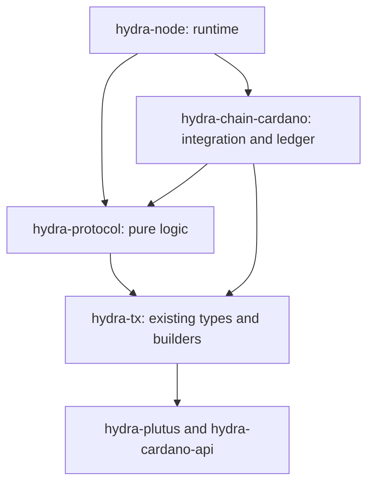

# First-stage refactor

**Separate the protocol, Cardano integration and node runtime without changing behavior.** Direct, Blockfrost and offline mode must remain compatible with existing Heads, clients, keys and databases.

This implements the first structural step of the [architecture](multichain-plan.md). The paths below are proposed moves, not completed changes.

## Package boundaries



The `hydra-protocol → hydra-tx` dependency is intentional for this stage. Snapshots, keys, accumulators and chain-state types stay where they are. The protocol is independently testable but still has transitive Cardano dependencies. Do not add a reverse dependency and create a package cycle.

| Package                             | Responsibility                                                                                   |
| ----------------------------------- | ------------------------------------------------------------------------------------------------ |
| `hydra-protocol`                    | Pure state machine, protocol messages, events and effect interfaces                              |
| `hydra-chain-cardano`               | Providers, wallet, native state/time, submission, observation and existing Cardano ledger        |
| `hydra-node`                        | Configuration parsing, component lifetimes, queues, effect execution, API, peers and persistence |
| `hydra-tx`                          | Existing representations, transaction builders/observers and low-level ledger helpers            |
| `hydra-plutus`, `hydra-cardano-api` | Existing contracts and Cardano adapters                                                          |

## Move the protocol dependency group together

The following paths are relative to `hydra-node/src/Hydra/`. Move them to `hydra-protocol/src/Hydra/`, keeping module names unless noted.

| Files                                                      | Behavior that moves                                                                           |
| ---------------------------------------------------------- | --------------------------------------------------------------------------------------------- |
| `HeadLogic.hs`, `HeadLogic/{Input,Outcome,State,Error}.hs` | State transitions, snapshot coordination, pending actions, close/contest and fanout decisions |
| `Node/{State,Environment,UnsyncedPeriod}.hs`               | Protocol state, pending deposits, environment and synchronization data                        |
| `API/{ClientInput,ServerOutput,WireFormat}.hs`             | Message types, pure validation and codecs                                                     |
| `Network/Message.hs`, protocol parts of `Network.hs`       | Peer messages, identities, connectivity and broadcast handle                                  |
| `Ledger.hs`                                                | Ledger application interface                                                                  |
| `Chain.hs`                                                 | Semantic commands/events, posting handle and history                                          |
| `CBOR/Orphans.hs`                                          | Existing codec instances used by the moved types                                              |

Moving only `HeadLogic.hs` would retain dependencies on the application. Its [imports](../../../hydra-node/src/Hydra/HeadLogic.hs) show why these types move together.

Two exceptions:

- Keep `HeadLogic/StateEvent.hs` in `hydra-node`: it adds persistence IDs/timestamps to protocol state changes.
- Move runtime `NetworkConfiguration` and `WhichEtcd` into `hydra-node/src/Hydra/Network/Configuration.hs`. The protocol handle should not select or launch etcd.

Preserve `Environment`'s signing-key handling and redacted codecs. Changing signing effects or key types belongs to a later step.

## Split Chain from native API services

The current [`Hydra.Chain`](../../../hydra-node/src/Hydra/Chain.hs) mixes semantic posting with Cardano API operations. Separate their consumers:

| Operation           | New owner                                   | Consumer                      |
| ------------------- | ------------------------------------------- | ----------------------------- |
| `postTx`            | `Chain tx m`                                | Node effect interpreter       |
| `draftDepositTx`    | `CardanoAPI m`                              | Deposit endpoints             |
| `submitTx`          | `CardanoAPI m`                              | Raw transaction endpoints     |
| `checkNonADAAssets` | Cardano policy exposed through `CardanoAPI` | Existing SafeClose validation |

Sketch:

```haskell
newtype Chain tx m = Chain
  { postTx :: MonadThrow m => PostChainTx tx -> m ()
  }

data CardanoBackend m = CardanoBackend
  { chain :: Chain Tx m
  , api   :: CardanoAPI m
  }
```

One `withCardanoChain` component creates **one wallet, follower and native state**, then returns both handles. Keep existing signatures, callback events, exceptions, validation locations and startup order.

Split `Chain.hs` into `Chain.Types`, `Chain.History` and a re-exporting `Chain` module if useful. Leave `PostTxError` with the shared protocol types for now: messages embed it and the core recognizes `StalePartialFanoutTx`. Leave `Chain.ChainState` in `hydra-tx`.

Do not add asynchronous posting or a submission journal here. Direct posting can currently block, despite the interface documentation. Preserve its actual behavior.

## Collect the Cardano implementation

Move these modules from `hydra-node/src/Hydra/` into `hydra-chain-cardano/src/Hydra/`:

| Current path                                         | Destination                                                         |
| ---------------------------------------------------- | ------------------------------------------------------------------- |
| `Chain/Cardano.hs`                                   | `Chain/Cardano.hs`                                                  |
| `Chain/Backend.hs`                                   | `Chain/Cardano/Provider.hs`                                         |
| `Chain/CardanoClient.hs`                             | `Chain/Cardano/Client.hs`                                           |
| `Chain/Direct.hs`                                    | `Chain/Cardano/Direct.hs`                                           |
| `Chain/Blockfrost.hs`, `Chain/Blockfrost/Client.hs`  | `Chain/Cardano/Blockfrost.hs`, `Chain/Cardano/Blockfrost/Client.hs` |
| `Chain/Direct/{Handlers,State,Wallet,TimeHandle}.hs` | `Chain/Cardano/{Handlers,State,Wallet,TimeHandle}.hs`               |
| `Chain/ScriptRegistry.hs`                            | `Chain/Cardano/ScriptRegistry.hs`                                   |
| `Chain/Offline.hs`                                   | `Chain/Cardano/Offline.hs`                                          |
| `Ledger/Cardano.hs`                                  | `Ledger/Cardano.hs`                                                 |

The shared handlers, wallet and timing code serve both Direct and Blockfrost. Keep the provider abstraction Cardano-specific. Offline mode also stays here because it uses Cardano ledger/time assumptions.

Keep one `IsChainState Tx` instance in the moved `Cardano.State`; update imports that bring it into scope. Namespace changes can be a separate mechanical commit.

Remove these reverse dependencies before extracting the package:

| Current dependency on node code       | Replacement                                                      |
| ------------------------------------- | ---------------------------------------------------------------- |
| `Hydra.Options` configuration records | `Chain.Cardano.Config`: concrete configs, defaults and instances |
| `Node.Util.readKeyPair`               | `Chain.Cardano.KeyFile`                                          |
| `Node.Util.checkNonADAAssetsUTxO`     | `Chain.Cardano.Policy`                                           |
| `Utils.readJsonFileThrow`             | Small internal backend helper                                    |

Move `CardanoChainConfig`, provider options and `OfflineChainConfig` together. Keep top-level mode selection, `RunOptions`, CLI parsing and validation in `hydra-node`. Pass concrete configuration to the backend.

## What stays where

**In `hydra-tx`:** `IsTx`, `Snapshot`, `Crypto`, `Party`, Head IDs/parameters, period types, `ChainState`, `Accumulator`, native builders/observers, blueprints, script registry helpers and `Ledger.Cardano.{Builder,Evaluate,Time}`. Preserve their representations and instances. Narrow imports from the `Hydra.Tx` umbrella where useful.

**In `hydra-node`:** `Node.hs`, `Node.Run`, queues/outbox, persistence envelope, API servers/projections, networking implementation, options and logging. `Node.Run` wires the new handles into existing component lifetimes.

The protocol decides _which_ claims to distribute and when. The Cardano adapter chooses a native batch size, balances transactions and observes the result.

## Compatibility requirements

| Surface            | Must remain unchanged                                                                    |
| ------------------ | ---------------------------------------------------------------------------------------- |
| Contracts          | Compiled scripts, hashes, policy IDs, datum/redeemer bytes and CRS                       |
| Evidence           | Snapshot signing bytes, signer ordering, both accumulator candidates and deposit binding |
| Protocol/runtime   | Accepted inputs, effects, exception handling, ordering, timing and rollback behavior     |
| API/peers          | Routes, payloads, errors, JSON/CBOR codecs and network version                           |
| Persistence        | Event bytes, schema, checkpoints, cursors and replay                                     |
| Configuration/keys | Defaults, precedence, normal/extended payment keys and secret redaction                  |
| Compilation        | Effective extensions, including `StrictData`, explicit laziness and instance ownership   |

Keep the oversized-snapshot checks at both API ingress and core validation, including their non-forcing behavior. Moving validation between threads can change admission order and failure timing.

Each type and instance has one owner. Use downward re-exports for source compatibility, never copied implementations. A structural move should not require regenerated goldens, a database migration or a network-version bump.

## Tests and build

| Existing tests                                                        | Destination                              |
| --------------------------------------------------------------------- | ---------------------------------------- |
| Pure HeadLogic, snapshot, agreement and mock-chain tests              | `hydra-protocol/test`                    |
| Simple ledger and generic generators                                  | `hydra-protocol:testlib`                 |
| Direct/Blockfrost, wallet, native state/time and Cardano ledger tests | `hydra-chain-cardano/test` and `testlib` |
| Runtime, API, configuration, networking and aggregate codec checks    | Stay in `hydra-node` initially           |
| Contract/builders and cluster scenarios                               | Stay in `hydra-tx` and `hydra-cluster`   |

Split mixed fixtures before moving tests. Generic test support must not import node or concrete-backend test support. Preserve Agda test relationships and verify that moved suites are actually discovered.

Update Cabal source lists/dependencies, [Nix package lists](../../../nix/hydra/local-packages.nix), [test runtime](../../../nix/hydra/test-runtime.nix) and [fixture checks](../../../nix/hydra/test-checks.nix). Audit embedded resources and `Paths_hydra_node` references. `cabal.project` already uses package globs; verify discovery.

Update consumers from their imports: `hydra-tui`, `hydraw`, `head-state-viewer`, `hydra-cluster` and `hydra-chain-observer`. Check release/CI definitions and retain fixture-mutation guards.

Use existing tests plus focused checks for shared wallet/state, old-database replay, unchanged effects/signatures, posting-error behavior and partial-fanout recovery.

## Implementation order

1. Record baseline scripts, signatures, codecs, replay fixtures and existing failures.
2. Extract concrete configuration/helpers and runtime network configuration.
3. Move the protocol group, retaining its `hydra-tx` dependency.
4. Split semantic and native API handles while sharing resources.
5. Move Cardano integration; normalize names separately.
6. Move tests, update consumers/builds and run compatibility checks.

Stop after interface/configuration cleanup if package extraction adds little value. The useful result is clearer ownership with unchanged Cardano behavior.

## Next stage

Before Ethereum integration, extract shared foundational types below both `hydra-protocol` and `hydra-tx`. Then introduce independent chain/deposit types, settlement profiles, versioned new codecs and durable submission recovery. Those changes have behavioral consequences and belong in the [implementation PoC](second-stage-implementation-poc.md).
