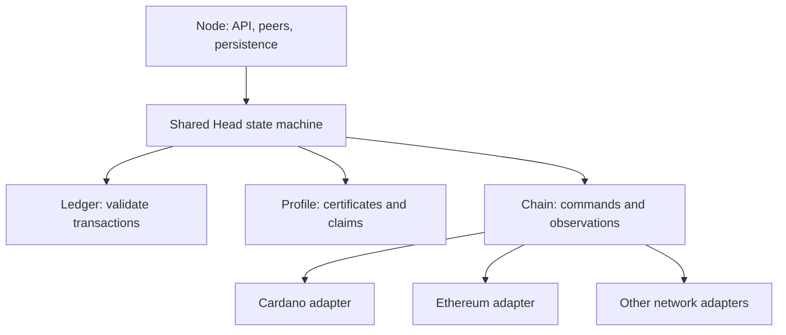

# Hydra on other settlement chains

**Start with Ethereum and a small ETH transfer ledger.** Reuse Hydra's state machine, networking and persistence; add network-specific contracts, evidence formats and chain adapters. Investigate Ergo next. Keep CKB conditional on a workable deadline design.

This is the architecture proposal. See the [refactor](first-stage-refactor.md), [implementation PoC](second-stage-implementation-poc.md) and [short roadmap](multichain-poc.md) for delivery.

## Scope

Three choices must be explicit:

| Choice             | Responsibility                                         |
| ------------------ | ------------------------------------------------------ |
| Head ledger        | Defines valid off-chain transactions                   |
| Settlement profile | Defines signatures, commitments and redeemable outputs |
| Settlement chain   | Holds assets and enforces funding, disputes and payout |

An Ethereum-backed Head need not run the EVM internally. A Cardano ledger running off chain does not make arbitrary Plutus outputs redeemable on Ethereum.

The first backend serves **one settlement chain per Head**. A Head holding ADA and ETH across two chains needs an additional funding and settlement protocol. The [trust notes](trust-notes.md) compare that shared-Head design with HTLC payments.

## Candidate networks

| Network    | Why it fits                                                          | Proposed contract                                                    | Main obstacle                                                                                     |
| ---------- | -------------------------------------------------------------------- | -------------------------------------------------------------------- | ------------------------------------------------------------------------------------------------- |
| Ethereum   | Programmable escrow, ECDSA verification and execution-time deadlines | Solidity Head; unanimous certificates; Merkle payout claims          | Gas, transaction limits, nonce recovery and new output semantics                                  |
| Ergo       | Native UTxO boxes, script state and authenticated dictionaries       | Singleton Head box; Schnorr certificates; AVL-backed claims          | Script cost, box limits, storage rent and native integration                                      |
| Nervos CKB | Programmable cells, lock/type scripts and RISC-V execution           | Singleton Head cell; signature verification and bounded cell payouts | `since` supplies a lower inclusion bound, not the upper deadline required by the current protocol |

These are engineering assessments, not measured ports.

**Ethereum:** use secp256k1 signatures and a versioned EIP-712 domain. Merkle claims avoid making a KZG port a prerequisite. Ethereum's BLS operations may support later work, but its point-evaluation precompile is not Hydra's subset-removal equation. Qualify each additional EVM network separately, including its finality and censorship-recovery rules. [Solidity primitives](https://docs.soliditylang.org/en/latest/units-and-global-variables.html), [EIP-712](https://eips.ethereum.org/EIPS/eip-712), [EIP-2537](https://eips.ethereum.org/EIPS/eip-2537), [EIP-4844](https://eips.ethereum.org/EIPS/eip-4844#point-evaluation-precompile)

**Ergo:** a unique token identifies the Head box; scripts constrain its successor and payouts. AVL proofs can authenticate and remove claims. Verify arbitrary-message Schnorr signatures explicitly. Bound the unattended lifetime or provide a safe refresh path because old boxes are subject to storage rent. [Boxes](https://docs.ergoplatform.com/dev/data-model/box/registers/), [Script specification](https://docs.ergoplatform.com/dev/scs/sigma/lang-spec/), [Schnorr verification](https://docs.ergoplatform.com/dev/scs/sigma/verifying/), [Storage rent](https://docs.ergoplatform.com/dev/protocol/storage-rent/)

**CKB:** Type ID and `ckb-auth` are useful building blocks. They do not solve timing. A historical header does not prove inclusion before a deadline. Require an executable alternative for bounded contests and deposit cancellation before committing to a port. [Type ID](https://docs.nervos.org/docs/script/type-id), [Authentication](https://github.com/nervosnetwork/ckb-auth), [`since` specification](https://github.com/nervosnetwork/rfcs/blob/master/rfcs/0017-tx-valid-since/0017-tx-valid-since.md)

## Preserve the current protocol

This checkout opens an empty Head directly, then funds it through deposit/increment. It supports decrement, close/contest and partial KZG fanout. Preserve that lifecycle. [Direct-open ADR](../2026-03-10_033-directly-open-head.md), [Head contract](../../../hydra-plutus/src/Hydra/Contract/Head.hs)

Every backend must enforce:

- A fixed Head identity, participant set and settlement profile.
- Unanimous snapshot certificates usable later without fresh signatures.
- Exactly one outcome for each deposit: admitted or refunded.
- Exactly one payout for each withdrawal or final claim.
- Funding-version compatibility when closing or contesting.
- Bounded disputes and an executable exit for every admitted output.
- Complete payout data and sufficient external fee funding.

Keep both signed settlement candidates. For base outputs `U`, pending withdrawal `W` and pending deposit `I`:

```text
before the pending action: commitment(U ∪ W)
after the pending action:  commitment(U ∪ I)
```

The on-chain funding version selects the candidate. One “latest root” can pay a withdrawal twice or include a refunded deposit. Preserve the current permitted version relations and pending-action restrictions. [Snapshot representation](../../../hydra-tx/src/Hydra/Tx/Snapshot.hs)

## Reusable components



The adapters are alternative configurations. They do not submit every transition to every network.

| Component               | Owns                                                                                  |
| ----------------------- | ------------------------------------------------------------------------------------- |
| `Ledger tx`             | Deterministic transaction validation, ownership and conservation                      |
| `HeadProtocol chain tx` | Certificate encoding/verification, commitments, claim proofs and output admissibility |
| `Chain chain tx m`      | Native transaction construction, submission, observation and recovery                 |
| `hydra-node`            | Process wiring, queues, effect execution, API, networking and persistence             |

The profile is fixed for the Head's lifetime. It is not an arbitrary runtime plugin.

Keep [`HeadLogic`](../../../hydra-node/src/Hydra/HeadLogic.hs) as the shared coordination algorithm. Abstract the Cardano-specific parts of [`Chain`](../../../hydra-node/src/Hydra/Chain.hs), [`IsChainState`](../../../hydra-tx/src/Hydra/Chain/ChainState.hs), [`IsTx`](../../../hydra-tx/src/Hydra/Tx/IsTx.hs), snapshots and accumulators. Direct and Blockfrost remain providers within the Cardano adapter.

In particular, separate L1 deposit references from L2 transaction IDs. Replace slot ordering with native block identity and ancestry. Make participant/output limits profile properties backed by measurements.

## Core Chain interface

This is a sketch, not compilable Haskell:

```haskell
class ChainTypes chain where
  type L1Tx chain
  type Point chain
  type DepositRef chain
  type NativeTime chain

data Chain chain tx m = Chain
  { descriptor       :: ChainDescriptor chain
  , submitCommand    :: CommandId -> ChainCommand chain tx
                     -> m (Either ChainError SubmissionId)
  , submissionStatus :: SubmissionId -> m (SubmissionStatus chain)
  , queryHead        :: HeadId -> ReadPoint chain
                     -> m (Either ChainError (HeadView chain))
  , syncStatus       :: m (SyncStatus chain)
  }

data ChainCommand chain tx
  = CreateHead (HeadConfiguration chain)
  | Increment HeadId (DepositRef chain) (Certificate chain tx)
  | Recover HeadId (DepositRef chain)
  | Decrement HeadId (Certificate chain tx)
  | Close HeadId (ClosingEvidence chain tx)
  | Contest HeadId (Certificate chain tx)
  | Distribute HeadId (PayoutSelection chain tx)

data ChainEvent chain tx
  = RollForward (BlockContext chain) [ObservedTransition chain tx]
  | RollBackward (Point chain)
  | StabilityAdvanced (StabilityEvidence chain)
  | SubmissionChanged SubmissionId (SubmissionStatus chain)
  | SyncChanged (SyncStatus chain)
```

Use the existing resource-scoped `with` pattern to construct the handle, resume its checkpoint and deliver events through a callback. `ClosingEvidence` includes the valid empty initial state. `Distribute` selects claims; the adapter chooses batches that fit native limits. [Component pattern](../2021-06-11_007-with-pattern-component-interfaces.md)

Keep native deposit preparation and raw transaction submission in separate API services. They share the adapter's wallet and observed state. User transaction signing, fee-wallet signing and snapshot signing are distinct roles.

The descriptor binds the network/genesis, deployment/code, profile version, supported assets, limits and timing policies. Persist its hash and include it in the peer handshake. Reject mismatched joins and resumes.

### Required adapter behavior

| Rule                             | Consequence                                                                                              |
| -------------------------------- | -------------------------------------------------------------------------------------------------------- |
| Submission is not inclusion      | Advance protocol state from canonical execution observations                                             |
| Commands have durable IDs        | Persist payload and native transaction identity before broadcast; reject ID reuse with different content |
| Timeouts have uncertain outcomes | Reconcile receipts, nonces or spent inputs before retrying an economic action                            |
| Replacements retain one intent   | Track fee bumps or rebuilt transactions under the same submission                                        |
| Events are replayable            | Include block hash, parent, ordered native provenance and native time                                    |
| Delivery can repeat              | Deduplicate events and persist effects/cursors consistently                                              |
| Rollbacks identify an ancestor   | Undo removed observations before replay; define recovery beyond retained history                         |
| Native failures remain visible   | Classify portable errors while retaining backend diagnostics                                             |

A current-state query helps reconciliation; it cannot replace replay of missed deposits or payouts.

## Evidence, time and recovery

New certificates bind the profile, network/genesis, deployment, Head, funding version, snapshot number, both commitments/counts and exact pending action. Define bytes, integer widths, ordering and absent values; test the same vectors in the node and contract. Preserve existing Cardano bytes under its existing profile.

Validate settlement admissibility on **every L2 transaction**, not just deposits. Unsupported scripts, destinations or amounts must never enter a certified state. Unique claim IDs preserve repeated output contents without allowing duplicate payouts.

Distinguish observation, funding activation and settlement stability. Watch hostile closes promptly; waiting for finality can consume the contest window. Activate funding only under the declared policy. Native time determines deadlines; a wall-clock timer only wakes the observer. Ethereum's `latest`, `safe` and `finalized` are different evidence. [RPC block parameters](https://ethereum.org/developers/docs/apis/json-rpc/#default-block)

Size challenge windows for detection, outage recovery, synchronization, transaction preparation, adverse inclusion and reorganization margins. No finite timeout covers an indefinitely halted chain.

Rollback must retain signed history. If already activated funding disappears, stop unsafe signing and report the recovery condition. Replaying chain events cannot undo certificates already issued.

## Delivery and decision gates

1. **Clean up Cardano ownership.** Follow the behavior-preserving [first-stage refactor](first-stage-refactor.md).
2. **Prove Ethereum contract feasibility.** Verify certificates, deadlines and bounded payouts in the native VM.
3. **Generalize types and integrate.** Separate chain identity and profile operations without copying the Head state machine.
4. **Run the complete local lifecycle.** Include stale close, one surviving defender, restart and reorganization.
5. **Decide on further investment.** Measure partner demand, exit costs and maintenance burden before public deployment or another backend.

Measure close, contest, funding changes and single/batched payouts at the supported state bound. Every permitted claim must fit an exit transaction. Test duplicate claims, funding races, malformed evidence, failing recipients, uncertain submissions and rollbacks against a liability model.

This refactor is useful independently where it clarifies interfaces and removes reverse dependencies. Package extraction is a checkpoint; full genericity is justified by an actual second implementation. The likely community value is a working integration with a credible use case. Adoption and unchanged-code percentages remain unmeasured.
