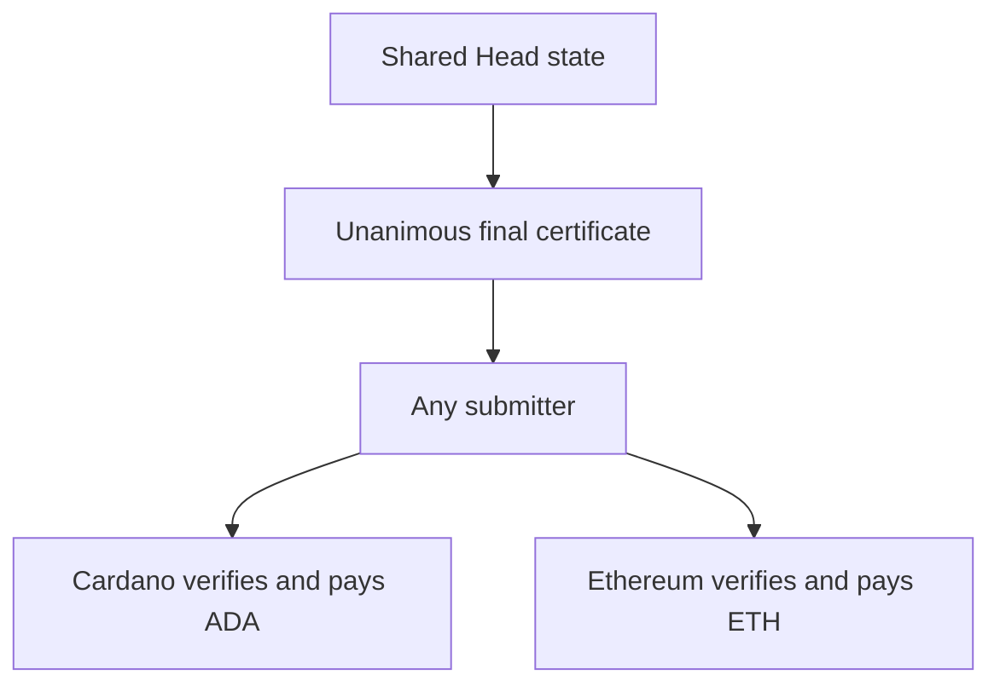

# Trust and cross-chain settlement

**A shared Head does not inherently need an external attester.** The simpler alternatives change its recovery guarantees.

| Design                                   | External result attester? | Main tradeoff                                                |
| ---------------------------------------- | ------------------------- | ------------------------------------------------------------ |
| Unanimous final certificate              | No                        | Funds can remain locked before final agreement               |
| HTLC payment                             | No                        | Separate payment legs, not one jointly settled Head          |
| Canonical Cardano result + test attester | Yes                       | Attester can lie or block remote settlement                  |
| Verified Cardano settlement receipt      | No dedicated attester key | Requires authenticated foreign-chain evidence and a verifier |

The original [PoC](second-stage-implementation-poc.md#milestone-b-cross-network-payment) chose an attester as a shortcut. These alternatives refine that choice; none has been implemented here.

## Relaying is different from authorizing

A submitter can deliver a certificate or proof and pay gas without authority to choose a payout. An attester instead asks Ethereum to trust its statement about Cardano.

Keep four guarantees separate:

- **Authorization:** nobody invents a debit or beneficiary.
- **Consistency:** both escrows select compatible outcomes.
- **Recovery:** funds can exit without fresh cooperation.
- **Completion:** both native payouts arrive.

Independent chains do not execute payouts simultaneously. A design may preserve authorization and consistency while allowing indefinite lockup.

The sketches assume secure signatures, durable signing history, available payout data and the declared security of both chains. Shared-Head safety also needs an honest participant who checks the whole allocation. Timed recovery needs bounded observation and inclusion delays.

## Why ordinary snapshot signatures are insufficient

A snapshot certificate proves agreement to an allocation. It does not prove which snapshot Cardano selected after close and contest.

Simply copying certificates between two independent adjudicators has a late-disclosure problem:

| Step               | Cardano                                                                                                      | Ethereum                                  |
| ------------------ | ------------------------------------------------------------------------------------------------------------ | ----------------------------------------- |
| Start              | Everyone knows signed snapshot 11. An adversary holds complete snapshot 12 but withholds its last signature. | Same history                              |
| Close              | Select 11, start dispute window                                                                              | Select 11, start dispute window           |
| Just before expiry | Still selecting 11                                                                                           | Adversary reveals 12; contract accepts it |
| Expiry             | Selection of 11 becomes irreversible                                                                         | Selecting 12                              |
| Honest response    | Copy of 12 arrives too late                                                                                  | Pays according to 12                      |

If 11 is the initial allocation and 12 the swap, Alice can regain ADA while Bob receives the provider's ETH.

An honest participant may have signed 12 without receiving everyone else's signatures. Stopping signing at close does not invalidate that withheld certificate. Hydra distinguishes collected acknowledgements from a confirmed snapshot in [`HeadLogic`](../../../hydra-node/src/Hydra/HeadLogic.hs).

Equal deadlines do not remove observation delay. Extending one chain's deadline does not extend the other. Staggering deadlines alone permits disclosure on the later-settling chain.

A small two-escrow model reproduced this ordering, with and without a local deadline extension. It is a counterexample to the naive design, not a proof that every coordinated adjudication protocol is impossible.

## Option A: one final certificate

Both escrows can verify the same unanimous terminal authorization:

```text
FinalSettlement:
  protocol/profile, Head and configuration
  both networks and deployments
  funding epoch and snapshot number
  ADA payout root/count and ETH payout root/count
  decision: SETTLE
```



For this narrow profile:

1. Check both deposits before signing.
2. Use distinct terminal-signature bytes; ordinary snapshots cannot release escrow.
3. Persist each signing decision before publishing its signature. Never sign a conflicting terminal decision for that funding epoch.
4. Keep the full certificate and payout witnesses. Either escrow accepts only the agreed local allocation and rejects duplicate claims.
5. Allow no independent timeout refund, stale-snapshot exit or administrative drain that could race with settlement.

Once the complete certificate is available, one surviving process can submit both payouts. Publication on either chain must expose evidence usable on the other, which must remain redeemable.

Unanimous final states are an established cooperative-close pattern; this two-escrow adaptation is a proposal. [Nitro finalization](https://docs.statechannels.org/protocol-tutorial/0070-finalizing-a-channel/)

**The cost is recovery before final agreement.** A missing signer can lock funds during funding, trading or final signing. A unanimous `ABORT` can refund deposits, but must be mutually exclusive with `SETTLE`; it cannot recover from a missing signer.

Adding “refund after Friday” is unsafe: one chain might settle just before Friday while the other refunds. Expiring the certificate creates the same race.

At settlement, this is unanimous multisignature escrow driven by Hydra's off-chain logic. It permits unilateral submission _after terminal agreement_, not Hydra's usual exit from an ordinary confirmed snapshot. Adding a final flag while retaining competing ordinary exits does not establish this guarantee.

An even smaller change to the original proposal is to have all existing participants acknowledge Cardano's final outcome. That removes the external signer set but requires fresh cooperation after close, so the one-surviving-participant recovery test would fail.

## Option B: reuse HTLCs for the payment

For ADA-for-ETH, Ethereum need not know the Head's final snapshot:

```text
Alice locks ADA to provider in Cardano Head ── later expiry
provider locks ETH to Bob on Ethereum      ── earlier expiry
Bob reveals secret to claim ETH; provider uses it to claim ADA
```

The [existing router](https://github.com/cardano-scaling/hydra-lightning-router) provides the application pattern. Hashlocked swaps protect conforming parties under their protocol and timing assumptions; they do not make locking or payout simultaneous. [Atomic Cross-Chain Swaps](https://arxiv.org/abs/1801.09515)

Bind Alice's authorization to Bob's invoice, both recipients and the provider's exact quote. Alice intentionally pays Bob; this is not three independent traders each exchanging their own assets.

The remaining work is concrete:

- Match hashing and byte encoding. Our [validator](https://github.com/cardano-scaling/htlc/blob/main/htlc/validators/htlc.ak) uses BLAKE2b-256.
- Leave time after the latest permitted ETH claim for observation, forced Cardano close/contest/fanout and ADA redemption.
- Treat secret disclosure as irreversible, even in an unsettled transaction. Test a Head stopping immediately afterwards.
- Check actual collateral, amounts, recipients and refund owners. Fund fees/reserves separately.
- Test the missing second lock, expiry and refund paths. Finite timeouts do not cover indefinite chain halts.

Start with one Cardano Head and an Ethereum L1 escrow. A later Ethereum Head needs hashlocked outputs enforceable after unilateral settlement. This delivers the requested native payment through a different topology.

## Option C: verify a terminal Cardano receipt

Keep Cardano as the canonical adjudicator, but replace the attester's statement with verifiable evidence.

The new Cardano profile would produce a receipt only when the settlement choice is irreversible:

```text
SettlementReceipt:
  Head/configuration, funding epoch
  outcome: SETTLE or ABORT
  selected global certificate digest
```

Authenticate it through the unique Head's allowed transition. Arbitrary datum bytes at a known script address are insufficient. Preserve the original selected digest through partial fanout, even as remaining-output commitments change.

Ethereum must verify:

- The correct Head, network, deployment and funding epoch.
- The receipt's binding to a successful authorized terminal transition.
- That transition's inclusion in authenticated Cardano history under a stated stability policy.
- The matching Ethereum allocation and replay protection.

This narrows the proof problem. Inclusion of a contestable **close** is insufficient; authenticated evidence of a stable **terminal transition** can establish the chosen outcome without proving which snapshot was ever latest.

The receipt establishes allocation, not actual delivery to every Cardano wallet. Joint funding and cancellation also remain part of the protocol.

Mithril is worth investigating for authenticated transaction membership. Its security includes assumptions about Mithril signing stake and a genesis trust anchor, in addition to Cardano consensus. [Certification](https://mithril.network/doc/mithril/advanced/mithril-certification/cardano-transactions/), [Security](https://mithril.network/doc/mithril/advanced/mithril-protocol/security/), [Threat model](https://mithril.network/doc/mithril/advanced/threat-model/)

Ethereum must verify the relevant evidence itself, directly or through a proof system. Checking Mithril only inside a relay leaves Ethereum trusting that relay. Membership alone does not establish terminal-transition semantics. No affordable Solidity verifier has been demonstrated here.

## Prior art and tempting shortcuts

Perun supplies useful multi-ledger implementation patterns: [dispatching to local adjudicators](https://github.com/hyperledger-labs/go-perun/blob/main/channel/multi/adjudicator.go), [watching disputes](https://github.com/hyperledger-labs/go-perun/blob/main/watcher/local/watcher.go) and a [multi-ledger dispute test](https://github.com/hyperledger-labs/go-perun/blob/main/client/test/multiledger_dispute.go).

The inspected test makes the update available to the defender before dispute. That does not establish our withheld-certificate case. I have not audited or run Perun; the counterexample above is not a demonstrated Perun exploit. Check its precise signing, dissemination and timing assumptions, especially for three-party support.

| Shortcut                                  | Remaining obligation                                                                       |
| ----------------------------------------- | ------------------------------------------------------------------------------------------ |
| Threshold attesters                       | Committee honesty replaces single-attester honesty                                         |
| Watchtower or longer windows              | Timely defense helps, but does not authenticate foreign outcomes or undo finalized payouts |
| Optimistic relay challenge                | Define verifiable objection evidence; unconditional veto can lock funds                    |
| Slashing bond                             | Prove misconduct and sufficient compensation; this does not ensure consistent settlement   |
| Merkle proof or signed native transaction | Authenticate the root and establish execution, terminality and stability                   |
| Shared secret or adaptor signature        | Specify the funding, redemption and timeout protocol                                       |

## Recommended experiments

1. **Shared-state demo:** use the final certificate; prove both native payouts and explicitly demonstrate lockup when a signer refuses.
2. **Payment with recovery:** extend HTLCs; test missing funding, expiry and shutdown after secret disclosure.
3. **Full shared-Head recovery:** investigate receipt verification or a coordinated adjudication protocol, using late disclosure as a required adversarial case.

Keep settlement coordination above the network-specific `Chain` adapters. Fix the authorization profile at deployment; do not fall back from verified proofs to a weaker attester path on failure.

These are design findings. Only the small deadline model was executed for this note; no cross-chain contracts, HTLC integration rerun or general security proof is claimed.
