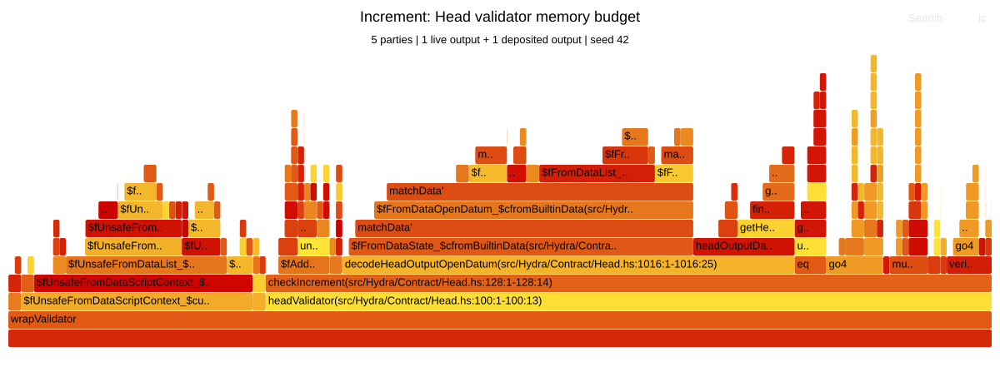

# Profiling Hydra scripts

Start with whole-transaction costs, then use function-level traces to locate
expensive parts of a validator. Record the repository revision, operation,
party count, and UTxO shape so results can be reproduced.

## Example: a five-party increment

This flamegraph profiles the head validator when an increment adds a deposit
to an open head. The fixture has five parties, one live ADA-only output, and
one deposited ADA-only output.

[](./increment-memory.svg)

Open the image to zoom into functions or search their names. Frame widths show
cumulative Plutus memory-budget units consumed within each call, including its
children. They do not measure peak RAM usage or elapsed time. The graph covers
traced calls; evaluation work outside the tracing markers is not shown.

The profile uses revision
[`ff531feba9`](https://github.com/cardano-scaling/hydra/commit/ff531feba9265788e22b155b474ad8420a6507da),
seed `42`, GHC `9.6.7`, Plutus `1.68.0.0`, and the fixture's cost model at protocol
version `11`. The instrumented head validator succeeds with a total budget of
`1,025,536,803` CPU units and `3,242,316` memory units; `3,171,452` memory units
appear in the graph. These are instrumented fixture costs, not release fees or
the combined cost of the head and deposit validators.

## Measure transaction costs

From the repository root, generate the current report:

```shell
nix build .#tx-cost
./result/bin/tx-cost --seed 42 --output-directory /tmp/hydra-tx-cost
```

The [published transaction-cost report](./transaction-cost.md) measures size,
CPU, memory, and fees for protocol transactions. Its generators and evaluation
code are in
[TxCost.hs](https://github.com/cardano-scaling/hydra/blob/master/hydra-node/bench/tx-cost/TxCost.hs).
For example, isolate a five-party increment by restricting
`computeIncrementCost` to `[5]` and removing its limit-search loop during the
experiment. Restore the full benchmark afterward.

Use the evaluation report to distinguish the cost of the head validator from
the deposit validator. The current evaluation interface is
[`evaluateTxWith`](pathname:///haddocks/hydra-tx/Hydra-Ledger-Cardano-Evaluate.html#v:evaluateTxWith),
which accepts the protocol parameters, time configuration, transaction, and
input UTxO context.

## Instrument a validator

For the PlutusTx head validator, enable tracing in `Hydra.Contract.Head`:

```haskell
{-# OPTIONS_GHC -fplugin-opt Plinth.Plugin:profile-all #-}
{-# OPTIONS_GHC -fplugin-opt Plinth.Plugin:conservative-optimisation #-}
```

Rebuild the scripts and the fixture that uses them. Instrumentation can change
optimization and script size, so compare the result with uninstrumented costs.

The deposit validator is Aiken code in `hydra-plutus/validators/deposit.ak`.
Its Haskell module defines datum and redeemer types; Plinth flags there do not
instrument the validator. Use the pinned Aiken toolchain's tracing facilities
for that script, and the transaction-cost benchmark for its total budget.

## Produce a function-level profile

After enabling the profiling flag, run the included
[`ProfileIncrement.hs`](https://github.com/cardano-scaling/hydra/blob/master/docs/scripts/ProfileIncrement.hs)
helper from the repository root in the development shell:

```shell
cabal repl hydra-node:bench:tx-cost <<'EOF'
:set -package cardano-ledger-alonzo -package cardano-ledger-core -package cardano-ledger-binary -package plutus-core
:load docs/scripts/ProfileIncrement.hs
:main /tmp/increment-budget.csv
:quit
EOF
```

The helper generates the five-party increment with seed `42`, obtains its
arguments from the ledger, and selects the head validator by script hash. It
checks that the validator succeeds and that the tracing evaluator agrees with
the ledger evaluator's budget. It also joins source locations to function
names so `traceToStacks` can parse the labels.

Install `traceToStacks` from the same Plutus release as the checkout and
[FlameGraph](https://github.com/brendangregg/FlameGraph)'s `flamegraph.pl`.
The example uses Plutus `1.68.0.0` and FlameGraph `2023-11-06`. With both tools
on your `PATH`, render the memory graph:

```shell
traceToStacks --column 2 < /tmp/increment-budget.csv > /tmp/increment-memory.folded
flamegraph.pl \
  --title 'Increment: Head validator memory budget' \
  --subtitle '5 parties | 1 live output + 1 deposited output | seed 42' \
  --countname 'memory units' \
  --fonttype 'Arial, Helvetica, sans-serif' \
  --colors hot --hash --bgcolors '#ffffff' \
  --height 22 --fontsize 13 --width 1200 \
  /tmp/increment-memory.folded > /tmp/increment-memory.svg
```

Use `--column 1` with `traceToStacks` to plot CPU units instead, and update the
graph's title and `--countname` accordingly. Regenerate graphs when the fixture,
contracts, or compiler changes, and remove the profiling flag after the
experiment.
