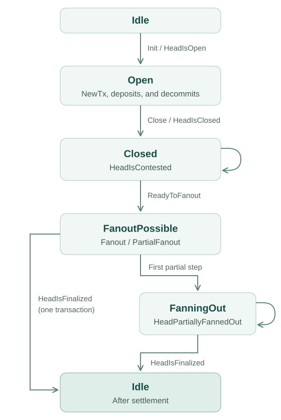

# API behavior

The node exposes HTTP endpoints and a WebSocket event stream. The diagram
shows lifecycle commands and their observed results; see the
[API reference](/api-reference) for payloads and response codes.

Boxes use API status names. `ReadyToFanout` announces `FanoutPossible`;
`HeadIsFinalized` returns the node to `Idle`.

Deposits and decommits leave the head open. Observe `CommitFinalized` or
`DecommitFinalized` for their settlement. During fanout, use
`HeadPartiallyFannedOut` to track progress and `HeadIsFinalized` for completion.
See [selective fanout](./how-to/selective-fanout.md).

The diagram omits outputs that do not change the lifecycle, including
`Greetings`, detailed transaction results, and network status. An invalid command for
the current state produces `CommandFailed`; malformed input produces
`InvalidInput`.

#### API configuration

There are some options for API clients to control the server outputs. Server outputs are controlled using the following query parameters:

+ `history=yes` -> Replays historical outputs on connection. All server outputs are recorded, but a connecting client is sent only the outputs produced from then on unless it asks for the history with `history=yes`.
+ `snapshot-utxo=no` -> In case of a `SnapshotConfirmed` message the `utxo` field in the inner `Snapshot` will be omitted.
+ `encoding=cbor` -> All messages on this connection are exchanged as binary WebSocket frames containing a compact CBOR encoding instead of JSON text frames. Each message starts with a text tag identical to the JSON `tag` value, followed by the constructor fields in declaration order. HTTP endpoints negotiate the same encoding per request via `Content-Type: application/cbor` (request bodies) and `Accept: application/cbor` (responses). Note that combined with `snapshot-utxo=no`, the snapshot `utxo` is sent as an empty set rather than omitted.
+ `address=$address` -> In the case of a `SnapshotConfirmed` message, it will be filtered out unless one of its `confirmed` transactions involves the provided address, either paying to it or spending from it. Spending is recognised from the transaction's signatures, so it is detected for key addresses and not for script addresses. A snapshot that confirms no transaction, such as one settling only a deposit or a decommit, carries no address at all and so is not filtered out. No other message is filtered, including messages that do carry a transaction such as `TxInvalid` and `DecommitRequested`. An `address` given without a value, as in `?address` or `?address=`, is ignored rather than applied as a filter that matches nothing.

## Replay of past server outputs

A `hydra-node` records all server outputs in persistence, and a client that asks for them with `history=yes` gets them replayed on connection so it can re-establish its state. Some of those outputs are obviously no longer relevant when replayed, `NetworkConnected` and `NetworkDisconnected` being the clearest examples. To make the end of the replayed history recognisable, client applications can use the `Greetings`, which is emitted after the history on every connection. See the `hydra-tui` example client for how this is handled.

Replay is opt-in: a client that passes no `history` parameter receives only the `Greetings` and the outputs produced from then on.

For example, a client that wants the server history from a local `hydra-node` but no utxo display in `SnapshotConfirmed` messages would connect on the default port `4001` with the full path `ws://localhost:4001/?history=yes&snapshot-utxo=no`.
