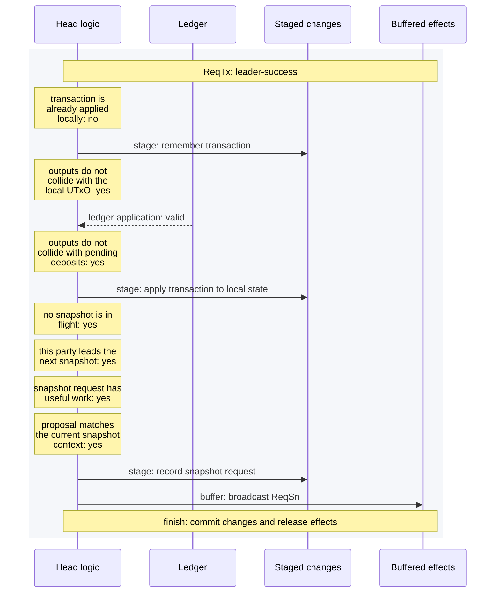
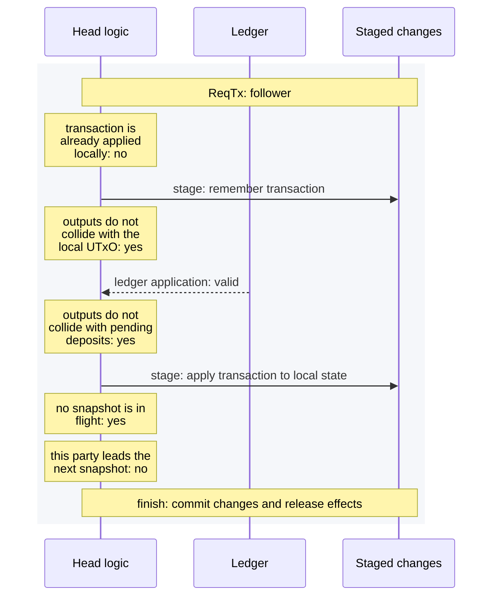
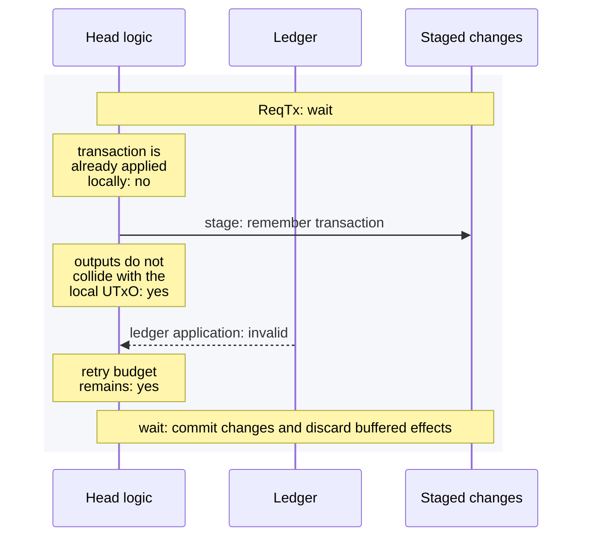
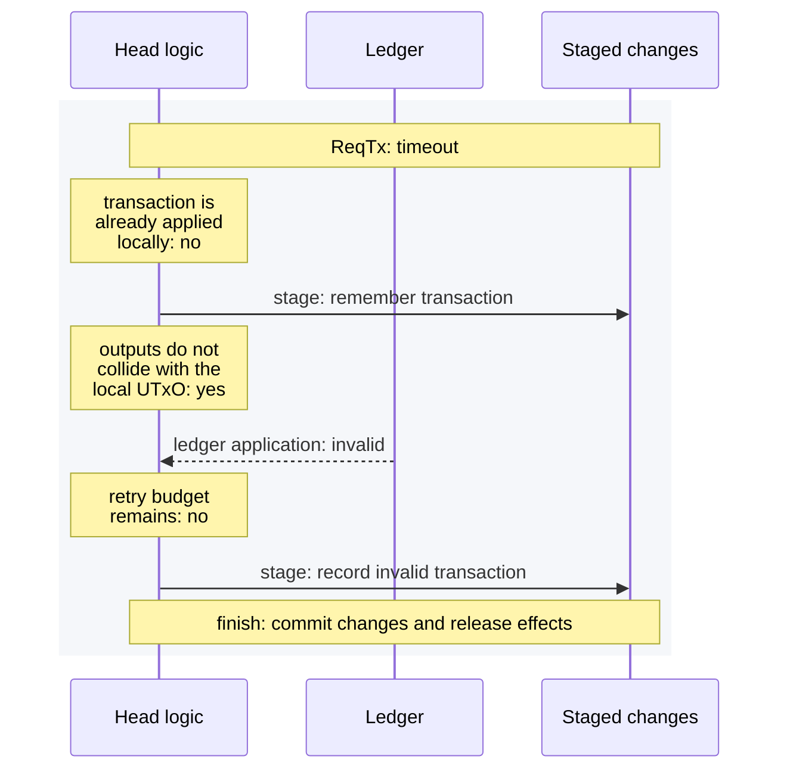
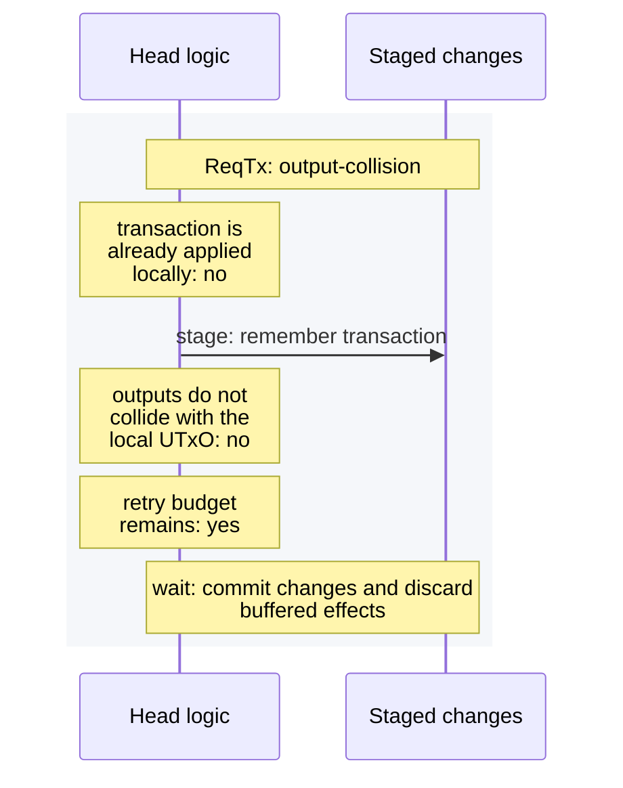
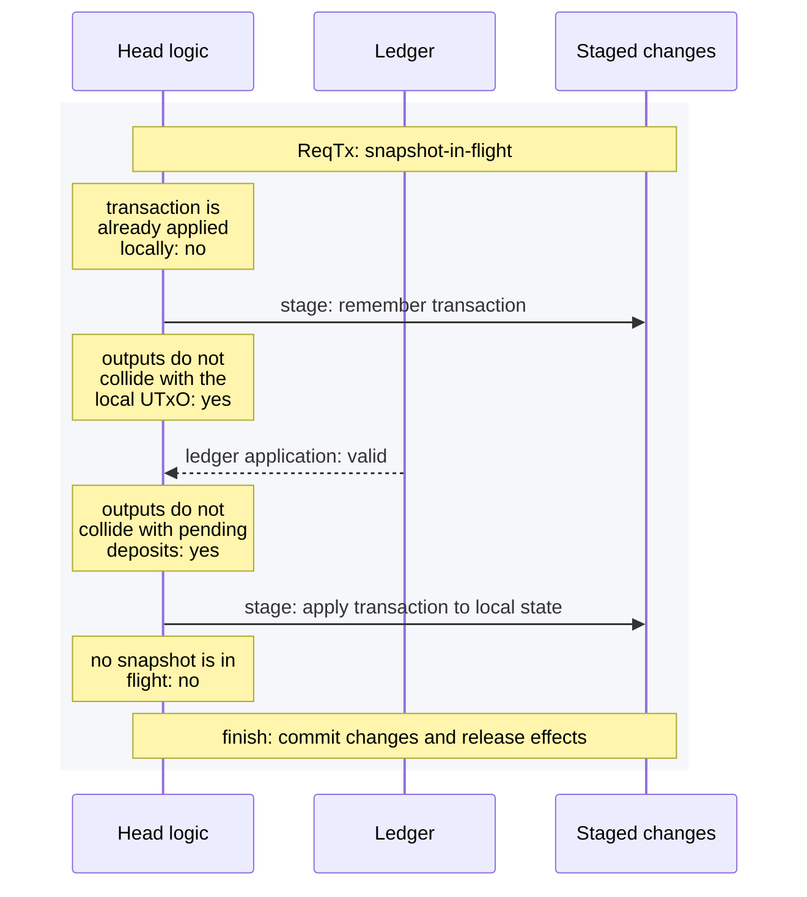

# Head logic: concrete ReqTx executions

These diagrams come from interpreting the actual `onOpenNetworkReqTxProgram`
with the simple test ledger. Each diagram covers one concrete input; unvisited
branches are outside its scope. Every generated run checks its complete outcome
against the frozen migration baseline.

Read each sequence diagram from top to bottom. Lanes separate head logic,
ledger replies, staged changes, and buffered effects within one node.
The last note says whether changes and effects are committed or discarded.

Regenerate this page and its `.mmd` files with:

```sh
cabal bench hydra-node:head-logic-program --benchmark-options='--trace docs/docs/dev/architecture/head-logic-experiments/traces'
```

## leader success



## follower



## wait



## timeout



## output collision



## snapshot in flight


