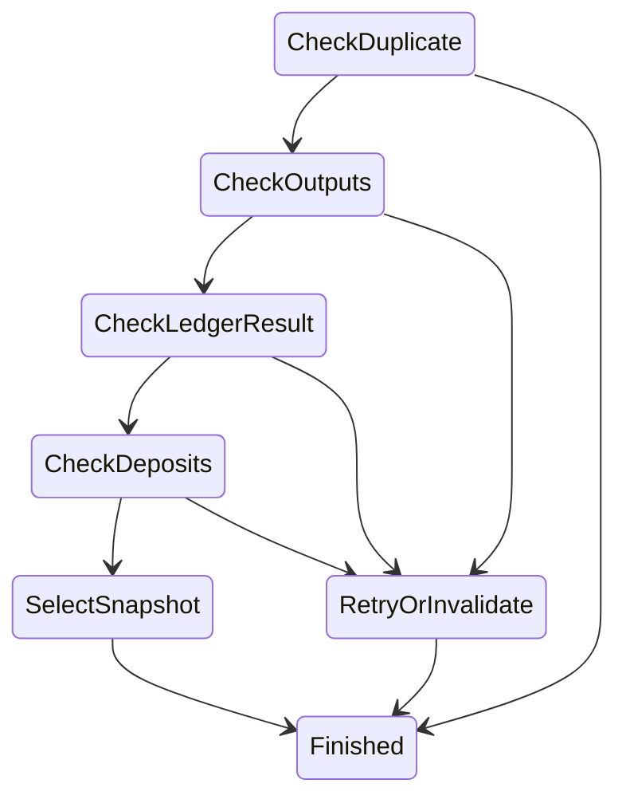
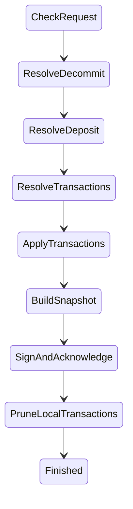
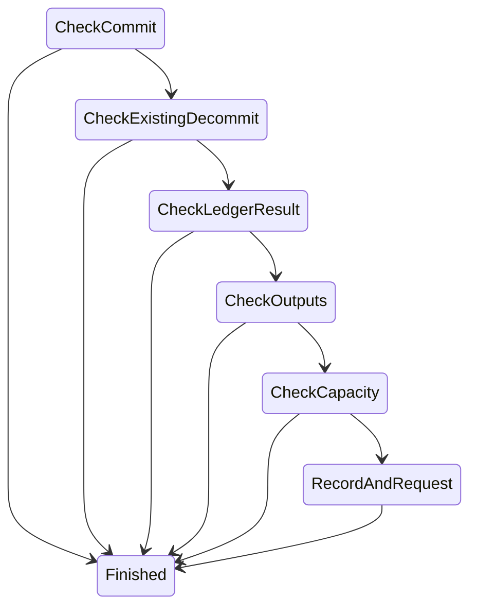
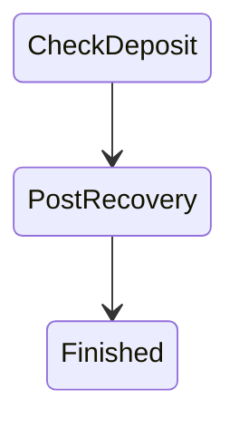
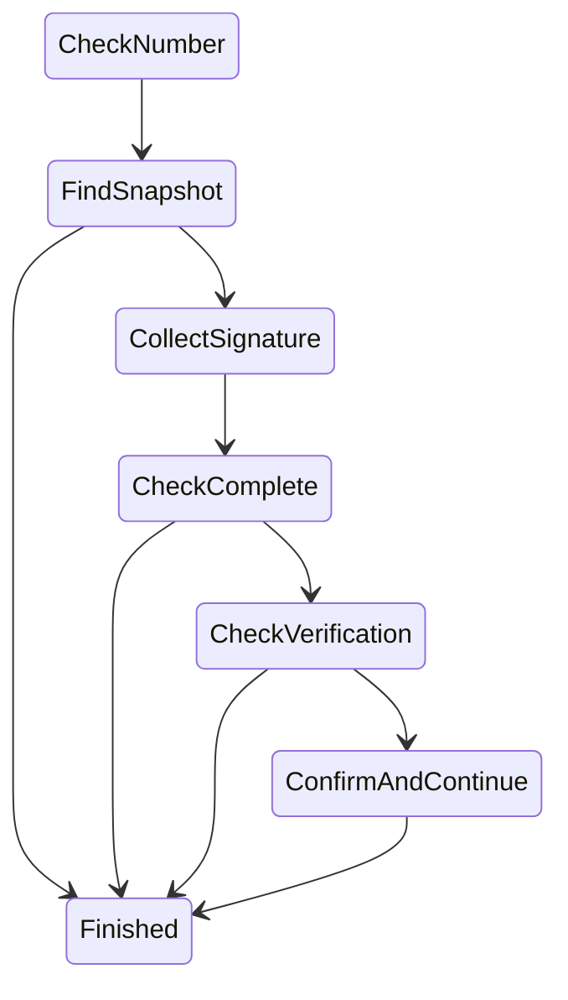
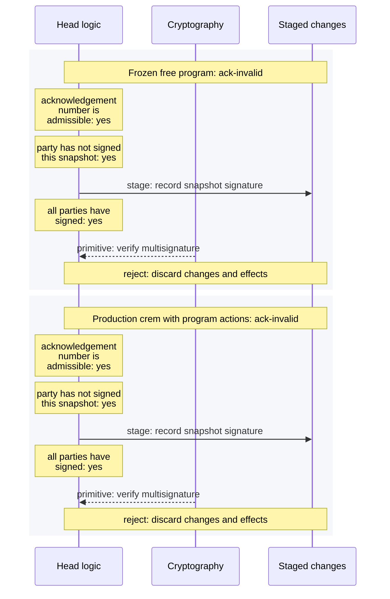

# Programs inside crem

Generated by `cabal run hydra-node:head-logic-lab -- compare-crem docs/docs/dev/architecture/head-logic-experiments/workflows`.

ReqTx, ReqSn and AckSn traces show each implementation's own execution. Generation checks ordered outcomes, primitive queries and replies, staged payloads, serialized states, and unchanged decisions. The named capacity guards and the moved useful-work decision are checked separately in CapacitySpec. ReqDec and Recover had no previous instruction trace; their outcomes and serialized states are checked against the frozen handlers.

Start with [waiting for a dependency](req-tx-wait.mmd) or [rejecting a final invalid signature](ack-invalid.mmd). Read down the component lanes; the terminal note states which changes survive.

The [ReqTx](req-tx-leader-topology.mmd), [ReqSn](req-sn-sign-topology.mmd), [AckSn](ack-confirm-topology.mmd), [ReqDec](req-dec-record-topology.mmd) and [Recover](recover-post-topology.mmd) graphs come from crem's topology. They constrain phase changes, including edges whose actions can terminate early by waiting or rejecting. They do not enumerate decisions inside each action; the execution traces show those decisions. Self-transitions are implicit.

- [req-tx-leader](req-tx-leader.mmd)
- [req-tx-follower](req-tx-follower.mmd)
- [req-tx-wait](req-tx-wait.mmd)
- [req-tx-timeout](req-tx-timeout.mmd)
- [req-tx-duplicate](req-tx-duplicate.mmd)
- [req-tx-output-collision](req-tx-output-collision.mmd)
- [req-tx-in-flight](req-tx-in-flight.mmd)
- [req-sn-sign](req-sn-sign.mmd)
- [req-sn-version-wait](req-sn-version-wait.mmd)
- [req-sn-missing-transaction](req-sn-missing-transaction.mmd)
- [req-sn-decommit](req-sn-decommit.mmd)
- [req-dec-record](req-dec-record.mmd)
- [req-dec-wait](req-dec-wait.mmd)
- [req-dec-timeout](req-dec-timeout.mmd)
- [recover-post](recover-post.mmd)
- [recover-missing](recover-missing.mmd)
- [recover-blocked](recover-blocked.mmd)
- [ack-early](ack-early.mmd)
- [ack-partial](ack-partial.mmd)
- [ack-duplicate](ack-duplicate.mmd)
- [ack-confirm](ack-confirm.mmd)
- [ack-invalid](ack-invalid.mmd)

## req-tx-leader topology

## req-sn-sign topology

## req-dec-record topology

## recover-post topology

## ack-confirm topology

## Invalid final acknowledgement

