This page is generated during the documentation build from the Haskell machine signatures and compositions. Commit the regenerated Markdown with topology changes so their diagrams can be reviewed alongside the code. Editing a topology changes its diagram; adding or removing a concrete machine requires updating the checked inventory.

Arrows show permitted transitions, not conditions under which a transition runs. Named self-loops show protocol operations such as increment, decrement, contest and further partial fanout. Primitive diagrams label the meanings of selected edges; the composition renderer shows the same allowed edges without operation labels. Crem also permits staying in the same state everywhere; unlabelled identity edges are omitted. Program guards, ledger checks, early waits and rejections occur inside actions and are not additional arrows. A one-state graph owns mutable data without restricting it to protocol phases.

Workflow stages last for one input. State owners survive across retained events and are reconstructed from persisted data. Deposit recovery and other small handlers compose Program operations directly and have no separate Crem graph.

The composition arrows below carry outputs between owners; they are not protocol transitions. The head owner delegates open-state events to the coordinated composition.

## Retained-event composition

Composition: [`Hydra.HeadLogic.State.Node.components`](../../../../hydra-node/src/Hydra/HeadLogic/State/Node.hs#L63).

| Machine | Topology |
| --- | --- |
| [`Hydra.HeadLogic.State.Deposits.machine`](../../../../hydra-node/src/Hydra/HeadLogic/State/Deposits.hs#L36) | [`Crem.Topology.TrivialTopology`](../../../../hydra-node/src/Hydra/HeadLogic/State/Deposits.hs#L36) (in the machine signature) |
| [`Hydra.HeadLogic.State.Head.machine`](../../../../hydra-node/src/Hydra/HeadLogic/State/Head.hs#L154) | [`Hydra.HeadLogic.State.Head.LifecycleTopology`](../../../../hydra-node/src/Hydra/HeadLogic/State/Head.hs#L101) |
| [`Hydra.HeadLogic.State.Clock.machine`](../../../../hydra-node/src/Hydra/HeadLogic/State/Clock.hs#L24) | [`Crem.Topology.TrivialTopology`](../../../../hydra-node/src/Hydra/HeadLogic/State/Clock.hs#L24) (in the machine signature) |

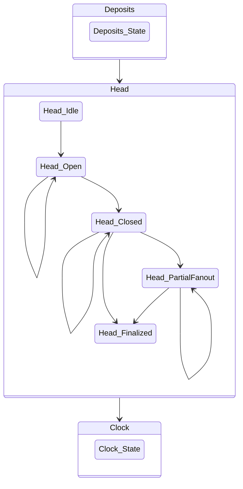

## Open-head composition

Composition: [`Hydra.HeadLogic.State.Coordinated.components`](../../../../hydra-node/src/Hydra/HeadLogic/State/Coordinated.hs#L116).

| Machine | Topology |
| --- | --- |
| [`Hydra.HeadLogic.State.Coordinated.Snapshots.machine`](../../../../hydra-node/src/Hydra/HeadLogic/State/Coordinated/Snapshots.hs#L86) | [`Hydra.HeadLogic.State.Coordinated.Snapshots.Topology.SnapshotTopology`](../../../../hydra-node/src/Hydra/HeadLogic/State/Coordinated/Snapshots/Topology.hs#L34) |
| [`Hydra.HeadLogic.State.Coordinated.Transactions.machine`](../../../../hydra-node/src/Hydra/HeadLogic/State/Coordinated/Transactions.hs#L87) | [`Hydra.HeadLogic.State.Coordinated.Transactions.Topology.DecommitTopology`](../../../../hydra-node/src/Hydra/HeadLogic/State/Coordinated/Transactions/Topology.hs#L17) |
| [`Hydra.HeadLogic.State.Coordinated.Commits.machine`](../../../../hydra-node/src/Hydra/HeadLogic/State/Coordinated/Commits.hs#L58) | [`Crem.Topology.TrivialTopology`](../../../../hydra-node/src/Hydra/HeadLogic/State/Coordinated/Commits.hs#L58) (in the machine signature) |

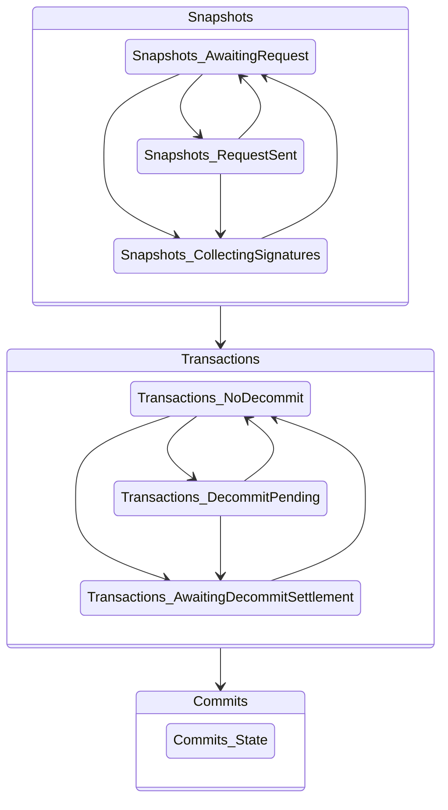

## Input admission and dispatch

Each input starts a fresh workflow. Admission checks precede dispatch by head state.

Machine: [`Hydra.HeadLogic.Rules.Input.workflow`](../../../../hydra-node/src/Hydra/HeadLogic/Rules/Input.hs#L98). Topology: [`Hydra.HeadLogic.Rules.Input.InputTopology`](../../../../hydra-node/src/Hydra/HeadLogic/Rules/Input.hs#L62).

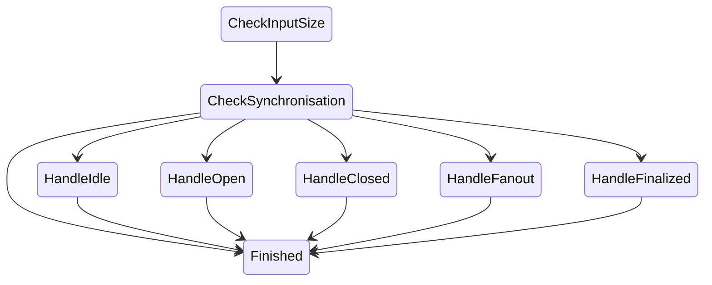

## Receive a transaction

Check duplicates, outputs and deposits before selecting a snapshot or deciding whether to retry.

Machine: [`Hydra.HeadLogic.Rules.Network.ReqTx.workflow`](../../../../hydra-node/src/Hydra/HeadLogic/Rules/Network/ReqTx.hs#L120). Topology: [`Hydra.HeadLogic.Rules.Network.ReqTx.ReqTxTopology`](../../../../hydra-node/src/Hydra/HeadLogic/Rules/Network/ReqTx.hs#L89).

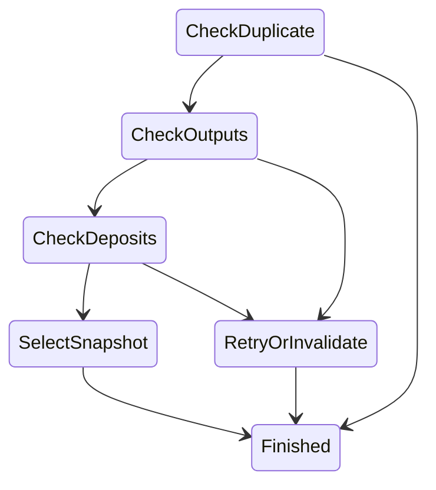

## Receive a decommit request

Check competing incremental work and transaction validity before recording a pending decommit.

Machine: [`Hydra.HeadLogic.Rules.Network.ReqDec.workflow`](../../../../hydra-node/src/Hydra/HeadLogic/Rules/Network/ReqDec.hs#L114). Topology: [`Hydra.HeadLogic.Rules.Network.ReqDec.ReqDecTopology`](../../../../hydra-node/src/Hydra/HeadLogic/Rules/Network/ReqDec.hs#L83).

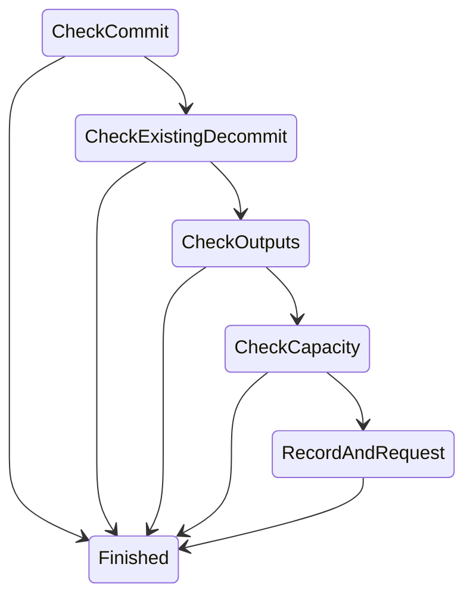

## Receive a snapshot request

Resolve the requested incremental work and transactions before building, signing and retaining the candidate.

Machine: [`Hydra.HeadLogic.Rules.Network.ReqSn.workflow`](../../../../hydra-node/src/Hydra/HeadLogic/Rules/Network/ReqSn.hs#L151). Topology: [`Hydra.HeadLogic.Rules.Network.ReqSn.ReqSnTopology`](../../../../hydra-node/src/Hydra/HeadLogic/Rules/Network/ReqSn.hs#L111).

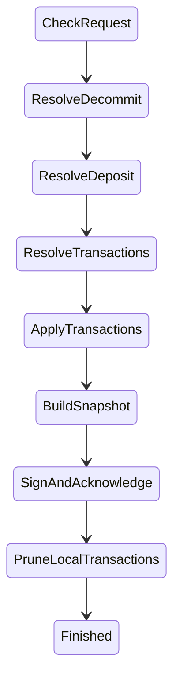

## Receive a snapshot acknowledgement

Collect a signature for the owned candidate; a complete certificate permits confirmation and continuation.

Machine: [`Hydra.HeadLogic.Rules.Network.AckSn.workflow`](../../../../hydra-node/src/Hydra/HeadLogic/Rules/Network/AckSn.hs#L152). Topology: [`Hydra.HeadLogic.Rules.Network.AckSn.AckTopology`](../../../../hydra-node/src/Hydra/HeadLogic/Rules/Network/AckSn.hs#L121).

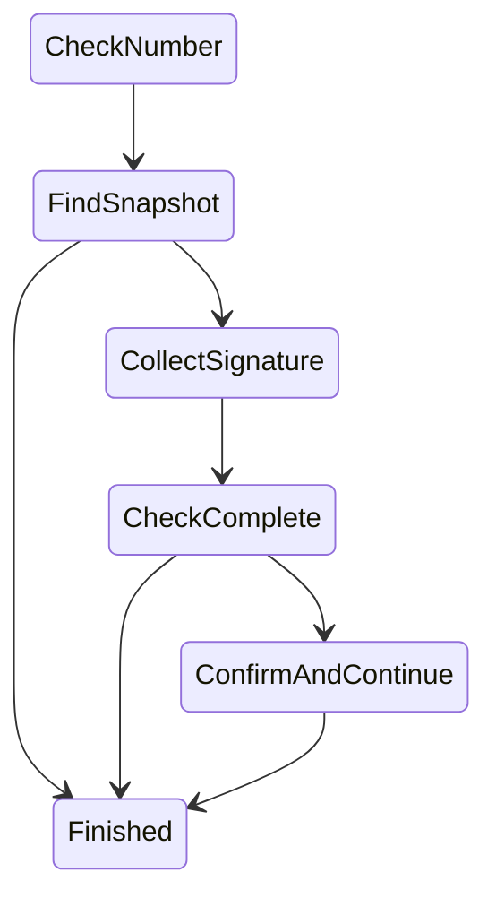

## Client decommit

Validate a client decommit before broadcasting it. Recording and approval occur later.

Machine: [`Hydra.HeadLogic.Rules.Client.Decommit.workflow`](../../../../hydra-node/src/Hydra/HeadLogic/Rules/Client/Decommit.hs#L71). Topology: [`Hydra.HeadLogic.Rules.Client.Decommit.DecommitTopology`](../../../../hydra-node/src/Hydra/HeadLogic/Rules/Client/Decommit.hs#L44).

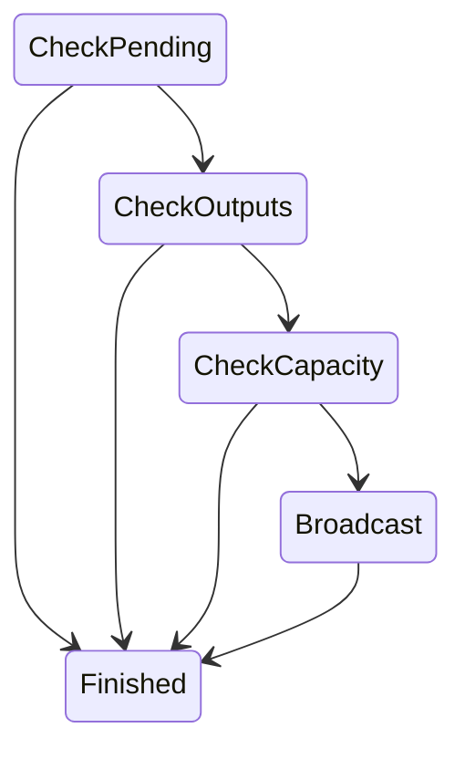

## Observe incremental settlement

Record the chain observation, reconcile a matching candidate and consider requesting the next snapshot.

Machine: [`Hydra.HeadLogic.Rules.Chain.Settlement.workflow`](../../../../hydra-node/src/Hydra/HeadLogic/Rules/Chain/Settlement.hs#L104). Topology: [`Hydra.HeadLogic.Rules.Chain.Settlement.SettlementTopology`](../../../../hydra-node/src/Hydra/HeadLogic/Rules/Chain/Settlement.hs#L78).

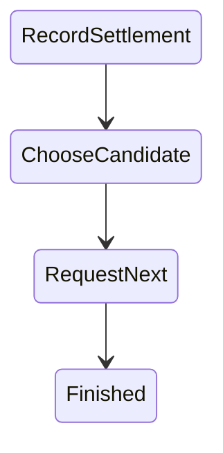

## Head lifecycle

This is the lifecycle of one Head identity. Contest updates a Closed Head's snapshot and deadline while staying Closed. A local fanout request and its cancellation also leave that protocol phase unchanged; only an observed partial distribution enters PartialFanout. Further partial distributions stay there. Full or final partial fanout reaches Finalized, which is terminal and survives checkpoint recovery. Starting a different Head creates a new machine at the node boundary. Named self-loops identify increment, decrement, contest and repeated partial distribution.

Machine: [`Hydra.HeadLogic.State.Head.machine`](../../../../hydra-node/src/Hydra/HeadLogic/State/Head.hs#L154). Topology: [`Hydra.HeadLogic.State.Head.LifecycleTopology`](../../../../hydra-node/src/Hydra/HeadLogic/State/Head.hs#L101).

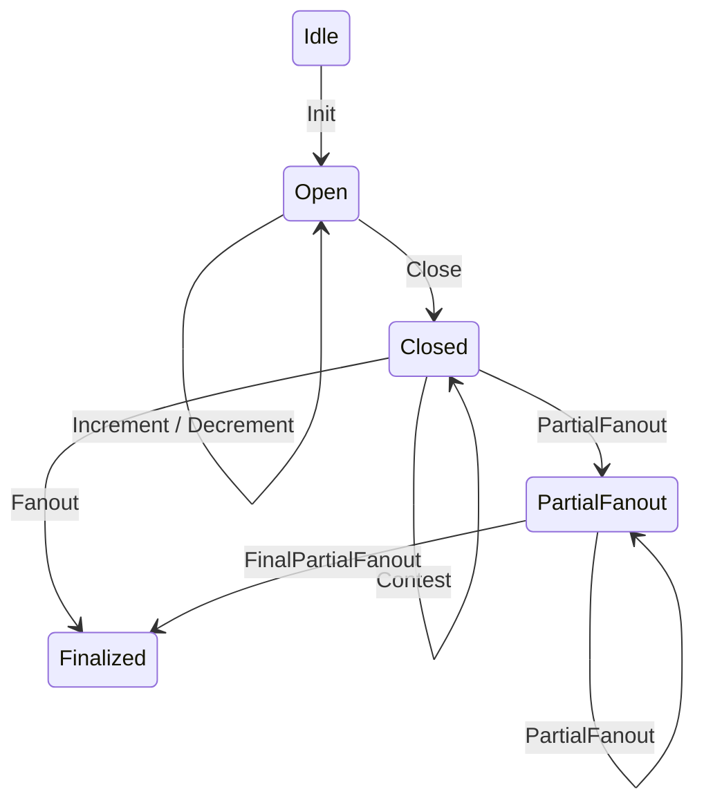

## Snapshot ownership

Normal request processing cannot restart a round while collecting signatures. Confirmation and certificate adoption finish it; administrative side-loading can instead discard the candidate and reset the seen number to the confirmed number. This administrative escape hatch is outside the Agda signing-discipline theorem. Retained-event restoration is separate from both operations.

Machine: [`Hydra.HeadLogic.State.Coordinated.Snapshots.machine`](../../../../hydra-node/src/Hydra/HeadLogic/State/Coordinated/Snapshots.hs#L86). Topology: [`Hydra.HeadLogic.State.Coordinated.Snapshots.Topology.SnapshotTopology`](../../../../hydra-node/src/Hydra/HeadLogic/State/Coordinated/Snapshots/Topology.hs#L34).

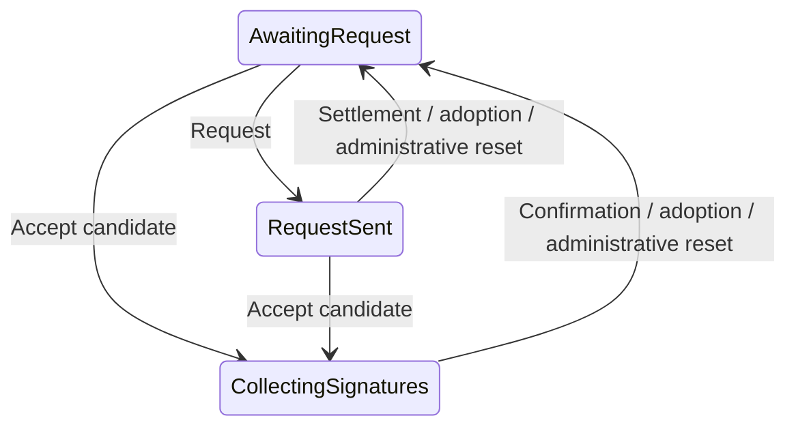

## Local transactions and decommit ownership

Local transactions and reserved decommit outputs share an owner. An approved decommit awaiting settlement cannot be replaced by a pending one. NoDecommit can move directly to AwaitingDecommitSettlement when a confirmed or adopted snapshot carries a decommit whose ReqDec this node has not received.

Machine: [`Hydra.HeadLogic.State.Coordinated.Transactions.machine`](../../../../hydra-node/src/Hydra/HeadLogic/State/Coordinated/Transactions.hs#L87). Topology: [`Hydra.HeadLogic.State.Coordinated.Transactions.Topology.DecommitTopology`](../../../../hydra-node/src/Hydra/HeadLogic/State/Coordinated/Transactions/Topology.hs#L17).

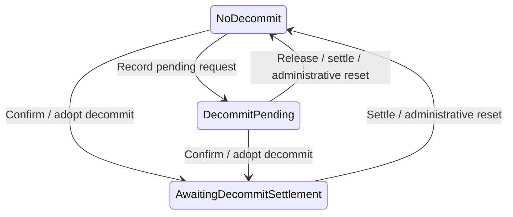

## Commit selection owner

A single Crem state contains Unselected, Selected or Approved data. Approval and the optional selected deposit are independent. Every pair of these data states is reachable, so a phase graph would add no restriction.

Machine: [`Hydra.HeadLogic.State.Coordinated.Commits.machine`](../../../../hydra-node/src/Hydra/HeadLogic/State/Coordinated/Commits.hs#L58). Topology: [`Crem.Topology.TrivialTopology`](../../../../hydra-node/src/Hydra/HeadLogic/State/Coordinated/Commits.hs#L58) (in the machine signature).

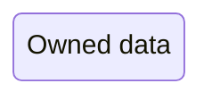

## Deposit registry owner

A single Crem state owns the registry. Each entry has independent eligibility, recording and consumption fields. Ordinary reducers handle observation, status updates, consumption and rollback. This is an ownership graph, not the lifecycle of one deposit; see the [deposit lifecycle](../deposit-lifecycle.svg).

Machine: [`Hydra.HeadLogic.State.Deposits.machine`](../../../../hydra-node/src/Hydra/HeadLogic/State/Deposits.hs#L36). Topology: [`Crem.Topology.TrivialTopology`](../../../../hydra-node/src/Hydra/HeadLogic/State/Deposits.hs#L36) (in the machine signature).

## Node clock owner

A single Crem state owns synchronization status and the observed chain clock; the diagram expresses ownership, not a protocol lifecycle.

Machine: [`Hydra.HeadLogic.State.Clock.machine`](../../../../hydra-node/src/Hydra/HeadLogic/State/Clock.hs#L24). Topology: [`Crem.Topology.TrivialTopology`](../../../../hydra-node/src/Hydra/HeadLogic/State/Clock.hs#L24) (in the machine signature).

