This page is generated from the Haskell machine signatures. The overview diagrams show state ownership; arrows in the individual machine diagrams show permitted phase transitions.
## Node state updates

The node owns the Head state, deposit registry, and observed chain time and synchronisation status. Deposits remain recoverable after their Head closes. Tick inputs trigger time-dependent work in the rules.

Updates: [`Hydra.HeadLogic.State.Node.step`](../../../../hydra-node/src/Hydra/HeadLogic/State/Node.hs#L54).

| Machine | Topology |
| --- | --- |
| [`Hydra.HeadLogic.State.Head.machine`](../../../../hydra-node/src/Hydra/HeadLogic/State/Head.hs#L159) | [`Hydra.HeadLogic.State.Head.LifecycleTopology`](../../../../hydra-node/src/Hydra/HeadLogic/State/Head.hs#L106) |
| [`Hydra.HeadLogic.State.Deposits.machine`](../../../../hydra-node/src/Hydra/HeadLogic/State/Deposits.hs#L35) | [`Crem.Topology.TrivialTopology`](../../../../hydra-node/src/Hydra/HeadLogic/State/Deposits.hs#L35) (in the machine signature) |

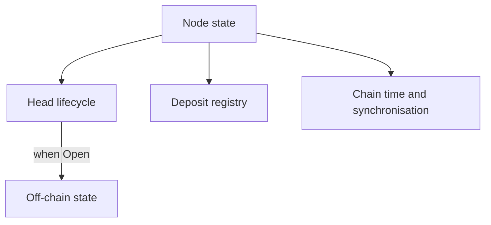

The node applies each state-change event to the relevant components and updates chain time and synchronisation directly in NodeState. Increment settlement reads the deposited UTxO before the registry marks it consumed and passes that value to the Head.

## Off-chain state updates

An open Head owns snapshots, local transactions and decommit reservations, and commit selection. Ordinary transaction commands go directly to the transaction machine.

Updates: [`Hydra.HeadLogic.State.Coordinated.advance`](../../../../hydra-node/src/Hydra/HeadLogic/State/Coordinated.hs#L166).

| Machine | Topology |
| --- | --- |
| [`Hydra.HeadLogic.State.Coordinated.Snapshots.machine`](../../../../hydra-node/src/Hydra/HeadLogic/State/Coordinated/Snapshots.hs#L87) | [`Hydra.HeadLogic.State.Coordinated.Snapshots.Topology.SnapshotTopology`](../../../../hydra-node/src/Hydra/HeadLogic/State/Coordinated/Snapshots/Topology.hs#L33) |
| [`Hydra.HeadLogic.State.Coordinated.Transactions.machine`](../../../../hydra-node/src/Hydra/HeadLogic/State/Coordinated/Transactions.hs#L132) | [`Hydra.HeadLogic.State.Coordinated.Transactions.DecommitTopology`](../../../../hydra-node/src/Hydra/HeadLogic/State/Coordinated/Transactions.hs#L83) |
| [`Hydra.HeadLogic.State.Coordinated.Commits.machine`](../../../../hydra-node/src/Hydra/HeadLogic/State/Coordinated/Commits.hs#L54) | [`Crem.Topology.TrivialTopology`](../../../../hydra-node/src/Hydra/HeadLogic/State/Coordinated/Commits.hs#L54) (in the machine signature) |

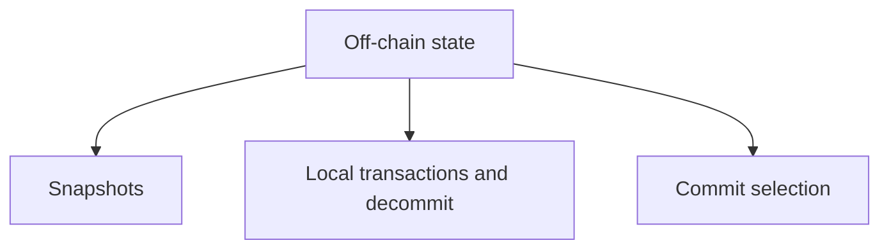

Snapshot acceptance, confirmation and adoption update the snapshot first, reconcile local transactions and decommit reservations, then update commit selection. Settlement uses the same order. Retained events restore snapshot state without repeating live admission checks.

## Head lifecycle

This is the lifecycle of the Head protocol.

- Machine: [`Hydra.HeadLogic.State.Head.machine`](../../../../hydra-node/src/Hydra/HeadLogic/State/Head.hs#L159).
- Topology: [`Hydra.HeadLogic.State.Head.LifecycleTopology`](../../../../hydra-node/src/Hydra/HeadLogic/State/Head.hs#L106).

↻ marks a transition that keeps the same state.

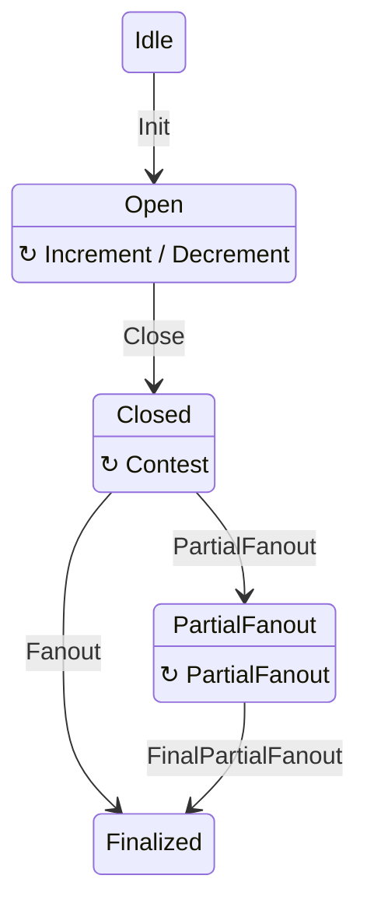

## All inputs into the head logic

Client commands, network messages, and chain events.

- Machine: [`Hydra.HeadLogic.Rules.Input.workflow`](../../../../hydra-node/src/Hydra/HeadLogic/Rules/Input.hs#L111).
- Topology: [`Hydra.HeadLogic.Rules.Input.InputTopology`](../../../../hydra-node/src/Hydra/HeadLogic/Rules/Input.hs#L68).

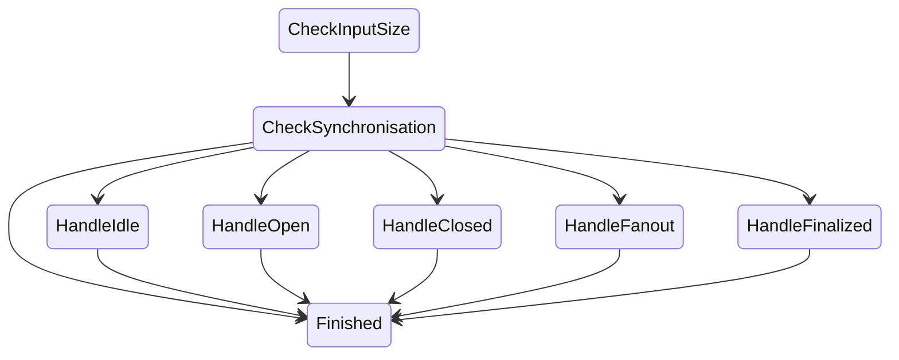

## ReqTx: Receive a transaction

Check duplicates, outputs and deposits before selecting a snapshot or deciding whether to retry.

- Machine: [`Hydra.HeadLogic.Rules.Network.ReqTx.workflow`](../../../../hydra-node/src/Hydra/HeadLogic/Rules/Network/ReqTx.hs#L137).
- Topology: [`Hydra.HeadLogic.Rules.Network.ReqTx.ReqTxTopology`](../../../../hydra-node/src/Hydra/HeadLogic/Rules/Network/ReqTx.hs#L97).

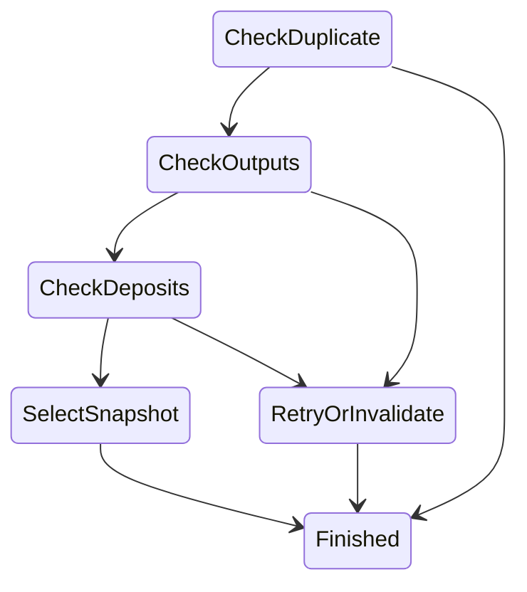

## ReqDec: Receive a decommit request

Check competing incremental work and transaction validity before recording a pending decommit.

- Machine: [`Hydra.HeadLogic.Rules.Network.ReqDec.workflow`](../../../../hydra-node/src/Hydra/HeadLogic/Rules/Network/ReqDec.hs#L111).
- Topology: [`Hydra.HeadLogic.Rules.Network.ReqDec.ReqDecTopology`](../../../../hydra-node/src/Hydra/HeadLogic/Rules/Network/ReqDec.hs#L77).

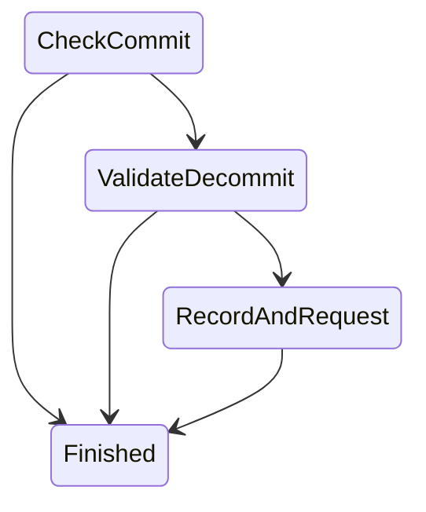

## Snapshot validation

Resolve incremental work, apply transactions and check commitment capacity before issuing a checked snapshot.

- Machine: [`Hydra.HeadLogic.Rules.Network.ReqSn.validationWorkflow`](../../../../hydra-node/src/Hydra/HeadLogic/Rules/Network/ReqSn.hs#L170).
- Topology: [`Hydra.HeadLogic.Rules.Network.ReqSn.ValidationTopology`](../../../../hydra-node/src/Hydra/HeadLogic/Rules/Network/ReqSn.hs#L119).

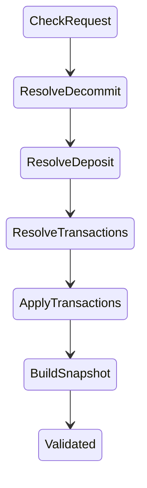

## ReqSn: Receive a snapshot request

Resolve any incremental work and transactions before building, signing and retaining the snapshot.

- Machine: [`Hydra.HeadLogic.Rules.Network.ReqSn.workflow`](../../../../hydra-node/src/Hydra/HeadLogic/Rules/Network/ReqSn.hs#L310).
- Topology: [`Hydra.HeadLogic.Rules.Network.ReqSn.ReqSnTopology`](../../../../hydra-node/src/Hydra/HeadLogic/Rules/Network/ReqSn.hs#L285).

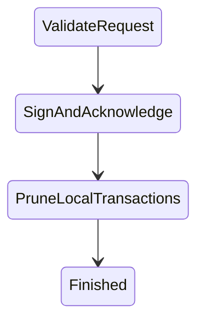

## AckSn: Receive a snapshot acknowledgement

Collect a signature for the owned candidate; a complete certificate permits confirmation and continuation.

- Machine: [`Hydra.HeadLogic.Rules.Network.AckSn.workflow`](../../../../hydra-node/src/Hydra/HeadLogic/Rules/Network/AckSn.hs#L178).
- Topology: [`Hydra.HeadLogic.Rules.Network.AckSn.AckTopology`](../../../../hydra-node/src/Hydra/HeadLogic/Rules/Network/AckSn.hs#L129).

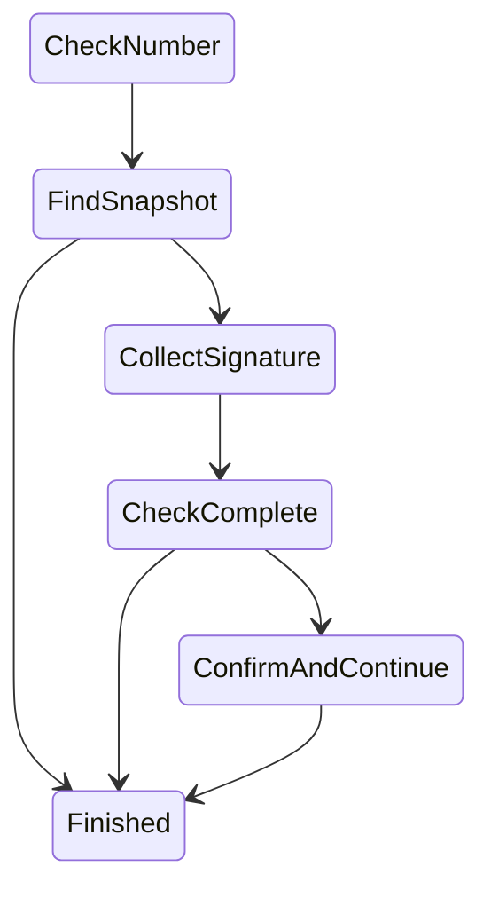

## Decommit admission

Check availability, ledger applicability, nonempty outputs and capacity once. Client and network callers retain distinct refusal and retry policies.

- Machine: [`Hydra.HeadLogic.Rules.Decommit.workflow`](../../../../hydra-node/src/Hydra/HeadLogic/Rules/Decommit.hs#L66).
- Topology: [`Hydra.HeadLogic.Rules.Decommit.AdmissionTopology`](../../../../hydra-node/src/Hydra/HeadLogic/Rules/Decommit.hs#L30).

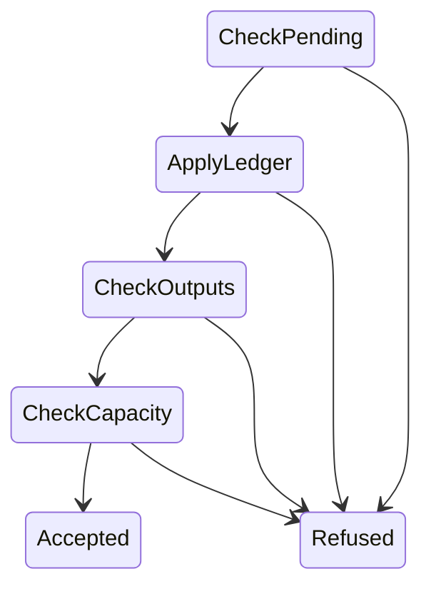

## Client decommit

Validate a client decommit before broadcasting it.

- Machine: [`Hydra.HeadLogic.Rules.Client.Decommit.workflow`](../../../../hydra-node/src/Hydra/HeadLogic/Rules/Client/Decommit.hs#L69).
- Topology: [`Hydra.HeadLogic.Rules.Client.Decommit.DecommitTopology`](../../../../hydra-node/src/Hydra/HeadLogic/Rules/Client/Decommit.hs#L40).

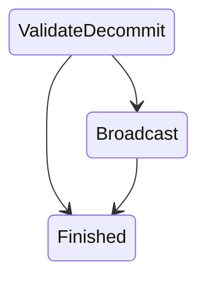

## Observe incremental settlement

Record the chain observation, reconcile a matching candidate and consider requesting the next snapshot.

- Machine: [`Hydra.HeadLogic.Rules.Chain.Settlement.workflow`](../../../../hydra-node/src/Hydra/HeadLogic/Rules/Chain/Settlement.hs#L129).
- Topology: [`Hydra.HeadLogic.Rules.Chain.Settlement.SettlementTopology`](../../../../hydra-node/src/Hydra/HeadLogic/Rules/Chain/Settlement.hs#L86).

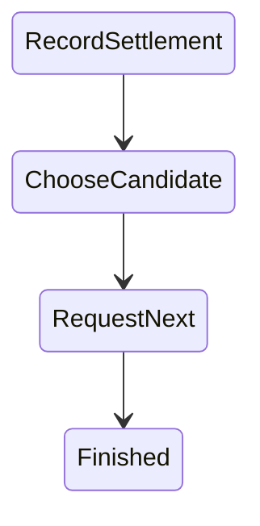

## Snapshot progressing logic

Handles requesting, accepting, collecting and confirming snapshots.

- Machine: [`Hydra.HeadLogic.State.Coordinated.Snapshots.machine`](../../../../hydra-node/src/Hydra/HeadLogic/State/Coordinated/Snapshots.hs#L87).
- Topology: [`Hydra.HeadLogic.State.Coordinated.Snapshots.Topology.SnapshotTopology`](../../../../hydra-node/src/Hydra/HeadLogic/State/Coordinated/Snapshots/Topology.hs#L33).

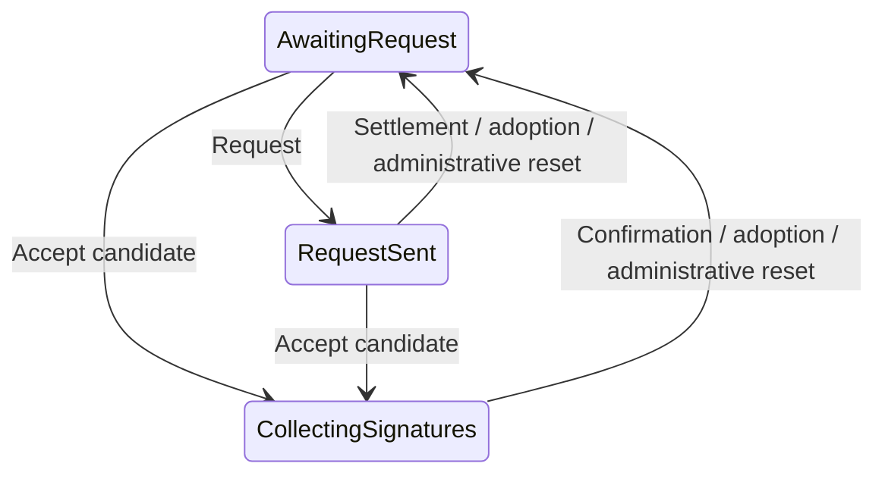

## Transactions on the local ledger

Handles transactions and updates the ledger; also manages decommits.

- Machine: [`Hydra.HeadLogic.State.Coordinated.Transactions.machine`](../../../../hydra-node/src/Hydra/HeadLogic/State/Coordinated/Transactions.hs#L132).
- Topology: [`Hydra.HeadLogic.State.Coordinated.Transactions.DecommitTopology`](../../../../hydra-node/src/Hydra/HeadLogic/State/Coordinated/Transactions.hs#L83).

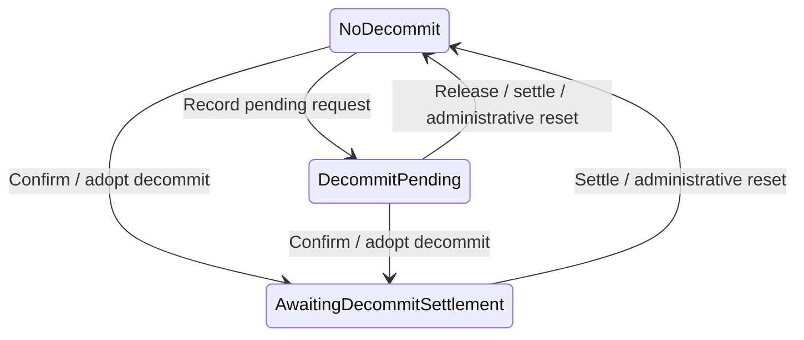

## Commits

Handles selection of commits for inclusion.

- Machine: [`Hydra.HeadLogic.State.Coordinated.Commits.machine`](../../../../hydra-node/src/Hydra/HeadLogic/State/Coordinated/Commits.hs#L54).
- Topology: [`Crem.Topology.TrivialTopology`](../../../../hydra-node/src/Hydra/HeadLogic/State/Coordinated/Commits.hs#L54) (in the machine signature).

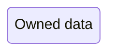

## Deposits

Handles recording a deposit, and their activation or expiry.

- Machine: [`Hydra.HeadLogic.State.Deposits.machine`](../../../../hydra-node/src/Hydra/HeadLogic/State/Deposits.hs#L35).
- Topology: [`Crem.Topology.TrivialTopology`](../../../../hydra-node/src/Hydra/HeadLogic/State/Deposits.hs#L35) (in the machine signature).

