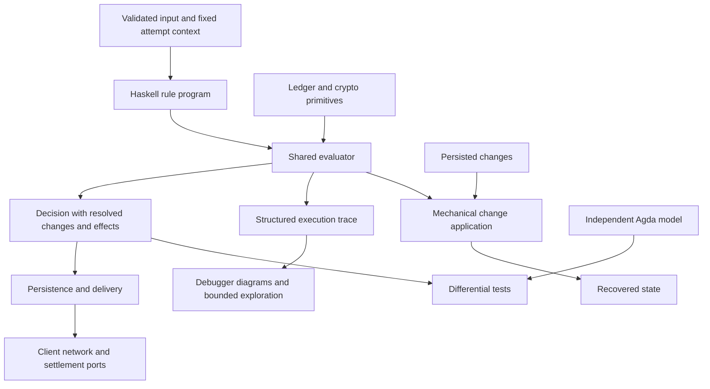

# Head logic refactor sketch

For the implemented spike, start with `docs/head-logic-review.md` in the checkout.
It links the approach to concrete source functions and separates current behavior,
experimental results and remaining work. This document retains the broader
design proposal; its suggested APIs and module layout are not all implemented.

Keep the production protocol rules in readable Haskell, expressed as a small
free-monad-style program. Give that program one execution semantics, reused by
the node, tests, debugger, and trace explorer. Keep Agda as an independent model
and strengthen the differential tests between the two.

The longer-term proposal is for each rule to produce a state change that can be
persisted and replayed without reconstructing the result. Separate the L2 ledger from the settlement
chain, and require each backend to implement the same explicit settlement
contract.

This proposal now has executable `ReqTx`, `ReqSn`, and `AckSn` programs, a bounded
scheduler/debugger, and a resolved transaction log experiment. Existing protocol
behavior remains the migration baseline except for the applied-ID registry fix
described in `docs/head-logic-bug-audit.md`. Wire encodings and production
persistence are unchanged. Retained events now execute through composed crem
machines for the head lifecycle, incremental actions and snapshot coordination;
see [the implementation guide](../../../head-logic-crem.md).

See [the snapshot lab](./head-logic-lab.md) for the review boundaries, independent
Agda coverage and exclusions, counterexample/replay commands, resolved-recovery
comparison, round benchmarks, and a maintenance exercise.

The programs use a Church encoding of the operational free monad. `foldProgram`
and the development cursor expose instructions and typed continuations. Production
and experimental interpreters share one definition of completion, retained wait
prefixes, rejection and effect buffering. Signing keys stay in interpreter
configuration. Fault injection and the separately versioned resolved log live in
the development test library, with no production execution switch.

The [original ReqTx measurements](./head-logic-benchmark.md) remain evidence only
for that earlier slice. The new round groups and resolved-delta measurements have
their own workloads and must be assessed separately. Neither a bounded search nor
uncertain performance intervals establish unbounded correctness or a hard 5%
performance bound.

## Current duplication

`HeadLogic.update` already separates pure decisions from effects. Some decisions
and state calculations are still repeated during aggregation:

| Current location | Consequence |
| --- | --- |
| The ReqTx program supplies validated UTxO endpoints, but production compatibility events discard them; aggregation later calls `applyTxTo` | Production replay still reconstructs the ledger change; the experimental log measures explicit deltas. |
| `pruneTransactions` computes the remaining transactions and their resulting UTxO, then returns only the transactions | `SnapshotRequested` replay reconstructs the UTxO again. |
| `onOpenChainIncrementTx` predicts the state after settlement when constructing another snapshot request | `Machine.Incremental` and `Machine.OffChain` implement settlement, version, and retention updates separately from the input rule. |
| `retryDecision` distinguishes several protocol wait reasons and is shared by `Node.maybeReenqueue` and the explorer | Retry eligibility has one definition; scheduling remains outside the programs. |
| Startup calls `repostFanoutStep` directly | Recovery bypasses the normal input path. |
| API event projection tracks the seen snapshot because a confirmation event can omit it | Another component reconstructs information already available when the decision was made. |

These are visible in `hydra-node/src/Hydra/HeadLogic.hs`,
`Hydra/HeadLogic/Outcome.hs`, `Hydra/Node.hs`, and `Hydra/API/Server.hs`.
[ADR 24](/adr/24) already identifies the split between decision and aggregation
as a consequence of the current event-sourcing design.

The aim is to define each guard, retry policy and state transformation once in
production code. An interpreter implements
operations such as assigning a value or verifying a signature. It does not choose
which snapshot to sign or whether a deposit blocks a decommit. Agda deliberately
remains an independent specification, as do properties that express expected
behavior.

## The proposed flow



Execution is still run-to-completion for one input. State, effects, and trace are
staged while evaluating it. A terminal decision specifies what survives. Real
network and chain operations happen after evaluation.

### Instructions

The following proposed interface gives each instruction a result type:

```haskell
data Program op a where
  Pure :: a -> Program op a
  Step :: op x -> (x -> Program op a) -> Program op a

type Rule chain ledger = Program (HeadOp chain ledger)

data HeadOp chain ledger a where
  ReadState :: HeadOp chain ledger (NodeState chain ledger)
  ReadContext :: HeadOp chain ledger (AttemptContext chain ledger)
  Change :: ResolvedChange chain ledger -> HeadOp chain ledger ()
  Emit :: Effect chain ledger -> HeadOp chain ledger ()
  Query :: Primitive chain ledger a -> HeadOp chain ledger a
  Check :: CheckId -> Bool -> StopReason chain ledger
        -> HeadOp chain ledger ()
  Mark :: RuleId -> HeadOp chain ledger ()

data StopReason chain ledger
  = Reject (LogicError chain ledger)
  | Suspend (WaitReason chain ledger) RetryPolicy
```

`require` and `await` are smart constructors for `Check`. When its predicate is
false, the evaluator terminates the attempt using the supplied stop reason;
the continuation is not run. `CheckId` and `RuleId` identify the source rule and
guard in traces. Ordinary Haskell pattern matching, local functions, and `do`
notation remain available. A shared helper such as `requestNextSnapshot` is an
ordinary rule subprogram, defined once.

This representation follows the familiar separation between a free program and
its fold into an interpreter; see the
[`free` API](https://hackage-content.haskell.org/package/free-5.1.10/docs/Control-Monad-Free.html).
The particular library is secondary. Avoid a general expression language,
serialized continuations, extensible effect rows, or an optimizer in the first
version.

`Primitive` contains operations whose semantics come from another component:
ledger application, signature verification, snapshot encoding, commitments, and
local signing. It does not contain `MaySignSnapshot`, `ValidateReqSn`, or
`ChooseNextDeposit`. Those are protocol decisions and belong in rules or their
pure helpers.

`AttemptContext` fixes public configuration, wall time, settlement time and view,
ledger validation context, and protocol profile for this attempt. Queries cannot
read a changing chain tip behind the evaluator's back. Private signing material
belongs to the primitive implementation, outside the rule environment and trace.
The current local signer can supply a pure signing function. A future remote
signer needs explicit request/result inputs and cannot perform blocking IO inside
the pure evaluator or STM.

### Resolved changes keep event sourcing simple

Retain a domain-specific change type, evolving `StateChanged`. Enrich payloads
where replay currently has to infer a result. For example:

```haskell
data ResolvedChange chain ledger
  = TransactionReceived
      { transaction :: Tx ledger }
  | LocalTransactionApplied
      { headId :: HeadId chain
      , transaction :: Tx ledger
      , localUTxOChange :: UTxODelta ledger
      }
  | SnapshotPrepared
      { snapshot :: Snapshot chain ledger
      , retainedTransactions :: Seq (Tx ledger)
      , localUTxOChange :: UTxODelta ledger
      , selectedDeposit :: Maybe (DepositRef chain)
      }
  -- Other constructors carry their resolved assignments in the same way.
```

`applyChange` is the one mechanical application function used both while staging
and while replaying. It assigns fields, inserts or deletes specified entries,
appends specified items, and applies explicit UTxO deltas. It never validates a
transaction, tests a deadline, compares snapshot versions to decide a transition,
chooses retained history, or decides whether a deposit is still usable.

For settlement events, the rule resolves the re-observation case, resulting
version, deposit bookkeeping, seen snapshot, and retained finalized snapshot.
The payload carries those results. State-variant changes carry all fields needed
to install the new variant atomically. Invalid state/event combinations fail
replay validation; they do not silently become no-ops.

Keep existing events where their meaning is already sufficient. `TransactionReceived` can still mean
inserting the supplied transaction under its ID. There is no need to replace
this finite domain schema with arbitrary paths, lenses, or a general patch
language.

Use deltas or stable references for large values. Storing a full UTxO on every
transaction would reverse the performance benefit of incremental persistence.
The ledger primitive returns its validated result; a mechanical delta operation
records that result with the law:

```text
applyDelta old (difference old new) = new
```

Computing or replaying a map difference does not rerun ledger validation. Where
possible, obtain the delta alongside validation. Benchmark this boundary before
choosing its representation.

The API still needs `ServerOutput` values. Derive them from state changes,
using the shared state where needed. A snapshot confirmation must
provide the resolved snapshot or a durable reference to it, so the API does not
need its own snapshot reconstruction algorithm. Direct query responses remain
client effects. Preserve the existing ordering of event-derived notices before
direct effects.

### Example rule

This abbreviated `ReqTx` example shows the proposed interface. It omits the
already-applied-ID guard and some deposit checks; see `onOpenNetworkReqTxProgram`
for the current rule:

```haskell
onReqTx ttl tx = do
  mark ReqTxRule
  before <- readState
  context <- readContext
  change TransactionReceived{transaction = tx}

  -- A rule helper owns the collision checks and queries the ledger once.
  result <- applyRequestedTransaction context before tx
  case result of
    Left err ->
      if ttl > 0
        then suspend (WaitOnNotApplicableTx err) retryWithDecreasedBudget
        else recordInvalidTransaction before tx err
    Right validatedUTxO -> do
      change LocalTransactionApplied
        { headId = headIdOfOpenState before
        , transaction = tx
        , localUTxOChange = difference (localUTxOOf before) validatedUTxO
        }
      requestNextSnapshot
```

`applyRequestedTransaction`, `recordInvalidTransaction`, and
`requestNextSnapshot` are Haskell rule helpers. They are not interpreter
callbacks. The last helper reads the staged state, which already contains the
applied transaction. It no longer constructs a predicted copy of the reducer's
future state. The timeout branch finishes normally with an invalid-transaction
change, matching the current behavior; it is not a protocol `Reject`.

Some current composed handlers intentionally use pre-input state. Capture that
value explicitly where required. Converting every use to a fresh `readState`
would change behavior, particularly for tick/activation/request and
settlement/adoption/request sequences.

## Execution semantics

Give the evaluator an initial state, working state, buffered changes, buffered
effects, and trace. State reads see the working state. The three terminal outcomes
have these semantics:

| Terminal outcome | State and persisted changes | Buffered `Effect` values | Next input handling |
| --- | --- | --- | --- |
| Finished | Commit all staged changes | Release in their recorded order | Input is complete |
| Suspended | Commit the prefix before suspension | Discard all effects staged by this attempt | Apply the returned retry policy |
| Rejected | Restore initial state; discard all staged changes | Discard all effects | Report the error; input is complete |

Notices derived from committed changes survive suspension, as they do today.
Only the buffered direct effects are discarded. The event sink's client notices
and the `Effect` buffer therefore remain distinct in the decision format.

The trace records tentative work and the final disposition even when changes
are discarded. It is diagnostic data, not the state log.

This preserves two essential cases: remembering a received transaction before
waiting for applicability, and discarding the tentative final acknowledgement
when aggregate signature validation fails. Implement these semantics directly
and test them. An incidental ordering of `StateT`, `WriterT`, and `ExceptT` is
too easy to misread.

One difference matters during migration: today's `Outcome` semigroup gives `Error` precedence
even in `Wait <> Error`. A short-circuit program never evaluates the continuation
after waiting. The current handler structure appears to guard those
continuations already, but equivalence must be demonstrated for reachable
inputs. Replacing `<>` with `>>` is not an algebraic equivalence.

Retry the original input against the latest committed state. Do not retain a
continuation with an old snapshot or deposit view. Put the retry decision in the
rule result: park until synchronization, retry after a delay with a decremented
budget, retry without consuming the budget, or drop. Preserve the current
unsynced-message and settling-commit `ReqSn` exceptions. A shared rule helper can
encode this policy once; the scheduler only implements the returned instruction.

Add an explicit recovery input for startup reconciliation. It invokes the same
fanout and settlement reconciliation helpers used by ordinary observations and
rollbacks. There is then no separate startup invocation of a fragment of
`HeadLogic`.

## Interpretation and analysis

Use one evaluator for state, suspension, rejection, and effect staging. Alternate
interpreters supply primitive implementations and consume its decisions or
trace. They do not each reimplement the operational semantics.

| Consumer | Interpretation |
| --- | --- |
| Production | Real ledger/crypto primitives; persist the resulting changes and dispatch effects |
| Unit and scenario tests | Real or controlled primitive implementations; inspect state, changes, effects, and stop reason |
| Debugger | Step through operations; show guard results, state differences, query results, and the commit/discard decision |
| Visualization | Render the structured trace as a sequence diagram or explored transition graph |
| Analysis | Count operations and explore bounded input sequences, delivery schedules, clock advances, failures, and rollbacks |
| State recovery | Fold persisted resolved changes with `applyChange`; execute no rules or external effects |

Arbitrary Haskell continuations cannot be inspected to recover every possible
branch. The first visualization is therefore an execution trace, and the first
explorer searches a declared finite domain. Every graph reports its scenario or
exploration bounds. This supports useful debugging and counterexample discovery
without claiming complete static analysis. A full symbolic control-flow model
would require reifying expressions and branches, a substantial extra language
that is unnecessary for this first design.

For reproducible debugging, record the input, attempt context, rule version, and
primitive replies or stable references to them. Replay replies only when query
identity and arguments match; a changed query must not silently consume an old
answer. Log safe summaries of signatures and large values, never keys. Keep input
size validation ahead of tracing, preserving the current oversized-snapshot
protection.

## Separate the ledger from the settlement chain

Use independent `chain` and `ledger` parameters on the core types. Currently
`IsChainState tx` ties chain state and points to the L2 transaction type, and
`Snapshot.depositTxId` uses that transaction's ID type for an L1 deposit.

| Concern | Proposed owner |
| --- | --- |
| L2 transactions, UTxO, application, validation context | `Ledger ledger` |
| L1 point identity, observation identity, deposit reference, participants | Settlement types parameterized by `chain` |
| Snapshot format, signature domain, commitments, supported protocol version | Fixed `ProtocolProfile chain ledger` agreed for the Head |
| Which deposit to claim, snapshot to close, contest to post, payout to select | Haskell rules |
| Native transaction construction, fees, wallet, scripts, transport | Settlement backend |

Start by supporting the existing UTxO-based protocol on different settlement
chains. This does not require promising arbitrary account-based L2 semantics.

```haskell
data SettlementEvent chain ledger
  = Observed (ChainPoint chain) (ObservationId chain)
             (HeadObservation chain ledger)
  | RolledBack (ChainPoint chain)
  | ChainTimeAdvanced (SettlementClock chain)
  | OperationResult OperationId SubmissionStatus

data SettlementPort chain ledger m = SettlementPort
  { submit :: OperationId -> SettlementIntent chain ledger -> m ()
  }
```

Each observation has a durable association with its chain/network, Head, exact
chain point, and position within that point. Observation identity distinguishes
multiple events within one block. This association determines which facts
survive a rollback and is part of the persisted settlement view.

Intents retain domain operations such as initializing, claiming a deposit,
closing, contesting, and distributing outputs. Observations describe validated
settlement facts. Submission acceptance is not evidence that an operation has
settled. Correlate asynchronous failures with the operation and expected Head
context so an old failure cannot undo a newer transition.

Split Cardano wallet and drafting operations out of `Hydra.Chain`: its
`draftDepositTx`, `checkNonADAAssets`, and native errors currently expose Cardano
types. Keep Direct and Blockfrost implementations under the Cardano backend;
they are two access methods for one chain. Normalize operational statuses needed
by the rules, retaining backend diagnostics separately. Decide protocol-specific
retry behavior in the rules.

Three boundaries need particular care:

1. **Time and history.** Chain point identity includes ancestry, not just height.
   Two competing blocks can have the same height. Backends provide explicit
   rollback targets and stability information; retention follows that contract
   rather than the current fixed Cardano slot horizon. L2 validation context and
   settlement deadlines remain distinct. An L1 block number cannot silently
   become a Cardano ledger slot. Rollbacks beyond retained history require an
   explicit recovery failure, never guessed state.
2. **Signed representation.** Introduce `DepositRef chain`, preserving the
   identity binding now supplied by Cardano's transaction ID and output-zero
   convention. A profile defines canonical snapshot bytes, both pre/post
   settlement commitments, and verifier compatibility. Preserve the current
   Cardano profile byte-for-byte. New profiles bind chain/network/protocol domains
   and have explicit version negotiation; changing signed bytes is a protocol
   migration. Prefer the existing cryptography unless another backend requires
   a different profile.
3. **Settlement capabilities.** A backend must enforce the required participant,
   signature, deposit, version, contestation, and conservation rules. Transaction
   submission alone is insufficient. Validate profile/backend compatibility at
   configuration time, including the mapping from L2 assets and outputs to L1
   custody and payouts. Deposits require backing; payout realization preserves
   recipients, values, and multiplicity. Independent type parameters do not make
   every ledger/chain pairing valid. The backend may fit a selected payout into native
   transaction limits, but cannot change the user's selected outputs or invent
   completion of a partial fanout.

The core continues to own rollback reconciliation. Roll back L1-derived facts
and reconcile them with retained off-chain knowledge. Do not restore a complete
old `HeadState`: the current protocol deliberately preserves L2 versions,
signatures, and finalized information across an L1 rollback. Re-observing an
increment must not resurrect outputs already spent on L2.

## Agda reference tests

In this design, Agda remains a separately authored model used by tests.
Production code does not depend on the extracted reference functions.

Reduce duplication within Agda by sharing extractable functions
used by the formal relations and `OffChainReference`. For example,
`OffChain.lagda.typ` explicitly calls `depositStatusAt` a twin of
`depositStatusRef`; these can share one Agda definition. Retain structural
conversions at the extraction boundary, with no eligibility decisions hidden in
them. Render or include the shared definitions in the relevant specification
sections, progressively retiring separately maintained normative pseudocode.
Do not attempt to extract the whole current literate module without first
addressing its opaque primitives and dependencies.

Existing agreement tests compare selected guards and intentionally collapse
`Wait` and `Error` into nonacceptance. Extend the comparison to a modeled result:
terminal outcome and reason, committed state/prefix, ordered effects, and retry
disposition where modeled. In symbols:

```text
projectResult (runHaskell context state input)
  = runAgda (projectContext context) (projectState state) (projectInput input)
```

For trace tests, advance both machines and compare after each input. Diagnostic
instruction traces need not match: independent implementations can have different
internal structure. Compare meaningful state changes, effect order, and terminal
results instead. Projection must preserve information
that influences the next modeled rule. A missing transaction registry, TTL,
pending deposit identity, or seen-snapshot phase cannot be dismissed as harmless
stuttering if it changes a later guard. State the domain covered by each
property; represent unsupported cases as `OutsideModel reason` and assert
coverage instead of silently filtering them away. Normalize incidental
representation details, not guard order or
wait/reject distinctions.

This spike covers `ReqTx` outcomes for a stated subset of inputs
and independent collision/incremental guards, followed by ordered `ReqSn` and
`AckSn` outcomes. Invalid number, wrong leader, snapshot in flight, and version
mismatch can lead to different outcomes; a single eligibility Boolean cannot
check that order. The snapshot outcome model still excludes incremental-action
payloads, pruning and scheduler behavior, as documented in the lab.

Audit existing invariant claims while doing this. The literate model already
documents that `NoBothInFlight` is stronger than the implementation when an
expired or recovered deposit ID remains recorded. A property about settleable
commitments also needs lifecycle premises: the model identifies freshness on
`deposit-add` as necessary, and restoration/re-observation after rollback needs
the same scrutiny. Preserve production behavior during the mechanical refactor;
resolve this invariant and its premises as an explicit model/proof change.

Independent differential tests remain valuable after migration. Add properties
for conservation, signature agreement, replay equivalence, and rollback
convergence, plus conformance tests for each ledger, profile, and backend.
Convergence compares canonical L1 facts and reconciliation for fixed retained L2
knowledge. It does not require whole-state equality with a branch that was never
observed, since signed knowledge and versions deliberately survive rollback.
Agreement does not establish completeness, and formal results still depend on
their ledger/crypto/chain assumptions and the correctness of representation
conversions. The existing extraction infrastructure and
[Agda's FFI](https://agda.readthedocs.io/en/v2.7.0.1/language/foreign-function-interface.html)
support the model boundary; they do not prove those conversions automatically.

## Persistence and effect delivery

Replay makes no protocol decisions and performs no ledger revalidation, signing,
or signature verification. Deterministic reconstruction of derived caches, such
as signable bytes, can remain under the fixed profile. Such reconstruction must
not alter committed decisions, and profile identity belongs in the persisted
format. Persist resolved cache values only where measurement justifies it.

The free program does not make effects crash-safe. Today memory changes precede
event persistence, SQLite uses asynchronous write-behind, and the network outbox
is in memory. Preserve and document that behavior during the initial refactor;
do not claim a stronger guarantee just because effects are represented as data.

For stronger recovery, a separate persistence step can atomically store a
versioned decision batch containing resolved changes, notices, delivery intents,
and the retry disposition. Give it a stable input/attempt identity, expected
state revision, Head identity, and deterministic effect IDs. Release effects
after the store's chosen durability acknowledgement; simply enqueueing a
write-behind request is insufficient. Checkpoints retain the state and rollback
history needed by the new representation.

Recovery then replays changes without broadcasting, and feeds pending deliveries
through the canonical reconciliation rules. Those rules can cancel or supersede
stale intents. External delivery is at least once, with operation identity,
idempotency, and observed settlement preventing duplicate consequences where
the backend supports them. Do not claim exactly-once network or chain execution.
Durably recording signed decisions before publication needs this stronger
boundary and deserves its own failure-injection tests and performance assessment.

Existing `StateChanged` constructors and their field order are persistent CBOR
schema. Introduce a versioned resolved-change format with an explicit migration.
Retain the old reducer only as frozen legacy replay code: replay an old log into a
verified checkpoint and start the new format. Back up the old log and preserve
its API history and rollback data; where legacy checkpoints lack needed history,
require recovery of that history before claiming equivalent rollback support.
The old reducer is not an alternative implementation for new inputs.

## Proposed module layout

The table below is a target layout. In the current spike the three programs stay
in `Hydra.HeadLogic`. `Program` defines the language, `Interpreter` owns execution,
and `Trace` defines observations. Scenario data, exploration, replay, debugging,
Mermaid rendering and the resolved log occupy separate modules in `testlib`. The source map in
`docs/head-logic-review.md` links to the implemented modules. A package split can
follow once imports demonstrate a useful boundary.

| File or module | Responsibility after migration |
| --- | --- |
| `Hydra.HeadLogic` | Thin compatibility facade over rule dispatch and evaluation |
| `Hydra.HeadLogic.Program` | Operational language and smart constructors |
| `Hydra.HeadLogic.Interpreter` | Shared staging, termination, and tracing semantics |
| `Hydra.HeadLogic.Rules.Transaction`, `.Snapshot`, `.Deposit`, `.Lifecycle`, `.Recovery` | Protocol rules and their shared pure calculations |
| `Hydra.HeadLogic.State` and `Hydra.Node.State` | State data; independent ledger/chain types; no hidden transition decisions |
| `Hydra.HeadLogic.Change` | Resolved change schema and mechanical application |
| `Hydra.HeadLogic.Outcome` | Terminal decisions, effects, wait reasons, and retry instructions |
| `Hydra.HeadLogic.Input` | Domain inputs, including recovery and operation results |
| `Hydra.HeadLogic.Trace` | Trace observations; presentation remains in development modules |
| `Test.Hydra.HeadLogic.Mermaid` | Sequence diagrams with component lanes and handler sections |
| `Hydra.Node` | Queue scheduling, persistence, and delivery of evaluated decisions |
| `Hydra.API.Server` | Formatting resolved notices and shared state views |
| `Hydra.Chain` | Settlement contract; Cardano construction/query code moves behind it |
| `Hydra.Ledger`, `Hydra.Tx.IsTx`, `Hydra.Tx.Snapshot` | Separate L2 operations, deposit identity, and protocol representation |
| `spec/` and `hydra-agda/` | Independent computational model, proofs, extraction, and model-boundary tests |

## Migration and acceptance

1. Characterize current semantics with full-result tests: partial progress on
   wait, rejection after tentative acknowledgement, effect order, retry budget,
   tick activation, settlement adoption, and re-observation after rollback.
   Preserve existing snapshot, event codec, API, and network golden tests.
2. Add the program and evaluator. Migrate `ReqTx` first with its existing events
   and replay, as this spike does, and compare complete outcomes and replayed
   states against the frozen handler. Measure interpretation overhead before
   broadening the migration. Then experiment with resolved changes in the
   comparison harness: prove that one successful validation supplies the
   resulting ledger change, and measure delta construction, log size, and replay
   cost. Switch production persistence only when versioned codecs, legacy replay
   compatibility, and API projections are ready. Tracing and controlled
   interpretation of the actual rule are available before that schema change.
3. `ReqSn` and `AckSn` now migrate together in this spike. Continue with
   deposit/settlement/recovery and the lifecycle. Resolve computations at decision time, share subprograms where
   the semantics actually match, and delete each migrated live reducer rule.
   Keep old/new execution only in the migration test harness. Update the spec,
   Agda model, and differential coverage with each slice.
4. Separate chain and ledger types behind the facade. Demonstrate independence
   with a deliberately different fake settlement backend: distinct deposit IDs,
   equal-height forks, explicit stability, and separate L1/L2 clocks, while using
   the same L2 ledger and rule scenarios. Direct versus Blockfrost is insufficient
   evidence. A real second chain still requires a conforming settlement contract.
5. Complete the remaining persistence and API migration with historical-log fixtures. Measure
   snapshot throughput, allocations, log growth, and recovery time. Add stronger
   durable delivery separately if required, with crash tests around every commit
   and dispatch boundary.

The proposed design needs tests showing that replay yields the same committed state without
ledger revalidation, signing, verification, or protocol decisions; enabling
tracing leaves decisions unchanged; full-result
differential tests cover the declared model; a second settlement model uses the
same rules; rollback/re-observation neither loses signed knowledge nor recreates
spent outputs. Bounded exploration reports its bounds and produces replayable
counterexamples.

Follow the repository workflow for implementation: same-package tests through
the test REPL, cross-package tests through `just test`, restart the REPL after
dependency changes, run `just lint`, and finish with `just check`. Run cluster or
TUI tests separately when those packages change. Benchmark before choosing a
more optimized free representation or broadening the abstraction.
