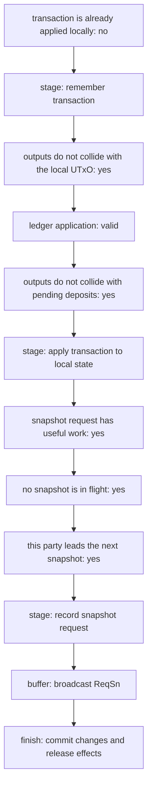
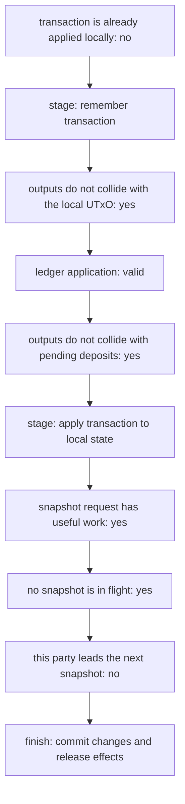
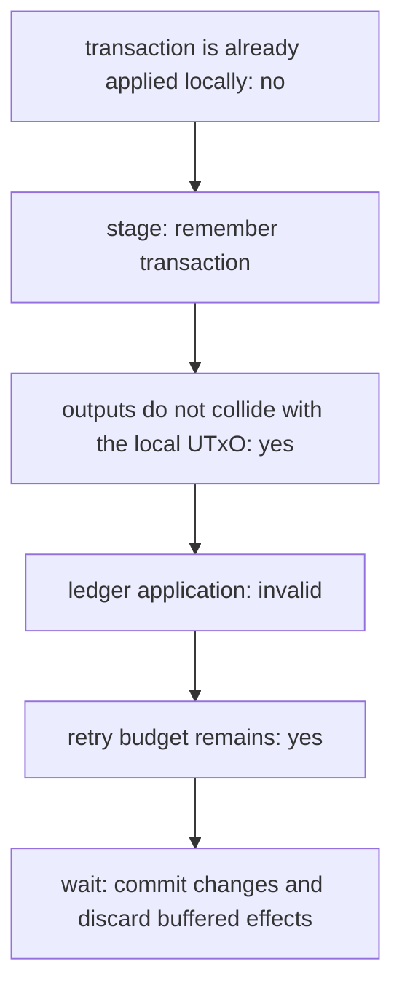
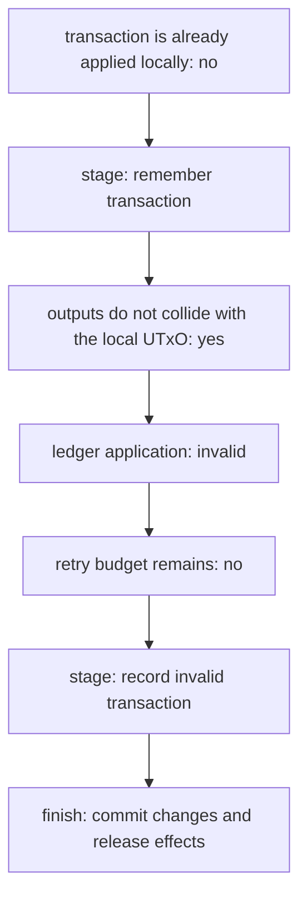
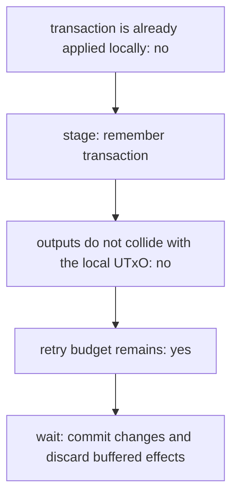
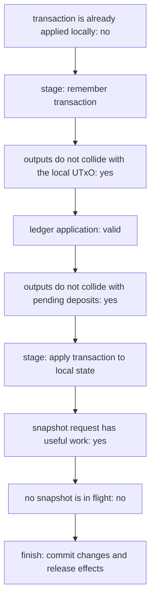

# Head logic: concrete ReqTx executions

These diagrams come from interpreting the actual `onOpenNetworkReqTxProgram`
with the simple test ledger. Each diagram covers one concrete input; unvisited
branches are outside its scope. Every generated run checks its complete outcome
against the frozen migration baseline.

Regenerate this page and its `.mmd` files with:

```sh
cabal bench hydra-node:head-logic-program --benchmark-options='--trace docs/docs/dev/architecture/head-logic-traces'
```

## leader success



## follower



## wait



## timeout



## output collision



## snapshot in flight


