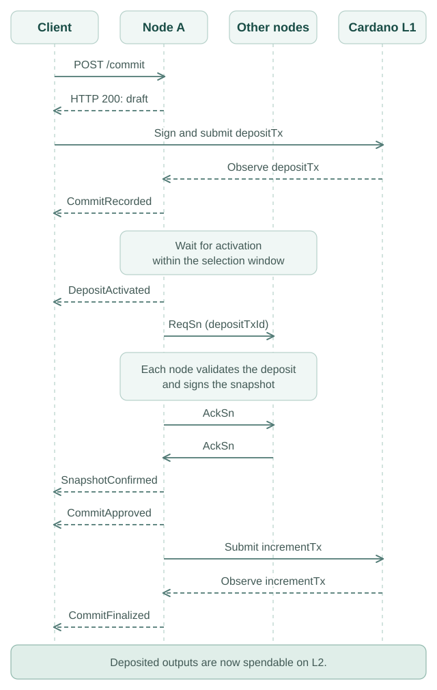
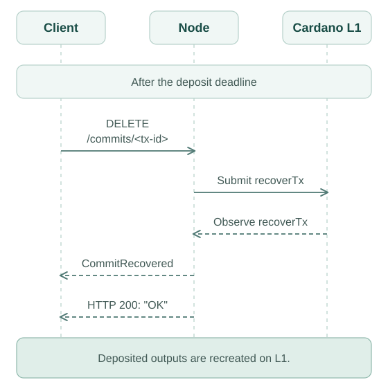
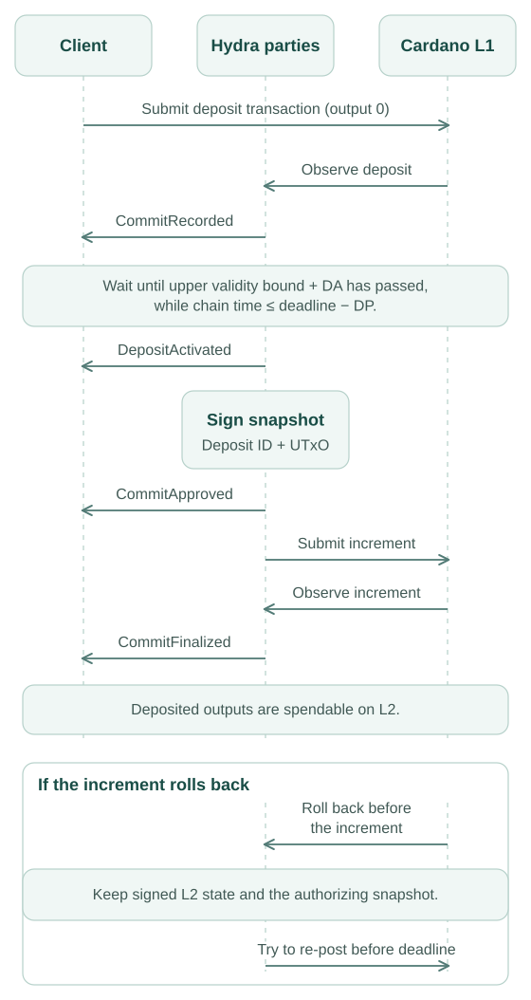
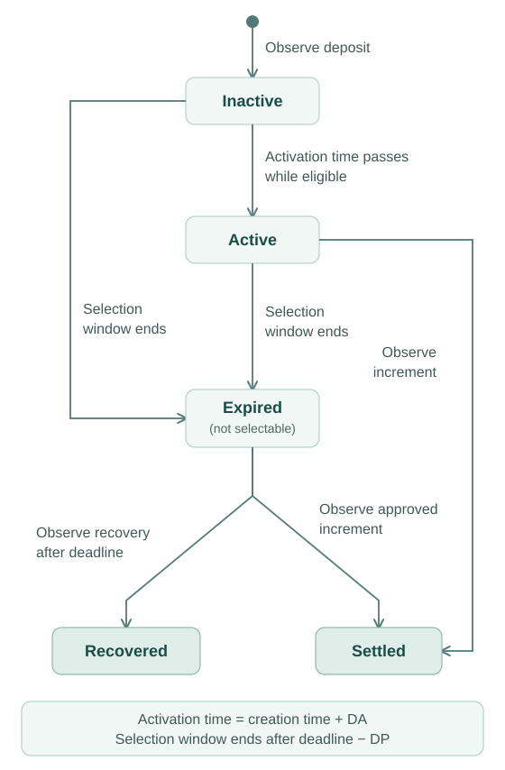
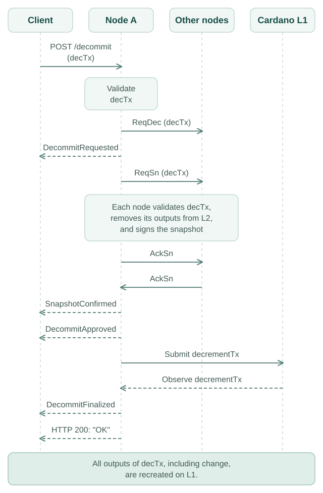

# Protocol

Implementation details of the Hydra Head protocol, including deposits,
decommits, and snapshot settlement.

## Implementation modules

`Hydra.HeadLogic` dispatches inputs and re-exports the handlers below. These module boundaries preserve the existing protocol rules and public imports.

| Module | Responsibility |
| --- | --- |
| `Hydra.HeadLogic.Snapshot.Request` | Snapshot proposal construction and leader selection |

## Deposits and decommits

A head opens with an empty UTxO set. Deposits add funds from L1 while the head
is open; decommits return funds to L1. A snapshot can settle one deposit or
one decommit, but cannot carry both.

## Incremental commits

An incremental commit starts with a `depositTx` that locks funds at the
deposit script. An `incrementTx` then adds them to the head. A deposit that
cannot be claimed can be recovered after its deadline, subject to the
[rollback restrictions](./rollbacks/index.md).

### Deposit flow

`POST /commit` returns a draft deposit transaction with the node's wallet
witness. The client adds the required owner signatures and submits it to L1.
See [deposit request forms](./commit.md).

The deposit and decommit diagrams show successful flows in which the client's
node, Node A, leads the next snapshot. Leadership rotates between parties;
any participant can submit the resulting increment or decrement. `ReqSn`,
`ReqDec`, and `AckSn` are broadcasts to all parties, including the sender.
The diagrams show one exchange with the other nodes and notifications to one
client. Named API events such as `CommitRecorded` are WebSocket notifications;
HTTP responses are labeled separately. Select a diagram to view it at full size.

`ReqSn` identifies the deposit by its transaction ID. Each party resolves the
deposited UTxO from its own chain observations and signs a snapshot binding
both the ID and the UTxO. Collecting every party's `AckSn` confirms the
snapshot and approves the commit; observing the increment finalizes it.

### Tracking deposits

When a `hydra-node` observes a deposit transaction, it records the deposit as
pending. A head can have many pending deposits, but a snapshot can claim only
one. The leader selects an eligible deposit while the others remain pending.

A deposit is identified by its `depositTx` transaction ID. The deposit must
be the transaction's **first output**, at index 0: the node drafts it there,
`recoverTx` spends `TxIn depositTxId (TxIx 0)`, and the increment validator
requires that index. The node does not observe deposits at other output indices.

A wallet that moves the deposit output away from index 0 prevents the node
from recording it as pending. `DELETE /commits/<tx-id>` then fails with
`NoMatchingDeposit`. Such funds require a hand-built recovery transaction
that reproduces the recorded outputs after the deposit deadline.

:::info
The node posting the increment pays its L1 fees, regardless of who owns the
deposited outputs on L2.
:::

When the increment is observed, the deposit is marked as settled. The node
retains its lifecycle and authorizing snapshot so it can re-post the increment
after a rollback.

The depositor supplies the output references in the deposit datum. These
references must not overlap with the active UTxO set or any output created by
the snapshot's requested transactions, even if a later transaction in that
request spends it. Leaders and followers enforce the same rule. Transactions,
including decommits, are also rejected if they create an output reference
already present in the UTxO set.

The increment redeemer carries the snapshot's full multisignature. A node
still collecting `AckSn` for that snapshot can verify the on-chain
multisignature and adopt the snapshot as confirmed. A peer withholding its
`AckSn` therefore cannot prevent confirmation once the increment is observed.

Each deposit has a **deposit deadline**. An increment must claim it before
that deadline; recovery is allowed only afterward. Nodes reserve part of
this interval for settlement, as described under [rollback resistance](#rollback-resistance).

### Recover flow

To recover an unclaimed deposit after its deadline, send
`DELETE /commits/<tx-id>` to a node tracking that deposit. The node creates
and submits a `recoverTx`, which recreates the deposited outputs on L1.
Each node tracking the deposit emits `CommitRecovered` when it observes
the recovery.

The diagram shows recovery completing within the HTTP timeout. The request
returns HTTP `200` with `"OK"` once recovery is observed, or HTTP `202` with
`RecoverSubmitted` if the wait times out. A `202` response does not confirm
settlement; continue watching the WebSocket events.

If a finalized increment rolls back while the head remains open, the node
blocks recovery of that deposit with `RecoverBlockedByFinalizedCommit`.
Its outputs already back signed L2 state, so the node attempts to re-post
the increment instead. See [rollback handling](./rollbacks/index.md).

### Rollback resistance

Cardano transactions can be rolled back. A deposit must therefore mature
before an honest party signs a snapshot that claims it.

The **deposit activation** delay (`DA`, default `3600s`) is measured from the
deposit transaction's upper validity bound. The **deposit period** (`DP`) is
agreed by all parties and recorded in the head's on-chain parameters. It
reserves time to settle or re-post an increment before the deposit deadline.
Changing `DP` does not change the default `DA`.

A node updates deposit status as chain time advances. The **activation time**
is the creation time (the deposit transaction's upper validity bound) plus
`DA`. A deposit is active when `creation time + DA < chain time <= deadline - DP`.
It becomes **expired** once `chain time > deadline - DP`, even if it never
became active. Expiry closes the selection window for a new commit; it does
not open recovery. An already approved increment can still settle before the
deposit deadline.

`POST /commit` chooses the deadline as drafting time plus `DA + 2 * DP`.
Because the creation time is a future upper validity bound, activation occurs
later than drafting time plus `DA`. See [configuration](../configuration.md#deposit-activation).

This diagram shows forward progress. A rollback can restore earlier chain
observations, but it does not undo signed L2 state.

The signed snapshot binds the deposit transaction ID as well as the deposited
outputs. Approval alone does not add those outputs to the spendable L2 UTxO.
An observed increment does. If that increment rolls back, the node retains
the signed snapshot and attempts to settle it again. Signed L2 state does not
roll back; see [rollback handling](./rollbacks/index.md) for recovery limits.

A snapshot request carrying a deposit already claimed by the confirmed snapshot still waits while that deposit is locally `Inactive`, including after re-observation following a rollback. A locally `Expired` deposit can still be carried as that same claim, because its increment may still land before the on-chain deadline.

## Incremental decommits

An incremental decommit returns funds from L2 to L1 while the head is open.
Send `POST /decommit` with a **decommit transaction** in the request body.
The node validates it against its local UTxO set and broadcasts `ReqDec`.
The snapshot leader then proposes it in `ReqSn`. Each party validates the
transaction, removes its outputs from the active L2 UTxO, and signs the snapshot.
Once every party has signed, any participant can submit a `decrementTx`.

The decommit transaction must have at least one output. **All of its outputs**
are recreated on L1, including any change output. To leave funds on L2,
split them into separate UTxOs before constructing the decommit transaction.

:::info
The decommit transaction proves that the requester can spend the L2 inputs.
:::

The confirmed snapshot excludes the decommitted outputs from spendable L2
funds. A rollback of the decrement does not make those outputs spendable on
L2 again: the node retains the authorizing snapshot and re-posts the
decrement. See [rollback handling](./rollbacks/index.md).

The diagram shows settlement within the HTTP timeout. `DecommitRequested`
and `DecommitApproved` are intermediate WebSocket events. The HTTP request
returns `200` with `"OK"` after `DecommitFinalized`, or `202` with
`DecommitSubmitted` if the wait times out. A `202` response leaves the
operation pending; watch for `DecommitFinalized` to confirm settlement.

As with increments, the decrement redeemer carries the snapshot's
multisignature. A node still collecting `AckSn` for that snapshot verifies
the multisignature and adopts the snapshot as confirmed when it observes
the decrement.

Until the decrement settles and bumps the head's version, subsequent snapshots
must carry the same pending decommit. Followers reject requests that drop it
or replace it with a deposit: doing so would leave no confirmed snapshot
from which the head could be closed and fanned out after settlement. The
decrement is re-posted with each snapshot carrying it.

A pending commit can eventually be dropped. At the same head version, it
remains in subsequent snapshots until the deposit is recovered or chain time
passes `deadline + DP`. This extra period allows for rollbacks; the earlier
expiry at `deadline - DP` alone does not allow the pending commit to be dropped.

## Closing with a snapshot still collecting signatures

Close and contest redeemers also carry the snapshot's multisignature. A node
still collecting `AckSn` verifies it against the snapshot it signed and adopts
that snapshot as confirmed. It then has the state needed to fan out the head.
The node retains its in-flight snapshot while the head is closed so that it
can also adopt a snapshot confirmed by a later contest.

A node only closes or contests with a snapshot from which it can fan out:
one signed at the current head version, or one version behind whose increment
or decrement bumped the version. Although the head validator would accept a
snapshot one version behind without a pending action, its accumulator would
not match the head, preventing fanout. The node rejects that close or contest;
rejecting a contest preserves the existing closed state.
