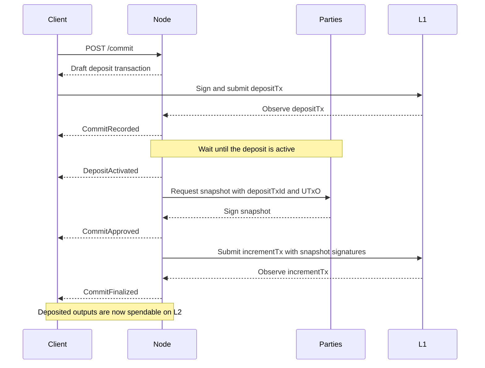
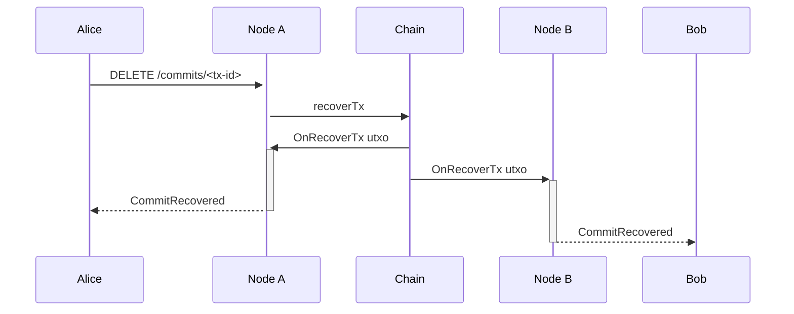
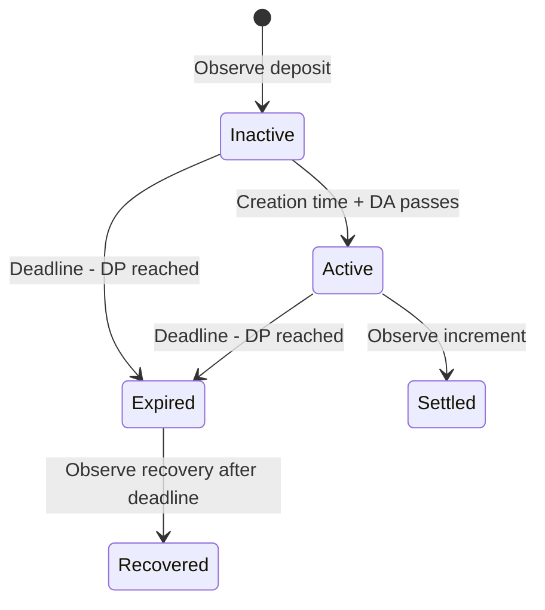
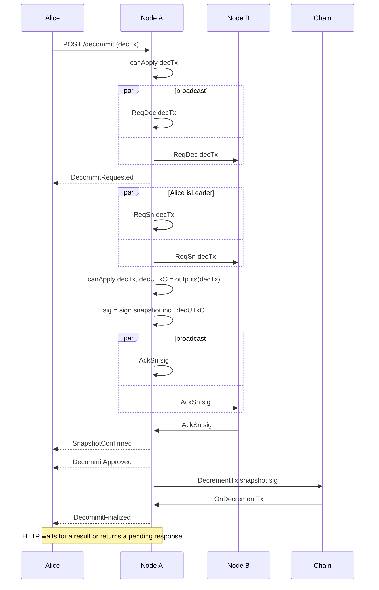

# Protocol

Additional implementation-specific documentation for the Hydra Head protocol and extensions like incremental decommits.

## Deposits and decommits

A head opens with an empty UTxO set. Deposits add funds from L1 while the head
is open; decommits return funds to L1. A snapshot can settle one deposit or
one decommit, but cannot carry both.

## Incremental commits

An incremental commit starts with a `depositTx` that locks funds at the
deposit script. An `incrementTx` then adds them to the head. A deposit that
cannot be claimed can be recovered after its deadline, subject to the
[rollback restrictions](./rollbacks/index.md).

### Deposit flow

`POST /commit` returns a draft deposit transaction with the node's wallet
witness. The client adds the required owner signatures and submits it to L1.
See [deposit request forms](./commit.md).

### Tracking deposits

Once a hydra-node observes a deposit transaction it will record the deposit as pending in its local state. There can be many pending deposits but the new Snapshot will include them one by one.

A deposit is identified throughout by the transaction id of the `depositTx`, which is only unambiguous because the deposit output is that transaction's *first* output. The `hydra-node` drafts deposits that way, `recoverTx` spends `TxIn depositTxId (TxIx 0)`, and the increment validator requires it. A deposit output anywhere else is not observed at all.

Note that the draft returned by `POST /commit` is signed and submitted by the client. A wallet that reorders its outputs moves the deposit off index 0, and the `hydra-node` then never records it as pending, so `DELETE /commits/<tx-id>` fails with `NoMatchingDeposit`. Such funds are only recoverable by a hand-built transaction reproducing the recorded outputs.

:::info
Note that any node that posts increment transaction will also pay the fees even if the deposit will not be owned by them on L2.
:::

When the increment is observed, the deposit is marked as settled. The node retains its lifecycle and the authorizing snapshot so it can re-post the increment after a rollback.

The output references in a deposit datum are supplied by the depositor. A snapshot can claim the deposit only if its references are disjoint from both the active UTxO set and every output created by the requested transactions, including outputs spent later in that request. Leaders select deposits using the same rule that followers validate. The Cardano ledger also rejects transactions, including decommits, that create an output reference already present in the UTxO set.

The increment transaction carries the full multisignature of the snapshot it settles in its redeemer. If a node is still collecting `AckSn` for that very snapshot when it observes the increment, it verifies that multisignature and adopts the snapshot as confirmed. This way a peer that withholds its `AckSn` after completing the multisignature locally cannot leave the other nodes stuck behind an in-flight snapshot they can never confirm.

:::note
Since we can potentially request many deposits, the leader will increment only one of them. While others stay pending. An honest snapshot leader _should_ consider all pending deposit and try to include it in a snapshot.
:::

To avoid potential races between observing the `depositTx` and adding the funds via an `incrementTx` to the Head, each deposit locks up funds until a **deposit deadline**. If that deposit deadline is sufficiently far enough in the future, a `hydra-node` will be picking up the deposit. Users, however, may only [recover](#recover-flow) the funds *after* the deadline has passed.

### Recover flow

If a deposit was not picked up by the head participants, the user can recover their funds _after the deposit deadline_ by sending a `DELETE /commits/<tx-id>` request to the `hydra-node`. This will trigger a `recoverTx` to be created and submitted to the L1 chain.

### Rollback resistance

Cardano transactions can be rolled back. A deposit must therefore mature
before an honest party signs a snapshot that claims it.

The **deposit activation** delay (`DA`, default `3600s`) is measured from the
deposit transaction's upper validity bound. The **deposit period** (`DP`) is
agreed by all parties and recorded in the head's on-chain parameters. It
reserves time to settle or re-post an increment before the deposit deadline.
Changing `DP` does not change the default `DA`.

A node considers a deposit active only after its creation time plus `DA` and
while its deadline remains more than `DP` away. `POST /commit` chooses the
deadline as drafting time plus `DA + 2 * DP`. Because the creation time is a
future upper validity bound, activation occurs later than drafting time plus
`DA`. See [configuration](../configuration.md#deposit-activation).

The signed snapshot binds the deposit transaction ID as well as the deposited
outputs. Approval alone does not add those outputs to the spendable L2 UTxO.
An observed increment does. If that increment rolls back, the node retains
the signed snapshot and attempts to settle it again. Signed L2 state does not
roll back; see [rollback handling](./rollbacks/index.md) for recovery limits.

## Incremental decommits

Incremental decommits allow us to take some L2 `UTxO` and bring it to the L1 while the Head protocol is running.

Users of a Hydra head can request decommits of UTxO from L2 to L1 by sending a `POST /decommit` request with a so-called **decommit transaction** in the request body. Hydra node validates this transaction by applying it to its local `UTxO` set. If it applies, it will broadcast a `ReqDec` message signalling to other parties that we want to produce a new `Snapshot` that contains the same `UTxO` to decommit. The snapshot leader may request such a snapshot and once it is signed by everyone, any of the participant nodes posts a `decrementTx` that will produce a corresponding output on the L1.

:::info
The decommit transaction is necessary to prove to the head participants that the decommitted UTxO can be spent by the requestor.
:::

As the decommit is first decided on the L2 with full consensus, no honest node would approve further spending of funds to be decommitted — so a rollback cannot lead to a double spend of them. A rollback erasing an already observed `decrementTx` still needs handling though: the node retains the signed snapshot that authorized the decrement and re-posts the transaction should a rollback erase it, see [rollbacks](./rollbacks) for details.

As with increments, the decrement redeemer carries the settled snapshot's multisignature, and a node still collecting `AckSn` for that snapshot adopts it as confirmed upon observing the decrement.

A snapshot request at the version of a confirmed snapshot that is still settling a decommit must carry that decommit again. Followers reject a request that drops it, or claims a deposit in its place, since the decommitted outputs would otherwise be in no confirmed snapshot once the decrement lands, and the head could no longer be closed and fanned out from a snapshot the honest nodes hold. A pending commit is dropped only once its increment can no longer land; a pending decommit never is, as the decrement is posted again with every snapshot carrying it.

## Closing with a snapshot still collecting signatures

Close and contest redeemers carry the multisignature of the snapshot they use too. A node still collecting `AckSn` for the snapshot a head gets closed or contested with verifies that multisignature over the snapshot it signed itself and adopts it as confirmed. The closed head then commits to a snapshot the node knows, so it can fan out the head rather than depending on the peer that completed the multisignature. The node keeps the snapshot it was collecting signatures for while the head is closed, for a contest that arrives later.

A node only closes or contests with a snapshot the head could be fanned out from: one signed at the head's current version, or one version behind whose own increment or decrement bumped the version. A snapshot without a pending action that is one version behind would be accepted by the head validator, but the accumulator stored with it does not match the head, so the closed head could never be fanned out. Refusing such a contest leaves the close in place, which may well be fanned out.
