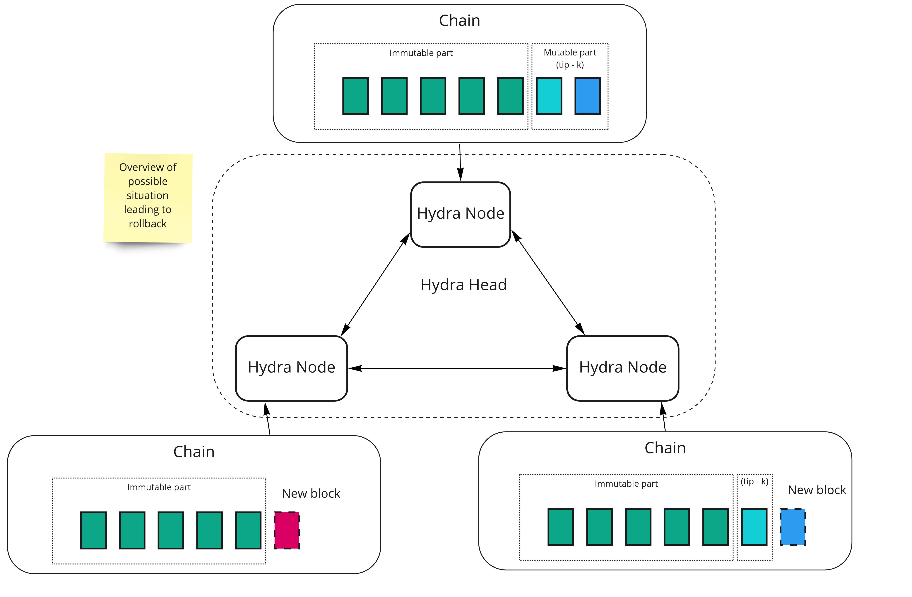
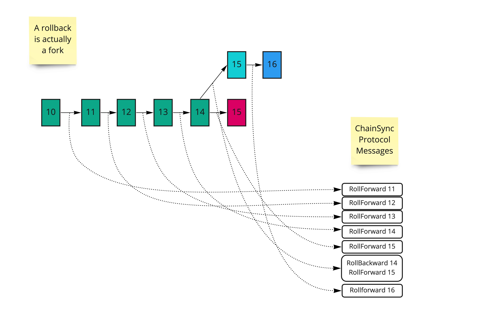
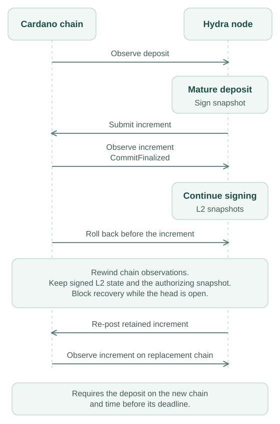

# Handling rollbacks

Rollbacks are fundamental to the operation of the Cardano chain. Any application built on Cardano, including Hydra, must anticipate occasional rollbacks, which are reversals of confirmed transactions due to chain reorganization or other consensus adjustments.

This document provides an overview of rollbacks, their origins, and details how Hydra heads manage them.

## Understanding rollbacks

Rollbacks occur on the Cardano chain, and other decentralized blockchains, due to its _asynchronous_ nature. Each node maintains its own view of the chain's state, updating it through communication with other nodes. This process involves exchanging messages about known blocks, which can lead to new blocks being produced that may be valid or invalid. As a result, the chain's state is _eventually consistent_, with all nodes agreeing on its state after processing a certain number of blocks.

A rollback occurs when a node switches to a different chain fork. Consider three nodes running a Hydra head. The following diagram illustrates each node's view of the layer 1 chain.

Under Cardano's settlement assumptions, the _immutable part_ is shared by synchronized nodes, extending `k` blocks in the past from the current _tip_ (on the mainnet, `k` is 2160). Here's an example scenario: node 2 receives a new block identical to node 1's view, but node 3 receives a different one. Eventually, because node 3's chain is shorter than the others, it will be superseded by a longer chain, resulting in a rollback.

The impact on the node's _direct chain_ observer is detailed in the following diagram:

When new blocks become available, the `ChainSync` client receives a `RollForward` message for each new block. In the event of a fork, it first receives a `RollBackward` message indicating a _point_ that identifies the slot and block hash where the rollback occurred (represented as a single number in the figure). After this rollback point, the client resumes receiving new blocks through `RollForward` messages.

## How do rollbacks impact the Hydra node?

Rollbacks pose challenges because when a transaction is observed on-chain, it can alter the state of the head in several stages: opening it via `Init`, observing deposits and increments (`DepositRecorded`/`CommitFinalized`), and ultimately _closing_ it and _fanning out_ the head's final UTXO.

The following diagram shows an increment being re-posted after a rollback,
while the node retains its signed L2 state:

The `Direct` chain component forwards rollbacks to `HeadLogic`. The node restores
its chain observer state and rewinds deposit recording/consumption slots. It does
not restore a historical Head state: lifecycle phases, signed snapshots and
snapshot versions remain unchanged. In particular, undoing a `Close` observation
does not reopen the Head in the node.

## How do we handle them?

The guiding principle is that layer 2 state never rolls back: snapshots and their signatures are irrevocable, so the node instead makes sure layer 1 eventually converges with what layer 2 already agreed on. The chain observer view and deposit recording/consumption slots are rewound. This does not cover every state change caused by a chain observation.

For deposits and incremental commits/decommits while the head is open, this works as follows:

- The node tracks each deposit with the slots its deposit transaction and (once settled or recovered) its consuming transaction were observed at. On a rollback it rewinds this view to the rolled-back slot: a deposit whose deposit transaction was rolled back stops being tracked (until re-observed on the new chain), and a deposit whose consuming transaction (increment or recover) was rolled back becomes pending again.

- Once a deposit becomes Active or Expired, receiving a chain tick with an earlier timestamp does not reset it to Inactive.
  - If a rollback removes the deposit transaction itself, the node removes the deposit from its records.
  - If the transaction appears on-chain again, the node records it as Inactive and waits for its activation delay before making it Active.

- When an increment or decrement transaction settles on-chain (`CommitFinalized`/`DecommitFinalized`), the node retains the signed snapshot that authorized it, together with the slot the settlement was observed at. If a later rollback reaches past that slot, the settling transaction was erased from the chain and the node re-posts it from the retained snapshot. This also covers the case where newer snapshots were confirmed in the meantime (see [#2741](https://github.com/cardano-scaling/hydra/issues/2741)).

- A deposit whose finalized increment was rolled back is *only* eligible for that re-post: while the head is open it cannot be recovered (its funds are already accounted for in the head, so an on-chain recover would corrupt the layer 2 ledger) and it is never proposed for a new snapshot (the already-signed snapshot claims it) — a snapshot request claiming it anyway is rejected. Once the head closes this changes: an increment can only settle into an open head, so the retained snapshot can never claim the deposit anymore and recovering it (after its deadline) becomes the escape hatch, together with excluding the deposited outputs from the fanout via a partial fanout.

- If the rollback erased the deposit transaction itself, the re-posted increment cannot land (the deposit UTxO does not exist on the new chain yet). The node re-posts the increment again when it observes the deposit transaction re-landing on the new chain.

If the settling transaction is re-observed on the new chain — whether it survived the fork, was re-included from the mempool, or was re-posted by any party — the corresponding state transition applies idempotently and the head continues as normal.

:::warning

The node retains only the latest finalized settlement of each kind. A rollback
spanning older settlements, an increment whose deposit deadline prevents
re-posting, or a rollback of `Init` can leave it unable to recover automatically.
The deposit period must cover the assumed rollback depth and re-posting time.

Close, Contest and partial/final fanout observations are not undone. In
particular, the node does not reconstruct fanout progress against a divergent
chain. A retained Finalized Head stays Finalized. These cases need recovery
outside this mechanism; closing is only an option while the on-chain Head is
still Open. Checkpoint recovery after a restart restores persisted state and is
separate from chain rollback handling.
:::

For the earlier design decisions, see [ADR-23](/adr/23). The behavior above describes the current implementation.
