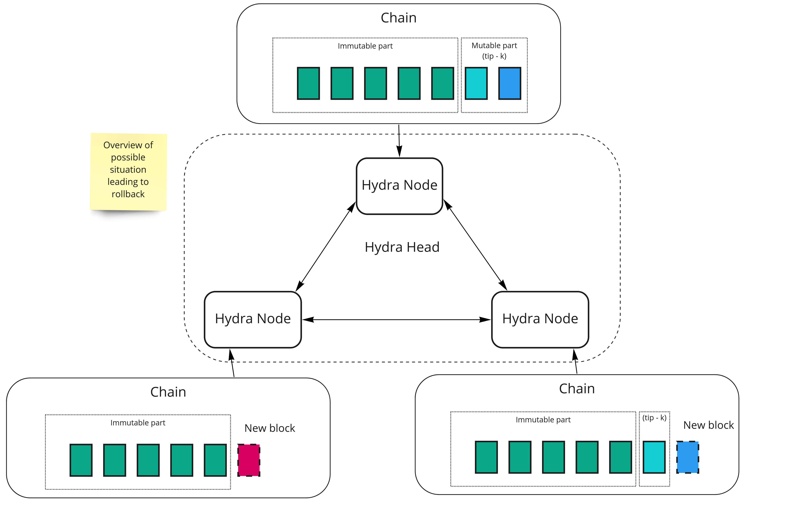
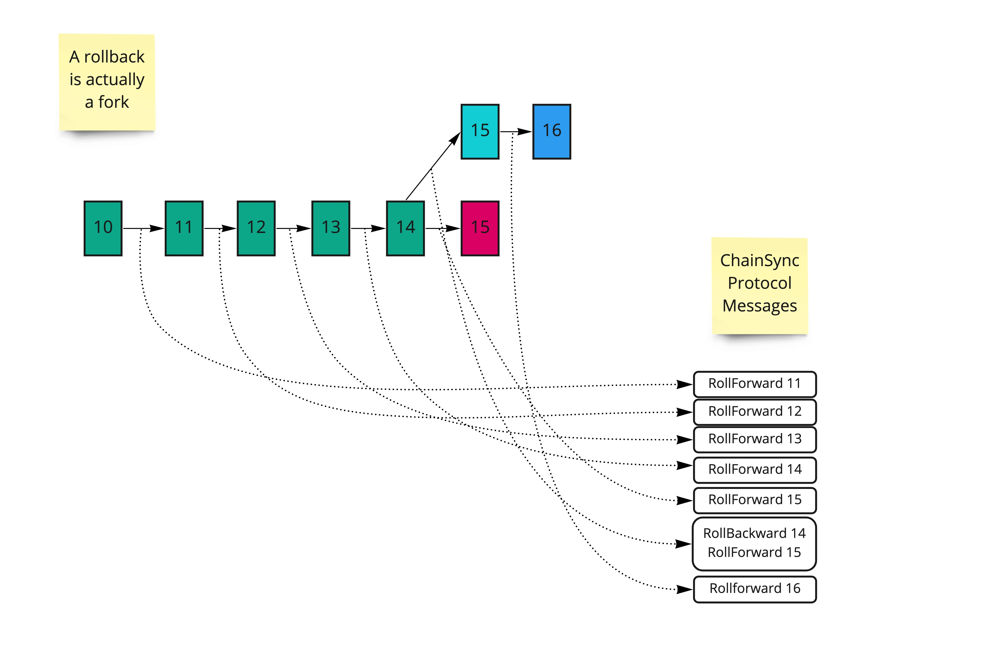
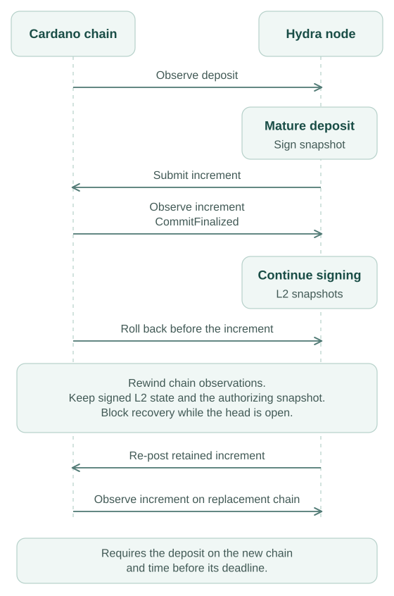

# Handling rollbacks

Rollbacks are fundamental to the operation of the Cardano chain. Any application built on Cardano, including Hydra, must anticipate occasional rollbacks, which are reversals of confirmed transactions due to chain reorganization or other consensus adjustments.

This document provides an overview of rollbacks, their origins, and details how Hydra heads manage them.

## Understanding rollbacks

Rollbacks occur on the Cardano chain, and other decentralized blockchains, due to its _asynchronous_ nature. Each node maintains its own view of the chain's state, updating it through communication with other nodes. This process involves exchanging messages about known blocks, which can lead to new blocks being produced that may be valid or invalid. As a result, the chain's state is _eventually consistent_, with all nodes agreeing on its state after processing a certain number of blocks.

A rollback occurs when a node switches to a different chain fork. Consider three nodes running a Hydra head. The following diagram illustrates each node's view of the layer 1 chain.

Under Cardano's settlement assumptions, the _immutable part_ is shared by synchronized nodes, extending `k` blocks in the past from the current _tip_ (on the mainnet, `k` is 2160). Here's an example scenario: node 2 receives a new block identical to node 1's view, but node 3 receives a different one. Eventually, because node 3's chain is shorter than the others, it will be superseded by a longer chain, resulting in a rollback.

The impact on the node's _direct chain_ observer is detailed in the following diagram:

When new blocks become available, the `ChainSync` client receives a `RollForward` message for each new block. In the event of a fork, it first receives a `RollBackward` message indicating a _point_ that identifies the slot and block hash where the rollback occurred (represented as a single number in the figure). After this rollback point, the client resumes receiving new blocks through `RollForward` messages.

## How do rollbacks impact the Hydra node?

Rollbacks pose challenges because when a transaction is observed on-chain, it can alter the state of the head in several stages: opening it via `Init`, observing deposits (`CommitRecorded`/`CommitFinalized`), and ultimately _closing_ it and _fanning out_ the head's final UTXO.

The following diagram shows an increment being re-posted after a rollback,
while the node retains its signed L2 state:

If the head does not properly handle the rollback, it risks becoming inconsistent with other nodes participating in the head. Therefore, any rollback observed at the `Direct` chain component level must be promptly communicated to the `HeadLogic`. This ensures that the `HeadLogic` can reset its state to maintain consistency with the changes on layer 1.

The consequences of a rollback on the head's state vary depending on when the rollback occurs:

1. If the rollback occurs before or after the head is opened – for example, before the `Init` transaction or after the `Close` – the resolution is relatively straightforward: the head's state can be reset to the point it was at before the rolled-back transaction was observed.

2. If the rollback occurs while the head is open – for instance, if a deposit or `Close` transaction is rolled back – it poses greater challenges. At this point, the node has already begun exchanging messages with its peers, and its state no longer depends solely on the blockchain.

## How do we handle them?

The guiding principle is that layer 2 state never rolls back: snapshots and their signatures are irrevocable, so the node instead makes sure layer 1 eventually converges with what layer 2 already agreed on. Only layer 1 derived state is rewound.

For deposits and incremental commits/decommits while the head is open, this works as follows:

- The node tracks each deposit with the slots its deposit transaction and (once settled or recovered) its consuming transaction were observed at. On a rollback it rewinds this view to the rolled-back slot: a deposit whose deposit transaction was rolled back stops being tracked (until re-observed on the new chain), and a deposit whose consuming transaction (increment or recover) was rolled back becomes pending again.

- When an increment or decrement transaction settles on-chain (`CommitFinalized`/`DecommitFinalized`), the node retains the signed snapshot that authorized it, keyed by the version it was based on, together with the slot the settlement was observed at. Retained snapshots are dropped once no rollback can reach them anymore, after observing `k` descendant blocks on the followed chain (`k` is the security parameter read from genesis). Elapsed slots alone do not establish immutability. After restart the node conservatively waits for fresh descendants before pruning. If a later rollback reaches past the observed slot, the settling transaction was erased from the chain and the node re-posts it from the retained snapshot. This also covers the case where newer snapshots were confirmed in the meantime (see [#2741](https://github.com/cardano-scaling/hydra/issues/2741)).

- A rollback can erase several settlements at once. They are then re-posted one at a time, in version order: the chain only accepts the lowest one, because each settlement bumps the on-chain version by one. The node posts nothing at rollback time; on each following block it posts the lowest erased settlement that can land (an increment only once its deposit is back on chain) until it observes it landing again, then moves on to the next. This gives the first block of the new fork the chance to bring the transaction back by itself, which a fork built from the same mempool usually does, retries a post that failed, and lets a restarted node resume from its persisted state. If the rollback erased no settled increment or decrement, but one was still in flight, that one is re-posted at rollback time instead.

- A deposit whose finalized increment was rolled back is *only* eligible for that re-post: while the head is open it cannot be recovered (its funds are already accounted for in the head, so an on-chain recover would corrupt the layer 2 ledger) and it is never proposed for a new snapshot (the already-signed snapshot claims it) — a snapshot request claiming it anyway is rejected. This holds for the deposits of every retained increment, not only the most recent one. Once the head closes this changes: an increment can only settle into an open head, so the retained snapshot can never claim the deposit anymore and recovering it (after its deadline) becomes the escape hatch, together with excluding the deposited outputs from the fanout via a partial fanout.

- If the rollback erased the deposit transaction itself, the re-posted increment cannot land (the deposit UTxO does not exist on the new chain yet). The node re-posts the increment again when it observes the deposit transaction re-landing on the new chain.

- A partial fanout in progress is rewound the same way. Each landed step is recorded with the slot it was observed at and the fanout mode it replaced. A rollback drops the steps past the rolled-back slot, so the erased steps' outputs count as still in the head again, the driver's mode goes back to what it was before them (an erased selection is the node's to distribute again; a passive observer keeps waiting), and the driver posts the next step from that rewound progress rather than from bookkeeping the chain no longer matches.

The opaque `Settlements` type in `Hydra.HeadLogic.Settlements` holds the retained settlement map and its cached deposit IDs. Callers read these through accessors and update them through operations that maintain the cache. Retaining or pruning entries updates the cache; rollback and re-landing preserve the claims. The cache is rebuilt from the entries on restart and does not change the persisted format.

The coordinated head state writes this map under the CBOR tag `CoordinatedHeadState3`. It still reads `CoordinatedHeadState2`, migrating its optional finalized commit and decommit snapshots with their signatures and observation slots as `Landed` entries. The original `CoordinatedHeadState` layout has no retained settlements and decodes with an empty map. Migration cannot recover older settlements or rollback status that the previous layout does not record. On startup, replaying the persisted state events reconstructs settlement status, including rollbacks.

Before retaining the current confirmed snapshot on a settlement observation, the node checks both its version and its action: the deposit ID for an increment, or the distributed output contents and counts for a decrement. Decrement matching ignores output references, which the chain observer relabels. An older snapshot at the same version may carry a recovered deposit instead. If the settling snapshot is still collecting signatures locally, its later confirmation fills the retained entry; the unrelated snapshot must not occupy that entry first. Re-observing a retained settlement still updates its landed slot even when the current confirmed snapshot has moved on.

A deposit can belong to only one retained version. Checked insertion rejects a claim already held by another version and keeps an existing entry for the same version unchanged. Decoding also checks that each map key matches its snapshot version. If an event introduces a conflicting claim, live processing reports an error and leaves the whole update unapplied, including its events and effects. Replay stops with the conflicting event's ID instead of continuing with an incomplete state. API projections and log rotation use the same checked aggregation.

If the settling transaction is re-observed on the new chain — whether it survived the fork, was re-included from the mempool, or was re-posted by any party — the corresponding state transition applies idempotently and the head continues as normal.

:::warning

🛠 Some rollback scenarios while the head is open remain out of scope of this mechanism: an increment that can no longer be re-posted because the deposit deadline passed (the deposit period must be sized to cover worst-case rollback depth plus re-posting time), a settlement whose deposit transaction is gone from the new chain for good, so it can never land again, or a rollback of the `Init` itself. These can lead to a head becoming stale, and the head will need to be closed.
:::

For the earlier design decisions, see [ADR-23](/adr/23). The behavior above describes the current implementation.

## Testing chain ordering

The model's mock chain updates the chain and queues its events under one shared lock. Each node has its own queue and delivers events in order, outside that lock. Each node processes the original blocks first, then the rollback that removes them, and finally the replacement blocks. Tests can pause one node while another follows the replacement chain. Reconnecting nodes queue catch-up events before live events, preserving the same order during replay.
