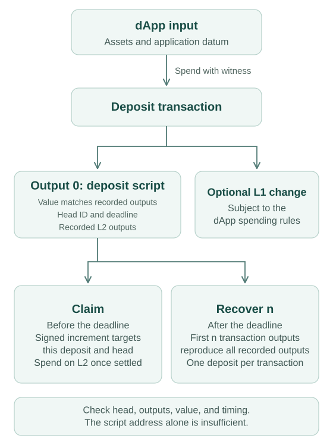

# Deposit from a dApp

A dApp can move funds from a Cardano script into an open Hydra head using a
[blueprint transaction](./commit-script-utxo.md). The dApp's validator must
check where those funds go. A transaction drafted by `hydra-node` still needs
these checks: another transaction author can bypass the node entirely.

## Transaction structure

[](./deposit-process.svg)

The first output of a deposit transaction locks the deposited value at the
Hydra deposit script. Its inline datum contains:

- The target Head ID (the head token policy ID).
- The recovery deadline, expressed as POSIX time in milliseconds.
- The output references and serialized outputs to make available on L2.

The deposit output's value must equal the total value recorded in the datum.
The transaction needs a finite upper validity bound, which the node uses as
the deposit's creation time. Keep the deposit at output index zero when adding
wallet signatures; the node identifies it by its transaction ID.

Blueprint outputs determine the outputs deposited into the head. With no
blueprint outputs, the node preserves the supplied input UTxO instead. With
explicit outputs, their references use the blueprint transaction ID. Use
`changeAddress` to return any remaining input value on L1. See the
[deposit variants](./incremental-commit.md).

## Checks in the dApp validator

The exact checks depend on the dApp's spending rules. For a transition that
preserves the dApp's funds and state in a particular head, verify:

1. Output zero uses the expected deposit script address and an inline datum
   with the expected structure.
2. The datum targets the intended Head ID. Checking the script hash alone
   does not identify a head: many heads use the same deposit validator.
3. The recorded outputs preserve the required assets, ownership, datum, and
   application state. In particular, paying an L2 output to a user's key
   releases it from the original dApp script's control.
4. The deposited value matches the recorded outputs. Account for each dApp
   input exactly once, and reject duplicate or ambiguous output references.
5. The deadline and validity bounds meet the application's recovery policy.
   Check any required signers and restrictions on L1 change as well.

Do not treat these checks as a complete validator implementation. Test the
application's invariants against wrong heads, substituted datums, diverted
assets, duplicate inputs, and altered output order. The
[deposit constructor](https://github.com/cardano-scaling/hydra/blob/master/hydra-tx/src/Hydra/Tx/Deposit.hs)
and [deposit validator](https://github.com/cardano-scaling/hydra/blob/master/hydra-plutus/validators/deposit.ak)
define the current encoding and transaction constraints.

Obtain script hashes from the exact node version used by the head:

```shell
hydra-node --hydra-script-catalogue
```

Obtain the Head ID from `HeadIsOpen` or `Greetings` on the
[API](../api-behavior.md), rather than reading internal persistence files.

## Claiming and recovering

A deposit becomes eligible after its activation delay. All parties must sign
a snapshot binding the deposit transaction ID and deposited outputs. The
`Claim` redeemer allows an increment to consume that specific deposit before
its deadline and add its value to the intended head. Wait for
`CommitFinalized` before spending the deposited outputs on L2.

After the deadline, `Recover n` requires the transaction's first `n` outputs
to reproduce the recorded outputs in reference order. Only one deposit may
be recovered per transaction. Recovery preserves the recorded outputs, which
need not be identical to the original inputs when a blueprint changes them.

The node also protects deposits already accounted for in signed snapshots.
See [deposit recovery](./incremental-commit.md#recover-a-deposit) and
[rollback handling](../dev/rollbacks/index.md) for the restriction on recovering
a finalized deposit whose increment rolled back while the head remains open.
