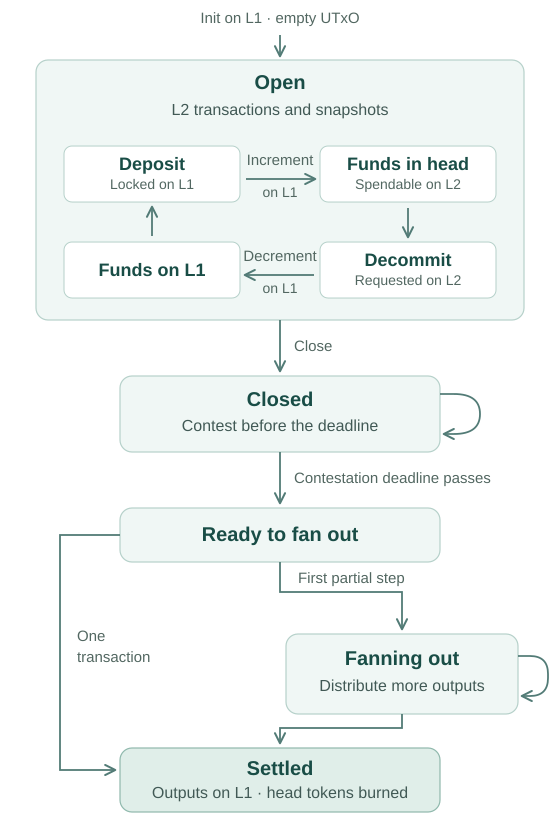

# Protocol overview

A Hydra head is a state channel between a fixed group of parties. Each party
runs a node, validates L2 transactions, and signs snapshots of the agreed
state. Multiple heads can operate independently alongside Cardano.

Hydra reuses Cardano transaction formats and script validation. Head-specific
ledger parameters can remove L2 fees, but outputs must remain compatible with
L1 settlement. Staking, governance, and L1 consensus are outside the head.
See [ledger parameters](./configuration.md#ledger-parameters) and
[known limitations](./known-issues.md).

## Hydra head lifecycle

1. **Open.** `Init` on L1 opens the head with the agreed parties, protocol
   parameters, and an empty UTxO set. Parties validate L2 transactions and
   confirm snapshots. To add funds, users **deposit** on L1; after maturation
   and approval by all parties, an **increment** makes them spendable in the
   head. To withdraw, a **decommit** request on L2 receives the parties'
   approval, then a **decrement** returns its outputs to L1. Both processes
   can repeat while the head stays open.
2. **Closed.** Any party can submit `Close` using its latest confirmed snapshot.
   Parties must retain signed snapshots and monitor L1 to contest an outdated
   snapshot before the contestation deadline. A contest keeps the head closed.
3. **Ready to fan out.** Once the deadline passes, outputs can return to L1.
   `Fanout` requests all outputs; `PartialFanout` selects which to distribute.
   A fanout of the whole head that fits in one transaction goes directly to
   **Settled**.
4. **Fanning out.** When distribution takes several transactions, each partial
   step returns more outputs to L1. After `Fanout`, the initiating node
   continues automatically. With selective fanout, parties issue further
   `PartialFanout` commands for the remaining outputs.
5. **Settled.** The final transaction distributes the remaining outputs and
   burns the head tokens. The node emits `HeadIsFinalized`.

L2 confirmation depends on validation, network communication, and signatures
from every party. L1 operations have separate confirmation and settlement
requirements. Total fanout cost depends on the outputs being distributed;
partial fanout does not remove the size or minimum-ADA constraints on each
individual output.

See the [testnet tutorial](./tutorial/index.md) for a complete workflow,
[protocol details](./dev/protocol.md) for deposits and rollbacks, and
[selective fanout](./how-to/selective-fanout.md) for settlement controls.
The [original research paper](https://eprint.iacr.org/2020/299.pdf) provides the
research background; the [current specification](./dev/specification.md)
describes the implemented protocol.
