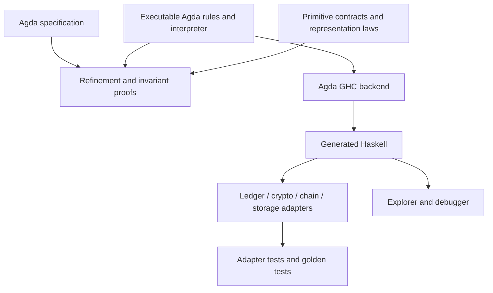

# Generating head logic from Agda

This is a proposal. The spike still implements the rules in Haskell and compares
selected behavior against an independent Agda reference. It does not generate
production head logic from Agda.

The proposal is to generate all protocol decisions and state transitions from
Agda. Handwritten Haskell would provide ledger, cryptographic, networking and
storage operations. This must include aggregation, rollback and recovery:
generating only the three message handlers would leave protocol decisions in
Haskell.

## Division of work

| Responsibility | Proposed implementation | Current code |
| --- | --- | --- |
| Guards, snapshots, transaction ordering, deposit/decommit selection and effects | Agda rules | [HeadLogic.hs](../hydra-node/src/Hydra/HeadLogic.hs): the three `onOpenNetwork…Program` functions and their helpers |
| Completion, waiting, rejection and effect buffering | Agda interpreter | [Interpreter.hs](../hydra-node/src/Hydra/HeadLogic/Interpreter.hs): `evaluateChanges` |
| Event application, chain observations, rollback and recovery | Agda transition functions | [HeadLogic.hs](../hydra-node/src/Hydra/HeadLogic.hs): `aggregateNodeState`, `aggregateState`, `applyEvent` and chain handlers |
| Whether to retry an input, and with which budget | Agda retry policy | [Retry.hs](../hydra-node/src/Hydra/HeadLogic/Retry.hs): `retryDecision` |
| Ledger application, hashing, signing and verification | Haskell implementations of Agda primitives | [Program.hs](../hydra-node/src/Hydra/HeadLogic/Program.hs): `Instruction`; [Interpreter.hs](../hydra-node/src/Hydra/HeadLogic/Interpreter.hs): configuration and primitive calls |
| Serialisation, sockets, persistence and queue execution | Haskell adapters | [Node.hs](../hydra-node/src/Hydra/Node.hs), message/event codecs and chain components |

This includes all Head phases and incremental commits/decommits. Choosing to
increment, decrement, close, contest or retry belongs in Agda. Building the chosen
Cardano transaction can remain in Haskell, subject to a contract relating that
transaction to the requested action.

## Specification and executable rules

The [literate specification](../spec/src/Hydra/Protocol/OffChain.lagda.typ) defines
relations and properties over abstract ledger and cryptographic operations. It
is not a complete executable node. [OffChainReference.agda](../spec/src/Hydra/Protocol/OffChainReference.agda)
already extracts to Haskell, but covers only selected behavior.

Keep the abstract specification and add executable Agda functions for the rules,
including the order of guards, event payloads, effects, waits and errors. Prove
that their transitions satisfy the specification and preserve its invariants.
The specification would also need to account for implementation details such as
finite retries, repeated inputs and rollback.



Each handler terminates for one input. It can recurse over finite transaction
lists; waiting returns control to the scheduler. Termination of a handler says
nothing about whether a transaction eventually confirms.

## Example rule

The following is pseudocode, not compiling Agda. Sequencing combinators and some
types are omitted:

```agda
data Query : Set → Set where
  applyTx : Slot → UTxO → Tx → Query (Either ValidationError UTxO)
  sign    : Snapshot → Query Signature
  verify  : List VerificationKey → MultiSignature → Bytes → Query Verified

data Program (A : Set) : Set where
  done     : A → Program A
  query    : {R : Set} → Query R → (R → Program A) → Program A
  stageOp  : Change → Program A → Program A
  emitOp   : Effect → Program A → Program A
  decideOp : Label → Bool → (Bool → Program A) → Program A
  wait     : WaitReason → Program A
  reject   : LogicError → Program A

reqTx context tx =
  if alreadyApplied context tx then done tt else do
    stage (transactionReceived tx)
    result ← checkOutputsThenApply context.slot context.localUTxO tx
    case result of λ where
      (left err) → invalidOrWait context tx err
      (right after) →
        if freshAgainstDeposits context tx
        then stage (appliedTransaction tx context.localUTxO after)
             >> requestNextSnapshotIfLeader context tx
        else invalidOrWait context tx depositCollision
```

`alreadyApplied`, collision checks, `invalidOrWait` and snapshot selection would
all be Agda definitions. Only ledger application calls the ledger primitive.
Moving a guard into a Haskell primitive such as `validateSnapshot` would leave
that protocol decision outside the proof.

For `AckSn`, the interpreter must discard the staged signature when aggregate
verification fails. A rejection lemma would prove that no events or effects are
committed. A separate wait lemma would prove that the preceding events survive,
in order, while effects are discarded. These properties belong to the generated
interpreter and apply to every rule.

Tests must compare event order as well as final state. For example, the current
partial-acknowledgement path records `PartySignedSnapshot` twice. A final-state
comparison would miss that difference. Removing it would need a deliberate rule
change, even if the state remains equal.

## Haskell interface

A handwritten module could hide the generated MAlonzo names and convert between
existing node types and generated types:

```haskell
update env ledger state input = do
  kernelInput <- decodeKernelInput state input
  let program = Generated.step kernelInput
      outcome = Generated.run (primitiveHandlers env ledger) program
  encodeCompatibleOutcome outcome

aggregate state events =
  fromKernelState $ Generated.applyEvents (toKernelState state) (toKernelEvents events)

retry input reason =
  fromKernelRetry $ Generated.retryDecision (toKernelInput input) (toKernelWait reason)
```

This is an example interface, not generated code. It converts data and supplies
primitive operations; the generated functions choose protocol behavior. The
signing adapter holds the key. The node, explorer and debugger would use the same
generated rules. The current [debugger](../hydra-node/testlib/Test/Hydra/HeadLogic/Debugger.hs)
shows how a typed continuation can support stepping and controlled replies.

The repository already runs `agda --compile --ghc-dont-call-ghc` in
[regenerate.sh](../hydra-agda/regenerate.sh) and provides a
[Haskell shim](../hydra-agda/src/Hydra/Agda/OffChainReference.hs). The same build
pattern could generate the rules. Pin Agda and GHC, check that generated files
are up to date, and keep edits in the Agda source. Existing network and
`StateChanged` codecs must stay under golden tests: a generated datatype must not
accidentally change persisted CBOR or signed bytes. See Agda's
[compiler](https://agda.readthedocs.io/en/latest/tools/compilers.html) and
[FFI](https://agda.readthedocs.io/en/latest/language/foreign-function-interface.html)
documentation for the extraction mechanism.

## Proofs and assumptions

These are proposed properties, not proofs supplied by the spike:

| Property | Additional assumptions or checks |
| --- | --- |
| Each executable transition satisfies the abstract relation | The relation must constrain errors and waiting as well as successful transitions. |
| Steps preserve the safety invariants | State the initial-state, ledger, crypto and chain assumptions. |
| Rejection commits nothing; waiting commits its event prefix | Storage durability and effect delivery need separate guarantees. |
| Applying recorded events reproduces the state computed by the rule | Check valid event sequences, serialisation and crash recovery. |
| Conversions preserve valid values and reject invalid ones | Cover numeric bounds, map order, duplicate keys and signed bytes. |
| Retry and rollback preserve the relevant state | Progress also needs assumptions about scheduling and the chain. |

A verifier returning `Verified` is not a proof of cryptographic security. Agda
would prove the protocol properties assuming that successful verification means
what its contract says. The Haskell verifier and ledger must implement their
contracts. `COMPILE GHC` mappings do not prove this, and an FFI mapping of natural
numbers must reject negative Haskell values. Agda, its compiler, GHC, the runtime
and foreign implementations remain trusted unless verified separately.

Proof erasure must not remove checks on untrusted input. A postulate cannot
replace runtime validation. The [trust-ledger checker](../spec/check-trust-ledger.sh)
and [Agda notes](./docs/dev/agda.md) identify assumptions and mock bridges in the
current specification.

Tests against the Agda function that generated the Haskell check extraction and
representation. They do not independently check that the specified protocol is
right. Keep separate invariants, old-handler comparisons, persistence goldens
and malformed-input scenarios.

## Migration and maintenance

1. Define the executable state and result, including ordered events/effects,
   errors and waits. Record differences from the abstract specification.
2. Port one handler and the interpreter. Prove the buffer properties and compare
   the extracted code with the current handler. Keep rule fixes distinct from
   extraction changes.
3. Port aggregation and retry policy, then chain observations, rollback and the
   remaining phases. Test serialised recovery after each transition.
4. Run the explorer against the generated rules with independent invariants.
   Recorded replies must still match query identity and arguments.
5. Measure complete rounds, allocations and recovery. Extraction and type
   conversions can add runtime cost; the [spike benchmarks](./docs/dev/architecture/head-logic-benchmark.md)
   provide the initial comparison.

For example, changing a version mismatch from a wait to a rejection would change
one Agda rule, its proofs and test expectations. Regeneration would update the
Haskell. Replaying the scenario would produce the new outcome and diagram without
adding a version check to the Haskell interpreter.

Start with direct extraction. Efficient foreign maps or ledger representations
would need laws and adapter tests. An additional code generator would need its
own correctness argument. The main benefit would be one checked implementation
of the protocol decisions; the ledger, chain and storage contracts would still
need review.
