# Head logic diagrams

Current Crem/Program diagrams are rendered below. Every `.mmd` in the checkout
has a source link and explanation here; archived diagrams have a separate index
at the end. Phase graphs describe permitted transitions; sequence
diagrams describe one execution, with lanes for head logic, ledger,
cryptography, staged changes and buffered effects. Arrows preserve instruction
order; a staged change is retained only if the terminal result allows it.

Start with [Complete snapshot round](#complete-snapshot-round),
[Decommit dependencies and reservation](#decommit-dependencies-and-reservation),
or [Capacity pruning and progress](#capacity-pruning-and-progress).

[Design](head-logic-review.md) · [Tracing commands](head-logic/tools.md)

Generated by `python3 scripts/head-logic-diagrams.py` from the sources and
`docs/head-logic-diagrams.json`. `--check` verifies coverage and freshness.

## Retained-event machines

### Event-machine composition

DepositRegistry → Lifecycle → Clock. Lifecycle holds the open head’s snapshot/transaction continuation, rendered separately. Ports carry owned state projections and the deposit value before consumption.

[Mermaid source](head-logic-machines/composition.mmd)

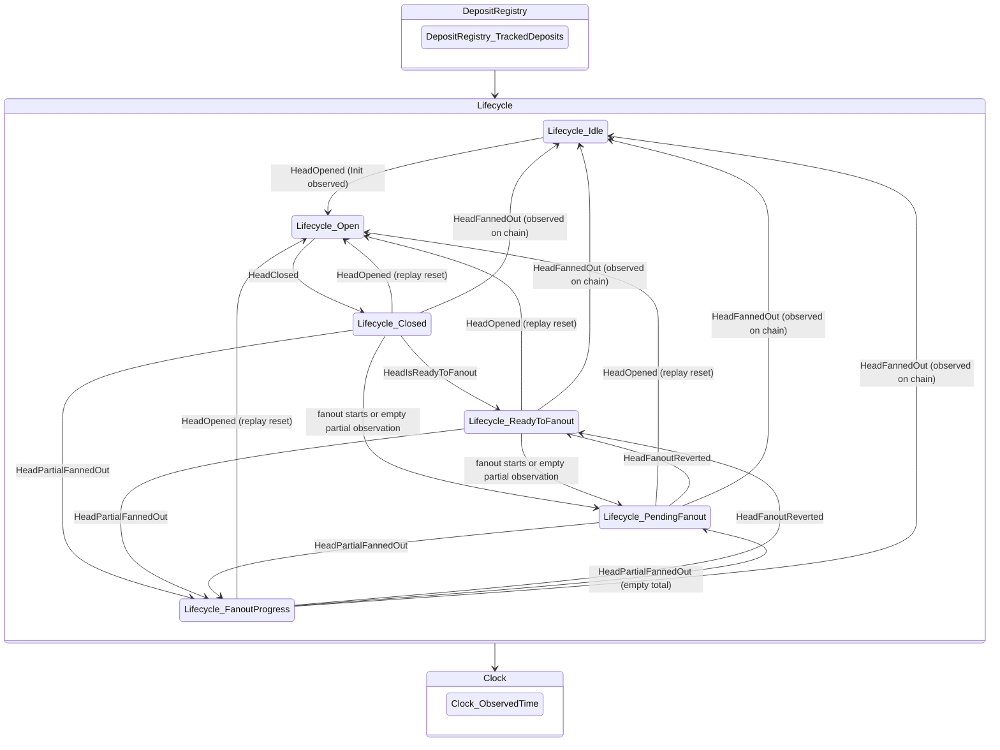

### Head lifecycle

Idle, Open, Closed, ReadyToFanout and fanout progress. Closed or ReadyToFanout can observe another party completing fanout and become Idle.

[Mermaid source](head-logic-machines/lifecycle.mmd)

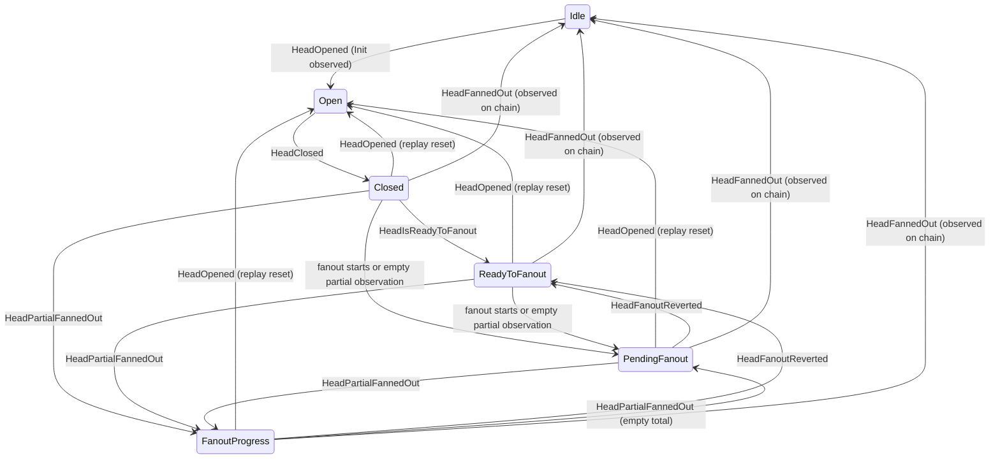

### Tracked deposits

Recorded, active, expired and consumed deposits, including what rollback can restore or remove. Deposit registration is distinct from selection for a snapshot.

[Mermaid source](head-logic-machines/deposits.mmd)

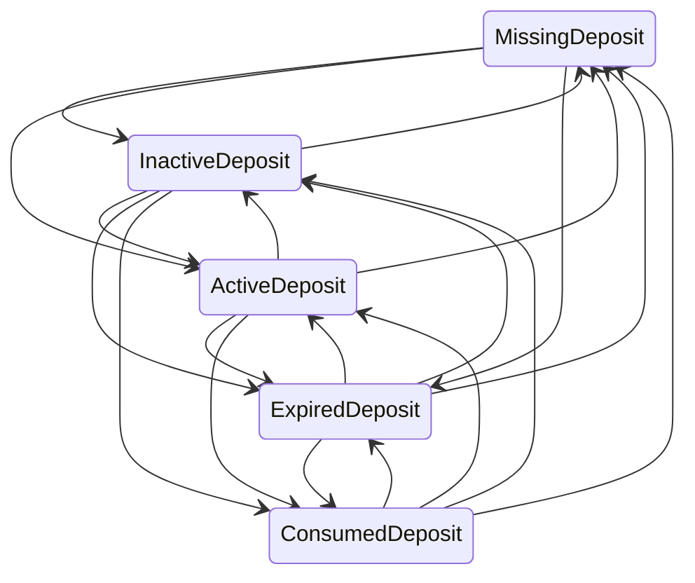

### Snapshot and transaction owners

Generated from the executable Snapshots → Transactions composition. Typed ports carry rebases, settlement and clearing. A fresh decrement releases a reservation; a repeated observation preserves it. Reserved means a decommit is recorded, not that every ledger property holds. Live requests require a checked proposal and start only from AwaitingRequest; the CollectingSignatures to RequestSent edge exists for trusted event replay.

[Mermaid source](head-logic-machines/coordinated.mmd)

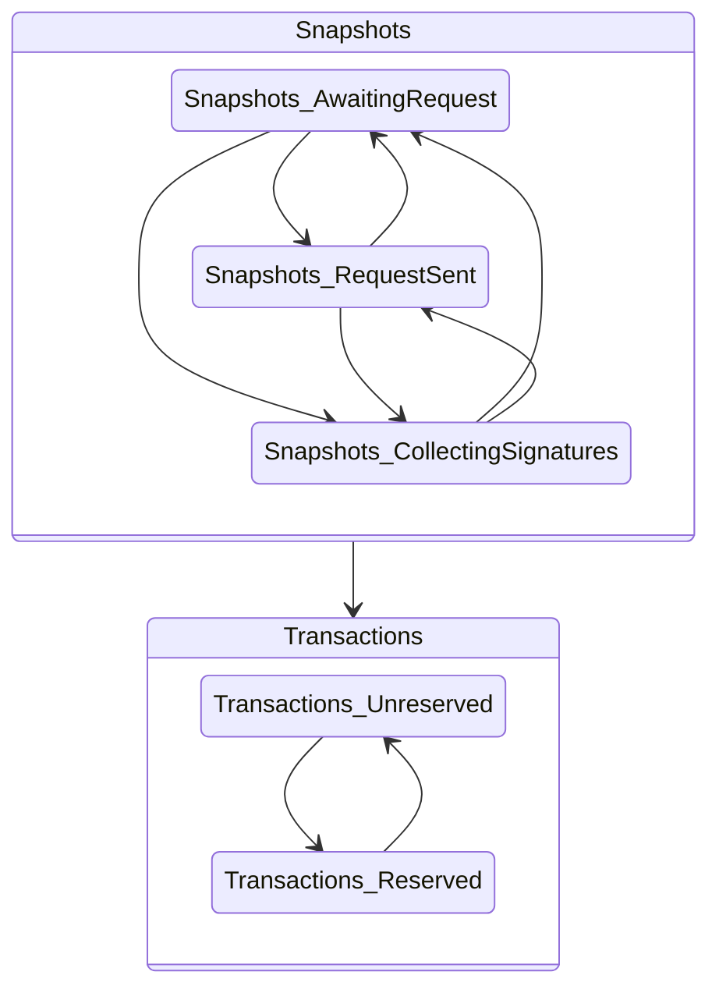

### Decommit dependencies and reservation

Rebase preserves the reservation, snapshot 2 confirms the dependency, and newly ready decommit work starts snapshot 3. A carried decommit alone does not start another round. This annotated diagram explains the generated sequence.

[Mermaid source](head-logic-machines/decommit-dependency.mmd)

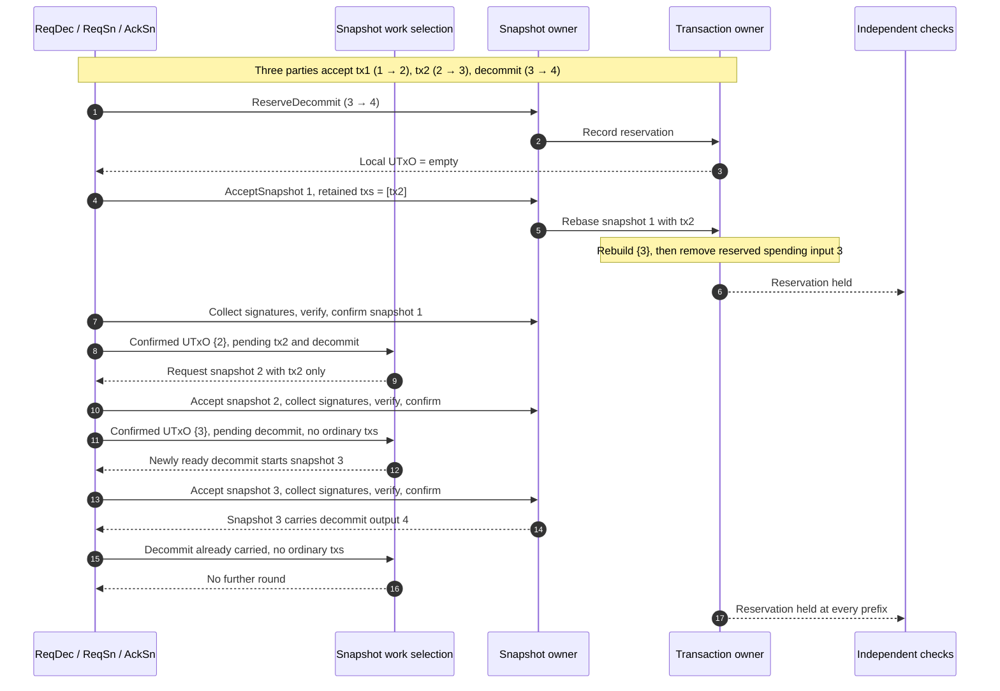

## Input and protocol phases

### ReqTx phases

The typed ReqTx topology generated from crem. Actions can terminate early with a Program wait or rejection; the graph does not enumerate guards inside each phase.

[Mermaid source](head-logic/workflows/req-tx-leader-topology.mmd)

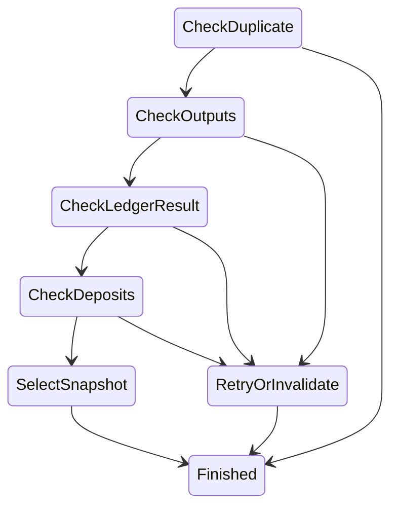

### ReqSn phases

The typed ReqSn topology generated from crem. Actions can terminate early with a Program wait or rejection; the graph does not enumerate guards inside each phase.

[Mermaid source](head-logic/workflows/req-sn-sign-topology.mmd)

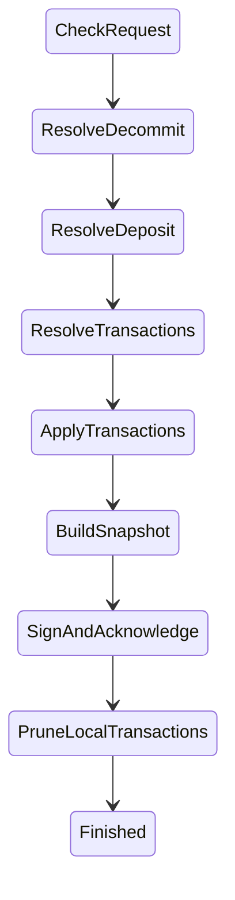

### AckSn phases

The typed AckSn topology generated from crem. Actions can terminate early with a Program wait or rejection; the graph does not enumerate guards inside each phase.

[Mermaid source](head-logic/workflows/ack-confirm-topology.mmd)

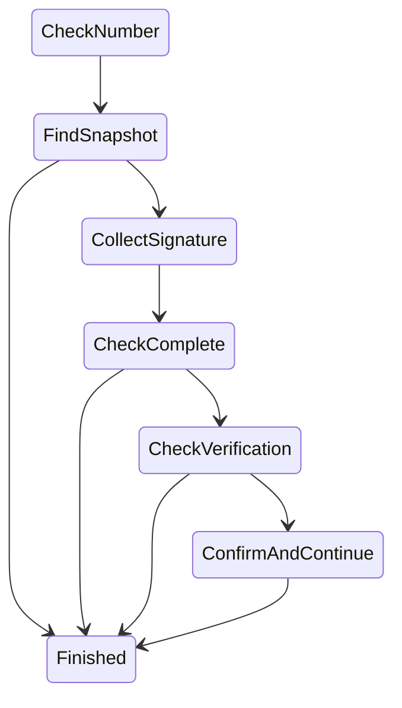

### ReqDec phases

The typed ReqDec topology generated from crem. Actions can terminate early with a Program wait or rejection; the graph does not enumerate guards inside each phase.

[Mermaid source](head-logic/workflows/req-dec-record-topology.mmd)

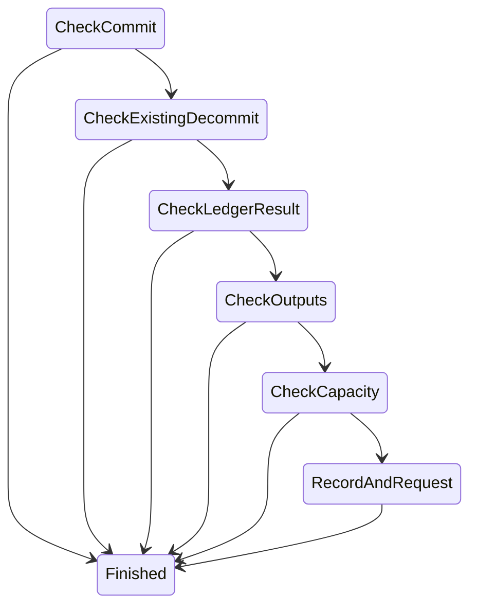

### Recover phases

The typed Recover topology generated from crem. Actions can terminate early with a Program wait or rejection; the graph does not enumerate guards inside each phase.

[Mermaid source](head-logic/workflows/recover-post-topology.mmd)

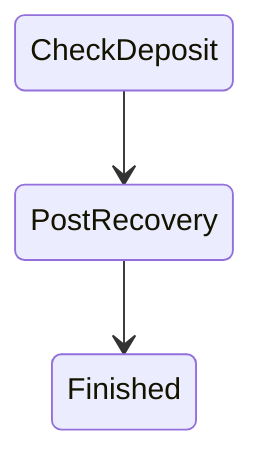

### Complete input phases

Size admission precedes synchronisation. Typed head-state payloads enter Idle, Open, Closed or FanoutProgress dispatch.

[Mermaid source](head-logic/inputs/input-topology.mmd)

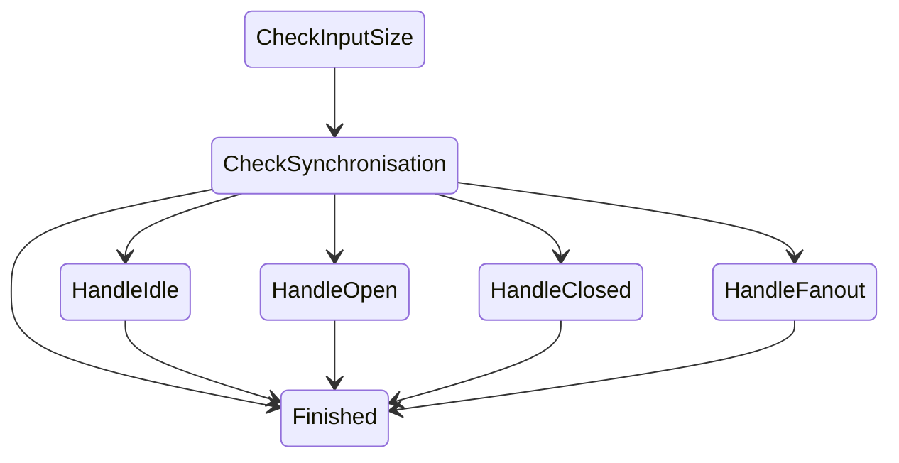

### Client decommit phases

Pending work, ledger result, output and capacity checks, and broadcast are separate typed phases.

[Mermaid source](head-logic/inputs/decommit-topology.mmd)

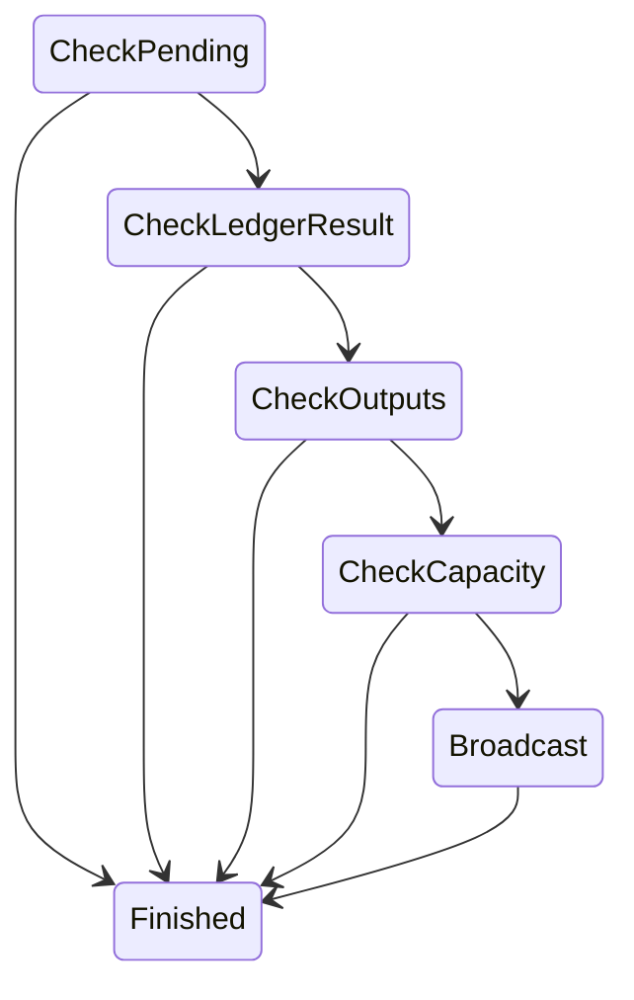

### Settlement phases

Record finalization, choose a candidate, verify it, and select work at the new version. Verification failure still reaches request selection.

[Mermaid source](head-logic/inputs/settlement-topology.mmd)

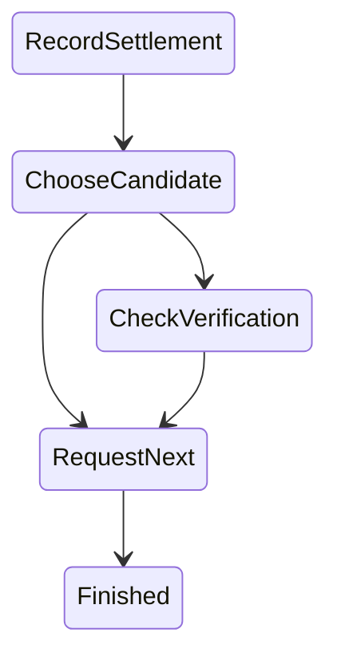

## Snapshot rounds and recovery limits

### Invalid confirmation under a verification fault

The test-only interpreter bypass lets an invalid acknowledgement confirm. Replay with normal verification rejects the same sequence.

[Mermaid source](head-logic/traces/counterexample-v2.json.mmd)

```mermaid
%%{init: {"sequence": {"wrap": true}}}%%
sequenceDiagram
  participant logic as Head logic
  participant ledger as Ledger
  participant crypto as Cryptography
  participant changes as Staged changes
  participant effects as Buffered effects
  rect rgb(245, 247, 250)
    Note over logic,effects: deliver ReqTx 1 from party 0 to 0 (TTL 2)
    Note over logic: input is admitted while at this sync status: True
    Note over logic: transaction is already applied locally: False
    logic->>changes: stage: remember transaction
    Note over logic: outputs do not collide with the local UTxO: True
    ledger-->>logic: primitive: apply transaction
    Note over logic: outputs do not collide with pending deposits: True
    logic->>changes: stage: validated transaction
    Note over logic: no snapshot is in flight: True
    Note over logic: this party leads the next snapshot: True
    Note over logic: snapshot request has useful work: True
    Note over logic: proposal matches the current snapshot context: True
    logic->>changes: stage: record snapshot request
    logic->>effects: buffer: broadcast ReqSn
    Note over logic,effects: finish: commit changes and release effects
  end
  rect rgb(245, 247, 250)
    Note over logic,effects: deliver ReqTx 1 from party 0 to 1 (TTL 2)
    Note over logic: input is admitted while at this sync status: True
    Note over logic: transaction is already applied locally: False
    logic->>changes: stage: remember transaction
    Note over logic: outputs do not collide with the local UTxO: True
    ledger-->>logic: primitive: apply transaction
    Note over logic: outputs do not collide with pending deposits: True
    logic->>changes: stage: validated transaction
    Note over logic: no snapshot is in flight: True
    Note over logic: this party leads the next snapshot: False
    Note over logic,effects: finish: commit changes and release effects
  end
  rect rgb(245, 247, 250)
    Note over logic,effects: deliver ReqTx 1 from party 0 to 2 (TTL 2)
    Note over logic: input is admitted while at this sync status: True
    Note over logic: transaction is already applied locally: False
    logic->>changes: stage: remember transaction
    Note over logic: outputs do not collide with the local UTxO: True
    ledger-->>logic: primitive: apply transaction
    Note over logic: outputs do not collide with pending deposits: True
    logic->>changes: stage: validated transaction
    Note over logic: no snapshot is in flight: True
    Note over logic: this party leads the next snapshot: False
    Note over logic,effects: finish: commit changes and release effects
  end
  rect rgb(245, 247, 250)
    Note over logic,effects: deliver ReqSn 0/1 txs [1] from party 0 to 0 (TTL 2)
    Note over logic: input is admitted while at this sync status: True
    Note over logic: request is the next snapshot: True
    Note over logic: sender leads this snapshot: True
    Note over logic: previous snapshot is confirmed: True
    Note over logic: snapshot version matches: True
    Note over logic: snapshot transaction outputs are fresh: True
    ledger-->>logic: primitive: apply transaction
    Note over logic: unsettled fanout fits accumulator capacity: True
    Note over logic: settled fanout fits accumulator capacity: True
    crypto-->>logic: primitive: sign snapshot
    logic->>effects: buffer: broadcast AckSn
    Note over logic: snapshot transaction outputs are fresh: False
    logic->>changes: stage: record requested snapshot and prune local transactions
    Note over logic,effects: finish: commit changes and release effects
  end
  rect rgb(245, 247, 250)
    Note over logic,effects: corrupt acknowledgement AckSn 1 from party 0 to 0 (TTL 2)
  end
  rect rgb(245, 247, 250)
    Note over logic,effects: deliver ReqSn 0/1 txs [1] from party 0 to 1 (TTL 2)
    Note over logic: input is admitted while at this sync status: True
    Note over logic: request is the next snapshot: True
    Note over logic: sender leads this snapshot: True
    Note over logic: previous snapshot is confirmed: True
    Note over logic: snapshot version matches: True
    Note over logic: snapshot transaction outputs are fresh: True
    ledger-->>logic: primitive: apply transaction
    Note over logic: unsettled fanout fits accumulator capacity: True
    Note over logic: settled fanout fits accumulator capacity: True
    crypto-->>logic: primitive: sign snapshot
    logic->>effects: buffer: broadcast AckSn
    Note over logic: snapshot transaction outputs are fresh: False
    logic->>changes: stage: record requested snapshot and prune local transactions
    Note over logic,effects: finish: commit changes and release effects
  end
  rect rgb(245, 247, 250)
    Note over logic,effects: deliver ReqSn 0/1 txs [1] from party 0 to 2 (TTL 2)
    Note over logic: input is admitted while at this sync status: True
    Note over logic: request is the next snapshot: True
    Note over logic: sender leads this snapshot: True
    Note over logic: previous snapshot is confirmed: True
    Note over logic: snapshot version matches: True
    Note over logic: snapshot transaction outputs are fresh: True
    ledger-->>logic: primitive: apply transaction
    Note over logic: unsettled fanout fits accumulator capacity: True
    Note over logic: settled fanout fits accumulator capacity: True
    crypto-->>logic: primitive: sign snapshot
    logic->>effects: buffer: broadcast AckSn
    Note over logic: snapshot transaction outputs are fresh: False
    logic->>changes: stage: record requested snapshot and prune local transactions
    Note over logic,effects: finish: commit changes and release effects
  end
  rect rgb(245, 247, 250)
    Note over logic,effects: deliver AckSn 1 from party 0 to 0 (TTL 2)
    Note over logic: input is admitted while at this sync status: True
    Note over logic: acknowledgement number is admissible: True
    Note over logic: party has not signed this snapshot: True
    logic->>changes: stage: record snapshot signature
    Note over logic: all parties have signed: False
    logic->>changes: stage: record snapshot signature
    Note over logic,effects: finish: commit changes and release effects
  end
  rect rgb(245, 247, 250)
    Note over logic,effects: deliver AckSn 1 from party 1 to 0 (TTL 2)
    Note over logic: input is admitted while at this sync status: True
    Note over logic: acknowledgement number is admissible: True
    Note over logic: party has not signed this snapshot: True
    logic->>changes: stage: record snapshot signature
    Note over logic: all parties have signed: False
    logic->>changes: stage: record snapshot signature
    Note over logic,effects: finish: commit changes and release effects
  end
  rect rgb(245, 247, 250)
    Note over logic,effects: deliver AckSn 1 from party 2 to 0 (TTL 2)
    Note over logic: input is admitted while at this sync status: True
    Note over logic: acknowledgement number is admissible: True
    Note over logic: party has not signed this snapshot: True
    logic->>changes: stage: record snapshot signature
    Note over logic: all parties have signed: True
    Note over logic: TEST ONLY: bypass multisignature verification: True
    logic->>changes: stage: confirm snapshot
    Note over logic,effects: finish: commit changes and release effects
  end
```

### Dependency retry expires

A normal-interpreter schedule drains its retries before the dependency arrives. Safety holds, but pending work is stranded.

[Mermaid source](head-logic/traces/expired-dependency-v2.json.mmd)

```mermaid
%%{init: {"sequence": {"wrap": true}}}%%
sequenceDiagram
  participant logic as Head logic
  participant ledger as Ledger
  participant crypto as Cryptography
  participant changes as Staged changes
  participant effects as Buffered effects
  rect rgb(245, 247, 250)
    Note over logic,effects: deliver ReqTx 2 from party 0 to 0 (TTL 2)
    Note over logic: input is admitted while at this sync status: True
    Note over logic: transaction is already applied locally: False
    logic->>changes: stage: remember transaction
    Note over logic: outputs do not collide with the local UTxO: True
    ledger-->>logic: primitive: apply transaction
    Note over logic: retry budget remains: True
    Note over logic,effects: wait: retain prefix, discard effects
  end
  rect rgb(245, 247, 250)
    Note over logic,effects: deliver ReqTx 2 from party 0 to 2 (TTL 2)
    Note over logic: input is admitted while at this sync status: True
    Note over logic: transaction is already applied locally: False
    logic->>changes: stage: remember transaction
    Note over logic: outputs do not collide with the local UTxO: True
    ledger-->>logic: primitive: apply transaction
    Note over logic: retry budget remains: True
    Note over logic,effects: wait: retain prefix, discard effects
  end
  rect rgb(245, 247, 250)
    Note over logic,effects: deliver ReqTx 2 from party 0 to 1 (TTL 2)
    Note over logic: input is admitted while at this sync status: True
    Note over logic: transaction is already applied locally: False
    logic->>changes: stage: remember transaction
    Note over logic: outputs do not collide with the local UTxO: True
    ledger-->>logic: primitive: apply transaction
    Note over logic: retry budget remains: True
    Note over logic,effects: wait: retain prefix, discard effects
  end
  rect rgb(245, 247, 250)
    Note over logic,effects: retry ReqTx 2 from party 0 to 1 (TTL 1)
    Note over logic: input is admitted while at this sync status: True
    Note over logic: transaction is already applied locally: False
    logic->>changes: stage: remember transaction
    Note over logic: outputs do not collide with the local UTxO: True
    ledger-->>logic: primitive: apply transaction
    Note over logic: retry budget remains: True
    Note over logic,effects: wait: retain prefix, discard effects
  end
  rect rgb(245, 247, 250)
    Note over logic,effects: retry ReqTx 2 from party 0 to 1 (TTL 0)
    Note over logic: input is admitted while at this sync status: True
    Note over logic: transaction is already applied locally: False
    logic->>changes: stage: remember transaction
    Note over logic: outputs do not collide with the local UTxO: True
    ledger-->>logic: primitive: apply transaction
    Note over logic: retry budget remains: False
    logic->>changes: stage: record invalid transaction
    Note over logic,effects: finish: commit changes and release effects
  end
  rect rgb(245, 247, 250)
    Note over logic,effects: deliver ReqTx 1 from party 0 to 0 (TTL 2)
    Note over logic: input is admitted while at this sync status: True
    Note over logic: transaction is already applied locally: False
    logic->>changes: stage: remember transaction
    Note over logic: outputs do not collide with the local UTxO: True
    ledger-->>logic: primitive: apply transaction
    Note over logic: outputs do not collide with pending deposits: True
    logic->>changes: stage: validated transaction
    Note over logic: no snapshot is in flight: True
    Note over logic: this party leads the next snapshot: True
    Note over logic: snapshot request has useful work: True
    Note over logic: proposal matches the current snapshot context: True
    logic->>changes: stage: record snapshot request
    logic->>effects: buffer: broadcast ReqSn
    Note over logic,effects: finish: commit changes and release effects
  end
  rect rgb(245, 247, 250)
    Note over logic,effects: deliver ReqTx 1 from party 0 to 1 (TTL 2)
    Note over logic: input is admitted while at this sync status: True
    Note over logic: transaction is already applied locally: False
    logic->>changes: stage: remember transaction
    Note over logic: outputs do not collide with the local UTxO: True
    ledger-->>logic: primitive: apply transaction
    Note over logic: outputs do not collide with pending deposits: True
    logic->>changes: stage: validated transaction
    Note over logic: no snapshot is in flight: True
    Note over logic: this party leads the next snapshot: False
    Note over logic,effects: finish: commit changes and release effects
  end
  rect rgb(245, 247, 250)
    Note over logic,effects: deliver ReqTx 1 from party 0 to 2 (TTL 2)
    Note over logic: input is admitted while at this sync status: True
    Note over logic: transaction is already applied locally: False
    logic->>changes: stage: remember transaction
    Note over logic: outputs do not collide with the local UTxO: True
    ledger-->>logic: primitive: apply transaction
    Note over logic: outputs do not collide with pending deposits: True
    logic->>changes: stage: validated transaction
    Note over logic: no snapshot is in flight: True
    Note over logic: this party leads the next snapshot: False
    Note over logic,effects: finish: commit changes and release effects
  end
  rect rgb(245, 247, 250)
    Note over logic,effects: deliver ReqSn 0/1 txs [1] from party 0 to 0 (TTL 2)
    Note over logic: input is admitted while at this sync status: True
    Note over logic: request is the next snapshot: True
    Note over logic: sender leads this snapshot: True
    Note over logic: previous snapshot is confirmed: True
    Note over logic: snapshot version matches: True
    Note over logic: snapshot transaction outputs are fresh: True
    ledger-->>logic: primitive: apply transaction
    Note over logic: unsettled fanout fits accumulator capacity: True
    Note over logic: settled fanout fits accumulator capacity: True
    crypto-->>logic: primitive: sign snapshot
    logic->>effects: buffer: broadcast AckSn
    Note over logic: snapshot transaction outputs are fresh: False
    logic->>changes: stage: record requested snapshot and prune local transactions
    Note over logic,effects: finish: commit changes and release effects
  end
  rect rgb(245, 247, 250)
    Note over logic,effects: deliver ReqSn 0/1 txs [1] from party 0 to 1 (TTL 2)
    Note over logic: input is admitted while at this sync status: True
    Note over logic: request is the next snapshot: True
    Note over logic: sender leads this snapshot: True
    Note over logic: previous snapshot is confirmed: True
    Note over logic: snapshot version matches: True
    Note over logic: snapshot transaction outputs are fresh: True
    ledger-->>logic: primitive: apply transaction
    Note over logic: unsettled fanout fits accumulator capacity: True
    Note over logic: settled fanout fits accumulator capacity: True
    crypto-->>logic: primitive: sign snapshot
    logic->>effects: buffer: broadcast AckSn
    Note over logic: snapshot transaction outputs are fresh: False
    logic->>changes: stage: record requested snapshot and prune local transactions
    Note over logic,effects: finish: commit changes and release effects
  end
  rect rgb(245, 247, 250)
    Note over logic,effects: deliver ReqSn 0/1 txs [1] from party 0 to 2 (TTL 2)
    Note over logic: input is admitted while at this sync status: True
    Note over logic: request is the next snapshot: True
    Note over logic: sender leads this snapshot: True
    Note over logic: previous snapshot is confirmed: True
    Note over logic: snapshot version matches: True
    Note over logic: snapshot transaction outputs are fresh: True
    ledger-->>logic: primitive: apply transaction
    Note over logic: unsettled fanout fits accumulator capacity: True
    Note over logic: settled fanout fits accumulator capacity: True
    crypto-->>logic: primitive: sign snapshot
    logic->>effects: buffer: broadcast AckSn
    Note over logic: snapshot transaction outputs are fresh: False
    logic->>changes: stage: record requested snapshot and prune local transactions
    Note over logic,effects: finish: commit changes and release effects
  end
  rect rgb(245, 247, 250)
    Note over logic,effects: deliver AckSn 1 from party 0 to 0 (TTL 2)
    Note over logic: input is admitted while at this sync status: True
    Note over logic: acknowledgement number is admissible: True
    Note over logic: party has not signed this snapshot: True
    logic->>changes: stage: record snapshot signature
    Note over logic: all parties have signed: False
    logic->>changes: stage: record snapshot signature
    Note over logic,effects: finish: commit changes and release effects
  end
  rect rgb(245, 247, 250)
    Note over logic,effects: deliver AckSn 1 from party 0 to 1 (TTL 2)
    Note over logic: input is admitted while at this sync status: True
    Note over logic: acknowledgement number is admissible: True
    Note over logic: party has not signed this snapshot: True
    logic->>changes: stage: record snapshot signature
    Note over logic: all parties have signed: False
    logic->>changes: stage: record snapshot signature
    Note over logic,effects: finish: commit changes and release effects
  end
  rect rgb(245, 247, 250)
    Note over logic,effects: deliver AckSn 1 from party 0 to 2 (TTL 2)
    Note over logic: input is admitted while at this sync status: True
    Note over logic: acknowledgement number is admissible: True
    Note over logic: party has not signed this snapshot: True
    logic->>changes: stage: record snapshot signature
    Note over logic: all parties have signed: False
    logic->>changes: stage: record snapshot signature
    Note over logic,effects: finish: commit changes and release effects
  end
  rect rgb(245, 247, 250)
    Note over logic,effects: deliver AckSn 1 from party 1 to 0 (TTL 2)
    Note over logic: input is admitted while at this sync status: True
    Note over logic: acknowledgement number is admissible: True
    Note over logic: party has not signed this snapshot: True
    logic->>changes: stage: record snapshot signature
    Note over logic: all parties have signed: False
    logic->>changes: stage: record snapshot signature
    Note over logic,effects: finish: commit changes and release effects
  end
  rect rgb(245, 247, 250)
    Note over logic,effects: deliver AckSn 1 from party 1 to 1 (TTL 2)
    Note over logic: input is admitted while at this sync status: True
    Note over logic: acknowledgement number is admissible: True
    Note over logic: party has not signed this snapshot: True
    logic->>changes: stage: record snapshot signature
    Note over logic: all parties have signed: False
    logic->>changes: stage: record snapshot signature
    Note over logic,effects: finish: commit changes and release effects
  end
  rect rgb(245, 247, 250)
    Note over logic,effects: deliver AckSn 1 from party 1 to 2 (TTL 2)
    Note over logic: input is admitted while at this sync status: True
    Note over logic: acknowledgement number is admissible: True
    Note over logic: party has not signed this snapshot: True
    logic->>changes: stage: record snapshot signature
    Note over logic: all parties have signed: False
    logic->>changes: stage: record snapshot signature
    Note over logic,effects: finish: commit changes and release effects
  end
  rect rgb(245, 247, 250)
    Note over logic,effects: deliver AckSn 1 from party 2 to 0 (TTL 2)
    Note over logic: input is admitted while at this sync status: True
    Note over logic: acknowledgement number is admissible: True
    Note over logic: party has not signed this snapshot: True
    logic->>changes: stage: record snapshot signature
    Note over logic: all parties have signed: True
    crypto-->>logic: primitive: verify multisignature
    logic->>changes: stage: confirm snapshot
    Note over logic,effects: finish: commit changes and release effects
  end
  rect rgb(245, 247, 250)
    Note over logic,effects: deliver AckSn 1 from party 2 to 1 (TTL 2)
    Note over logic: input is admitted while at this sync status: True
    Note over logic: acknowledgement number is admissible: True
    Note over logic: party has not signed this snapshot: True
    logic->>changes: stage: record snapshot signature
    Note over logic: all parties have signed: True
    crypto-->>logic: primitive: verify multisignature
    logic->>changes: stage: confirm snapshot
    Note over logic,effects: finish: commit changes and release effects
  end
  rect rgb(245, 247, 250)
    Note over logic,effects: deliver AckSn 1 from party 2 to 2 (TTL 2)
    Note over logic: input is admitted while at this sync status: True
    Note over logic: acknowledgement number is admissible: True
    Note over logic: party has not signed this snapshot: True
    logic->>changes: stage: record snapshot signature
    Note over logic: all parties have signed: True
    crypto-->>logic: primitive: verify multisignature
    logic->>changes: stage: confirm snapshot
    Note over logic,effects: finish: commit changes and release effects
  end
  rect rgb(245, 247, 250)
    Note over logic,effects: retry ReqTx 2 from party 0 to 0 (TTL 1)
    Note over logic: input is admitted while at this sync status: True
    Note over logic: transaction is already applied locally: False
    logic->>changes: stage: remember transaction
    Note over logic: outputs do not collide with the local UTxO: True
    ledger-->>logic: primitive: apply transaction
    Note over logic: outputs do not collide with pending deposits: True
    logic->>changes: stage: validated transaction
    Note over logic: no snapshot is in flight: True
    Note over logic: this party leads the next snapshot: False
    Note over logic,effects: finish: commit changes and release effects
  end
  rect rgb(245, 247, 250)
    Note over logic,effects: retry ReqTx 2 from party 0 to 2 (TTL 1)
    Note over logic: input is admitted while at this sync status: True
    Note over logic: transaction is already applied locally: False
    logic->>changes: stage: remember transaction
    Note over logic: outputs do not collide with the local UTxO: True
    ledger-->>logic: primitive: apply transaction
    Note over logic: outputs do not collide with pending deposits: True
    logic->>changes: stage: validated transaction
    Note over logic: no snapshot is in flight: True
    Note over logic: this party leads the next snapshot: False
    Note over logic,effects: finish: commit changes and release effects
  end
```

### Explorer finds retry expiry

A focused bounded retry-window search finds the expiry schedule. The artifact records its bounds and does not establish general liveness.

[Mermaid source](head-logic/traces/expiry-search-v2.json.mmd)


### Registry regression replay

A scheduler sequence checks duplicate transaction handling and preservation of the validated registry payload.

[Mermaid source](head-logic/traces/registry-regression-v2.json.mmd)

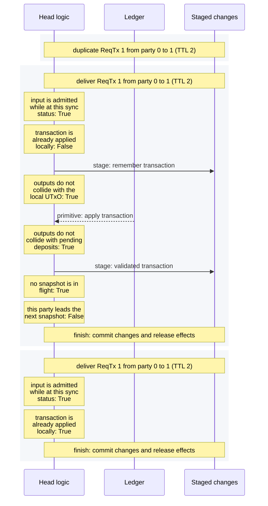

### Complete snapshot round

A normal three-party round with recorded primitive replies, confirmation and subsequent work.

[Mermaid source](head-logic/traces/snapshot-round-v2.json.mmd)

```mermaid
%%{init: {"sequence": {"wrap": true}}}%%
sequenceDiagram
  participant logic as Head logic
  participant ledger as Ledger
  participant crypto as Cryptography
  participant changes as Staged changes
  participant effects as Buffered effects
  rect rgb(245, 247, 250)
    Note over logic,effects: deliver ReqTx 1 from party 0 to 0 (TTL 2)
    Note over logic: input is admitted while at this sync status: True
    Note over logic: transaction is already applied locally: False
    logic->>changes: stage: remember transaction
    Note over logic: outputs do not collide with the local UTxO: True
    ledger-->>logic: primitive: apply transaction
    Note over logic: outputs do not collide with pending deposits: True
    logic->>changes: stage: validated transaction
    Note over logic: no snapshot is in flight: True
    Note over logic: this party leads the next snapshot: True
    Note over logic: snapshot request has useful work: True
    Note over logic: proposal matches the current snapshot context: True
    logic->>changes: stage: record snapshot request
    logic->>effects: buffer: broadcast ReqSn
    Note over logic,effects: finish: commit changes and release effects
  end
  rect rgb(245, 247, 250)
    Note over logic,effects: deliver ReqTx 1 from party 0 to 1 (TTL 2)
    Note over logic: input is admitted while at this sync status: True
    Note over logic: transaction is already applied locally: False
    logic->>changes: stage: remember transaction
    Note over logic: outputs do not collide with the local UTxO: True
    ledger-->>logic: primitive: apply transaction
    Note over logic: outputs do not collide with pending deposits: True
    logic->>changes: stage: validated transaction
    Note over logic: no snapshot is in flight: True
    Note over logic: this party leads the next snapshot: False
    Note over logic,effects: finish: commit changes and release effects
  end
  rect rgb(245, 247, 250)
    Note over logic,effects: deliver ReqTx 1 from party 0 to 2 (TTL 2)
    Note over logic: input is admitted while at this sync status: True
    Note over logic: transaction is already applied locally: False
    logic->>changes: stage: remember transaction
    Note over logic: outputs do not collide with the local UTxO: True
    ledger-->>logic: primitive: apply transaction
    Note over logic: outputs do not collide with pending deposits: True
    logic->>changes: stage: validated transaction
    Note over logic: no snapshot is in flight: True
    Note over logic: this party leads the next snapshot: False
    Note over logic,effects: finish: commit changes and release effects
  end
  rect rgb(245, 247, 250)
    Note over logic,effects: deliver ReqTx 2 from party 0 to 0 (TTL 2)
    Note over logic: input is admitted while at this sync status: True
    Note over logic: transaction is already applied locally: False
    logic->>changes: stage: remember transaction
    Note over logic: outputs do not collide with the local UTxO: True
    ledger-->>logic: primitive: apply transaction
    Note over logic: outputs do not collide with pending deposits: True
    logic->>changes: stage: validated transaction
    Note over logic: no snapshot is in flight: False
    Note over logic,effects: finish: commit changes and release effects
  end
  rect rgb(245, 247, 250)
    Note over logic,effects: deliver ReqTx 2 from party 0 to 1 (TTL 2)
    Note over logic: input is admitted while at this sync status: True
    Note over logic: transaction is already applied locally: False
    logic->>changes: stage: remember transaction
    Note over logic: outputs do not collide with the local UTxO: True
    ledger-->>logic: primitive: apply transaction
    Note over logic: outputs do not collide with pending deposits: True
    logic->>changes: stage: validated transaction
    Note over logic: no snapshot is in flight: True
    Note over logic: this party leads the next snapshot: False
    Note over logic,effects: finish: commit changes and release effects
  end
  rect rgb(245, 247, 250)
    Note over logic,effects: deliver ReqTx 2 from party 0 to 2 (TTL 2)
    Note over logic: input is admitted while at this sync status: True
    Note over logic: transaction is already applied locally: False
    logic->>changes: stage: remember transaction
    Note over logic: outputs do not collide with the local UTxO: True
    ledger-->>logic: primitive: apply transaction
    Note over logic: outputs do not collide with pending deposits: True
    logic->>changes: stage: validated transaction
    Note over logic: no snapshot is in flight: True
    Note over logic: this party leads the next snapshot: False
    Note over logic,effects: finish: commit changes and release effects
  end
  rect rgb(245, 247, 250)
    Note over logic,effects: deliver ReqSn 0/1 txs [1] from party 0 to 0 (TTL 2)
    Note over logic: input is admitted while at this sync status: True
    Note over logic: request is the next snapshot: True
    Note over logic: sender leads this snapshot: True
    Note over logic: previous snapshot is confirmed: True
    Note over logic: snapshot version matches: True
    Note over logic: snapshot transaction outputs are fresh: True
    ledger-->>logic: primitive: apply transaction
    Note over logic: unsettled fanout fits accumulator capacity: True
    Note over logic: settled fanout fits accumulator capacity: True
    crypto-->>logic: primitive: sign snapshot
    logic->>effects: buffer: broadcast AckSn
    Note over logic: snapshot transaction outputs are fresh: False
    Note over logic: snapshot transaction outputs are fresh: True
    ledger-->>logic: primitive: apply transaction
    Note over logic: pending transaction outputs avoid the carried deposit: True
    Note over logic: pending transaction fits both fanout alternatives: True
    logic->>changes: stage: record requested snapshot and prune local transactions
    Note over logic,effects: finish: commit changes and release effects
  end
  rect rgb(245, 247, 250)
    Note over logic,effects: deliver ReqSn 0/1 txs [1] from party 0 to 1 (TTL 2)
    Note over logic: input is admitted while at this sync status: True
    Note over logic: request is the next snapshot: True
    Note over logic: sender leads this snapshot: True
    Note over logic: previous snapshot is confirmed: True
    Note over logic: snapshot version matches: True
    Note over logic: snapshot transaction outputs are fresh: True
    ledger-->>logic: primitive: apply transaction
    Note over logic: unsettled fanout fits accumulator capacity: True
    Note over logic: settled fanout fits accumulator capacity: True
    crypto-->>logic: primitive: sign snapshot
    logic->>effects: buffer: broadcast AckSn
    Note over logic: snapshot transaction outputs are fresh: False
    Note over logic: snapshot transaction outputs are fresh: True
    ledger-->>logic: primitive: apply transaction
    Note over logic: pending transaction outputs avoid the carried deposit: True
    Note over logic: pending transaction fits both fanout alternatives: True
    logic->>changes: stage: record requested snapshot and prune local transactions
    Note over logic,effects: finish: commit changes and release effects
  end
  rect rgb(245, 247, 250)
    Note over logic,effects: deliver ReqSn 0/1 txs [1] from party 0 to 2 (TTL 2)
    Note over logic: input is admitted while at this sync status: True
    Note over logic: request is the next snapshot: True
    Note over logic: sender leads this snapshot: True
    Note over logic: previous snapshot is confirmed: True
    Note over logic: snapshot version matches: True
    Note over logic: snapshot transaction outputs are fresh: True
    ledger-->>logic: primitive: apply transaction
    Note over logic: unsettled fanout fits accumulator capacity: True
    Note over logic: settled fanout fits accumulator capacity: True
    crypto-->>logic: primitive: sign snapshot
    logic->>effects: buffer: broadcast AckSn
    Note over logic: snapshot transaction outputs are fresh: False
    Note over logic: snapshot transaction outputs are fresh: True
    ledger-->>logic: primitive: apply transaction
    Note over logic: pending transaction outputs avoid the carried deposit: True
    Note over logic: pending transaction fits both fanout alternatives: True
    logic->>changes: stage: record requested snapshot and prune local transactions
    Note over logic,effects: finish: commit changes and release effects
  end
  rect rgb(245, 247, 250)
    Note over logic,effects: deliver AckSn 1 from party 0 to 0 (TTL 2)
    Note over logic: input is admitted while at this sync status: True
    Note over logic: acknowledgement number is admissible: True
    Note over logic: party has not signed this snapshot: True
    logic->>changes: stage: record snapshot signature
    Note over logic: all parties have signed: False
    logic->>changes: stage: record snapshot signature
    Note over logic,effects: finish: commit changes and release effects
  end
  rect rgb(245, 247, 250)
    Note over logic,effects: deliver AckSn 1 from party 0 to 1 (TTL 2)
    Note over logic: input is admitted while at this sync status: True
    Note over logic: acknowledgement number is admissible: True
    Note over logic: party has not signed this snapshot: True
    logic->>changes: stage: record snapshot signature
    Note over logic: all parties have signed: False
    logic->>changes: stage: record snapshot signature
    Note over logic,effects: finish: commit changes and release effects
  end
  rect rgb(245, 247, 250)
    Note over logic,effects: deliver AckSn 1 from party 0 to 2 (TTL 2)
    Note over logic: input is admitted while at this sync status: True
    Note over logic: acknowledgement number is admissible: True
    Note over logic: party has not signed this snapshot: True
    logic->>changes: stage: record snapshot signature
    Note over logic: all parties have signed: False
    logic->>changes: stage: record snapshot signature
    Note over logic,effects: finish: commit changes and release effects
  end
  rect rgb(245, 247, 250)
    Note over logic,effects: deliver AckSn 1 from party 1 to 0 (TTL 2)
    Note over logic: input is admitted while at this sync status: True
    Note over logic: acknowledgement number is admissible: True
    Note over logic: party has not signed this snapshot: True
    logic->>changes: stage: record snapshot signature
    Note over logic: all parties have signed: False
    logic->>changes: stage: record snapshot signature
    Note over logic,effects: finish: commit changes and release effects
  end
  rect rgb(245, 247, 250)
    Note over logic,effects: deliver AckSn 1 from party 1 to 1 (TTL 2)
    Note over logic: input is admitted while at this sync status: True
    Note over logic: acknowledgement number is admissible: True
    Note over logic: party has not signed this snapshot: True
    logic->>changes: stage: record snapshot signature
    Note over logic: all parties have signed: False
    logic->>changes: stage: record snapshot signature
    Note over logic,effects: finish: commit changes and release effects
  end
  rect rgb(245, 247, 250)
    Note over logic,effects: deliver AckSn 1 from party 1 to 2 (TTL 2)
    Note over logic: input is admitted while at this sync status: True
    Note over logic: acknowledgement number is admissible: True
    Note over logic: party has not signed this snapshot: True
    logic->>changes: stage: record snapshot signature
    Note over logic: all parties have signed: False
    logic->>changes: stage: record snapshot signature
    Note over logic,effects: finish: commit changes and release effects
  end
  rect rgb(245, 247, 250)
    Note over logic,effects: deliver AckSn 1 from party 2 to 0 (TTL 2)
    Note over logic: input is admitted while at this sync status: True
    Note over logic: acknowledgement number is admissible: True
    Note over logic: party has not signed this snapshot: True
    logic->>changes: stage: record snapshot signature
    Note over logic: all parties have signed: True
    crypto-->>logic: primitive: verify multisignature
    logic->>changes: stage: confirm snapshot
    Note over logic,effects: finish: commit changes and release effects
  end
  rect rgb(245, 247, 250)
    Note over logic,effects: deliver AckSn 1 from party 2 to 1 (TTL 2)
    Note over logic: input is admitted while at this sync status: True
    Note over logic: acknowledgement number is admissible: True
    Note over logic: party has not signed this snapshot: True
    logic->>changes: stage: record snapshot signature
    Note over logic: all parties have signed: True
    crypto-->>logic: primitive: verify multisignature
    logic->>changes: stage: confirm snapshot
    Note over logic: proposal matches the current snapshot context: True
    logic->>changes: stage: record snapshot request
    logic->>effects: buffer: broadcast ReqSn
    Note over logic,effects: finish: commit changes and release effects
  end
  rect rgb(245, 247, 250)
    Note over logic,effects: deliver AckSn 1 from party 2 to 2 (TTL 2)
    Note over logic: input is admitted while at this sync status: True
    Note over logic: acknowledgement number is admissible: True
    Note over logic: party has not signed this snapshot: True
    logic->>changes: stage: record snapshot signature
    Note over logic: all parties have signed: True
    crypto-->>logic: primitive: verify multisignature
    logic->>changes: stage: confirm snapshot
    Note over logic,effects: finish: commit changes and release effects
  end
  rect rgb(245, 247, 250)
    Note over logic,effects: deliver ReqSn 0/2 txs [2] from party 1 to 0 (TTL 2)
    Note over logic: input is admitted while at this sync status: True
    Note over logic: request is the next snapshot: True
    Note over logic: sender leads this snapshot: True
    Note over logic: previous snapshot is confirmed: True
    Note over logic: snapshot version matches: True
    Note over logic: snapshot transaction outputs are fresh: True
    ledger-->>logic: primitive: apply transaction
    Note over logic: unsettled fanout fits accumulator capacity: True
    Note over logic: settled fanout fits accumulator capacity: True
    crypto-->>logic: primitive: sign snapshot
    logic->>effects: buffer: broadcast AckSn
    Note over logic: snapshot transaction outputs are fresh: False
    logic->>changes: stage: record requested snapshot and prune local transactions
    Note over logic,effects: finish: commit changes and release effects
  end
  rect rgb(245, 247, 250)
    Note over logic,effects: deliver ReqSn 0/2 txs [2] from party 1 to 1 (TTL 2)
    Note over logic: input is admitted while at this sync status: True
    Note over logic: request is the next snapshot: True
    Note over logic: sender leads this snapshot: True
    Note over logic: previous snapshot is confirmed: True
    Note over logic: snapshot version matches: True
    Note over logic: snapshot transaction outputs are fresh: True
    ledger-->>logic: primitive: apply transaction
    Note over logic: unsettled fanout fits accumulator capacity: True
    Note over logic: settled fanout fits accumulator capacity: True
    crypto-->>logic: primitive: sign snapshot
    logic->>effects: buffer: broadcast AckSn
    Note over logic: snapshot transaction outputs are fresh: False
    logic->>changes: stage: record requested snapshot and prune local transactions
    Note over logic,effects: finish: commit changes and release effects
  end
  rect rgb(245, 247, 250)
    Note over logic,effects: deliver ReqSn 0/2 txs [2] from party 1 to 2 (TTL 2)
    Note over logic: input is admitted while at this sync status: True
    Note over logic: request is the next snapshot: True
    Note over logic: sender leads this snapshot: True
    Note over logic: previous snapshot is confirmed: True
    Note over logic: snapshot version matches: True
    Note over logic: snapshot transaction outputs are fresh: True
    ledger-->>logic: primitive: apply transaction
    Note over logic: unsettled fanout fits accumulator capacity: True
    Note over logic: settled fanout fits accumulator capacity: True
    crypto-->>logic: primitive: sign snapshot
    logic->>effects: buffer: broadcast AckSn
    Note over logic: snapshot transaction outputs are fresh: False
    logic->>changes: stage: record requested snapshot and prune local transactions
    Note over logic,effects: finish: commit changes and release effects
  end
  rect rgb(245, 247, 250)
    Note over logic,effects: deliver AckSn 2 from party 0 to 0 (TTL 2)
    Note over logic: input is admitted while at this sync status: True
    Note over logic: acknowledgement number is admissible: True
    Note over logic: party has not signed this snapshot: True
    logic->>changes: stage: record snapshot signature
    Note over logic: all parties have signed: False
    logic->>changes: stage: record snapshot signature
    Note over logic,effects: finish: commit changes and release effects
  end
  rect rgb(245, 247, 250)
    Note over logic,effects: deliver AckSn 2 from party 0 to 1 (TTL 2)
    Note over logic: input is admitted while at this sync status: True
    Note over logic: acknowledgement number is admissible: True
    Note over logic: party has not signed this snapshot: True
    logic->>changes: stage: record snapshot signature
    Note over logic: all parties have signed: False
    logic->>changes: stage: record snapshot signature
    Note over logic,effects: finish: commit changes and release effects
  end
  rect rgb(245, 247, 250)
    Note over logic,effects: deliver AckSn 2 from party 0 to 2 (TTL 2)
    Note over logic: input is admitted while at this sync status: True
    Note over logic: acknowledgement number is admissible: True
    Note over logic: party has not signed this snapshot: True
    logic->>changes: stage: record snapshot signature
    Note over logic: all parties have signed: False
    logic->>changes: stage: record snapshot signature
    Note over logic,effects: finish: commit changes and release effects
  end
  rect rgb(245, 247, 250)
    Note over logic,effects: deliver AckSn 2 from party 1 to 0 (TTL 2)
    Note over logic: input is admitted while at this sync status: True
    Note over logic: acknowledgement number is admissible: True
    Note over logic: party has not signed this snapshot: True
    logic->>changes: stage: record snapshot signature
    Note over logic: all parties have signed: False
    logic->>changes: stage: record snapshot signature
    Note over logic,effects: finish: commit changes and release effects
  end
  rect rgb(245, 247, 250)
    Note over logic,effects: deliver AckSn 2 from party 1 to 1 (TTL 2)
    Note over logic: input is admitted while at this sync status: True
    Note over logic: acknowledgement number is admissible: True
    Note over logic: party has not signed this snapshot: True
    logic->>changes: stage: record snapshot signature
    Note over logic: all parties have signed: False
    logic->>changes: stage: record snapshot signature
    Note over logic,effects: finish: commit changes and release effects
  end
  rect rgb(245, 247, 250)
    Note over logic,effects: deliver AckSn 2 from party 1 to 2 (TTL 2)
    Note over logic: input is admitted while at this sync status: True
    Note over logic: acknowledgement number is admissible: True
    Note over logic: party has not signed this snapshot: True
    logic->>changes: stage: record snapshot signature
    Note over logic: all parties have signed: False
    logic->>changes: stage: record snapshot signature
    Note over logic,effects: finish: commit changes and release effects
  end
  rect rgb(245, 247, 250)
    Note over logic,effects: deliver AckSn 2 from party 2 to 0 (TTL 2)
    Note over logic: input is admitted while at this sync status: True
    Note over logic: acknowledgement number is admissible: True
    Note over logic: party has not signed this snapshot: True
    logic->>changes: stage: record snapshot signature
    Note over logic: all parties have signed: True
    crypto-->>logic: primitive: verify multisignature
    logic->>changes: stage: confirm snapshot
    Note over logic,effects: finish: commit changes and release effects
  end
  rect rgb(245, 247, 250)
    Note over logic,effects: deliver AckSn 2 from party 2 to 1 (TTL 2)
    Note over logic: input is admitted while at this sync status: True
    Note over logic: acknowledgement number is admissible: True
    Note over logic: party has not signed this snapshot: True
    logic->>changes: stage: record snapshot signature
    Note over logic: all parties have signed: True
    crypto-->>logic: primitive: verify multisignature
    logic->>changes: stage: confirm snapshot
    Note over logic,effects: finish: commit changes and release effects
  end
  rect rgb(245, 247, 250)
    Note over logic,effects: deliver AckSn 2 from party 2 to 2 (TTL 2)
    Note over logic: input is admitted while at this sync status: True
    Note over logic: acknowledgement number is admissible: True
    Note over logic: party has not signed this snapshot: True
    logic->>changes: stage: record snapshot signature
    Note over logic: all parties have signed: True
    crypto-->>logic: primitive: verify multisignature
    logic->>changes: stage: confirm snapshot
    Note over logic,effects: finish: commit changes and release effects
  end
```

### Settlement and rollback

Party lanes show deposit confirmation, on-chain increment, spending, rollback and re-observation. The driver checks outcomes and serialized replay at every prefix.

[Mermaid source](head-logic/traces/settlement-v1.mmd)

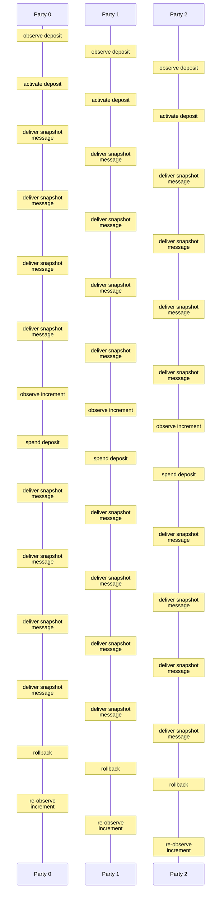

### Decommit dependency sequence

The reservation holds while snapshot 2 confirms the dependency and snapshot 3 confirms the decommit. Independent checks and serialized replay run at every prefix.

[Mermaid source](head-logic/traces/decommit-dependency-fixed-v2.json.mmd)

```mermaid
%%{init: {"sequence": {"wrap": true}}}%%
sequenceDiagram
  participant logic as Head logic
  participant ledger as Ledger
  participant crypto as Cryptography
  participant changes as Staged changes
  participant effects as Buffered effects
  rect rgb(245, 247, 250)
    Note over logic,effects: Party 0: ReqTx 1
    Note over logic: transaction is already applied locally: no
    logic->>changes: stage: remember transaction
    Note over logic: outputs do not collide with the local UTxO: yes
    ledger-->>logic: ledger application: valid
    Note over logic: outputs do not collide with pending deposits: yes
    logic->>changes: stage: apply transaction to local state
    Note over logic: no snapshot is in flight: yes
    Note over logic: this party leads the next snapshot: yes
    Note over logic: snapshot request has useful work: yes
    Note over logic: proposal matches the current snapshot context: yes
    logic->>changes: stage: record snapshot request
    logic->>effects: buffer: broadcast ReqSn
    Note over logic,effects: finish: commit changes and release effects
  end
  rect rgb(245, 247, 250)
    Note over logic,effects: Party 1: ReqTx 1
    Note over logic: transaction is already applied locally: no
    logic->>changes: stage: remember transaction
    Note over logic: outputs do not collide with the local UTxO: yes
    ledger-->>logic: ledger application: valid
    Note over logic: outputs do not collide with pending deposits: yes
    logic->>changes: stage: apply transaction to local state
    Note over logic: no snapshot is in flight: yes
    Note over logic: this party leads the next snapshot: no
    Note over logic,effects: finish: commit changes and release effects
  end
  rect rgb(245, 247, 250)
    Note over logic,effects: Party 2: ReqTx 1
    Note over logic: transaction is already applied locally: no
    logic->>changes: stage: remember transaction
    Note over logic: outputs do not collide with the local UTxO: yes
    ledger-->>logic: ledger application: valid
    Note over logic: outputs do not collide with pending deposits: yes
    logic->>changes: stage: apply transaction to local state
    Note over logic: no snapshot is in flight: yes
    Note over logic: this party leads the next snapshot: no
    Note over logic,effects: finish: commit changes and release effects
  end
  rect rgb(245, 247, 250)
    Note over logic,effects: Party 0: ReqTx 2
    Note over logic: transaction is already applied locally: no
    logic->>changes: stage: remember transaction
    Note over logic: outputs do not collide with the local UTxO: yes
    ledger-->>logic: ledger application: valid
    Note over logic: outputs do not collide with pending deposits: yes
    logic->>changes: stage: apply transaction to local state
    Note over logic: no snapshot is in flight: no
    Note over logic,effects: finish: commit changes and release effects
  end
  rect rgb(245, 247, 250)
    Note over logic,effects: Party 1: ReqTx 2
    Note over logic: transaction is already applied locally: no
    logic->>changes: stage: remember transaction
    Note over logic: outputs do not collide with the local UTxO: yes
    ledger-->>logic: ledger application: valid
    Note over logic: outputs do not collide with pending deposits: yes
    logic->>changes: stage: apply transaction to local state
    Note over logic: no snapshot is in flight: yes
    Note over logic: this party leads the next snapshot: no
    Note over logic,effects: finish: commit changes and release effects
  end
  rect rgb(245, 247, 250)
    Note over logic,effects: Party 2: ReqTx 2
    Note over logic: transaction is already applied locally: no
    logic->>changes: stage: remember transaction
    Note over logic: outputs do not collide with the local UTxO: yes
    ledger-->>logic: ledger application: valid
    Note over logic: outputs do not collide with pending deposits: yes
    logic->>changes: stage: apply transaction to local state
    Note over logic: no snapshot is in flight: yes
    Note over logic: this party leads the next snapshot: no
    Note over logic,effects: finish: commit changes and release effects
  end
  rect rgb(245, 247, 250)
    Note over logic,effects: Party 0: ReqDec 3 (spends output of tx2)
    Note over logic: next snapshot carries a deposit: no
    Note over logic: no decommit is in flight: yes
    ledger-->>logic: ledger application: valid
    Note over logic: decommit produces outputs: yes
    Note over logic: decommit fits local and confirmed capacity: yes
    logic->>changes: stage: reserve decommit
    Note over logic: no snapshot is in flight: no
    Note over logic,effects: finish: commit changes and release effects
  end
  rect rgb(245, 247, 250)
    Note over logic,effects: Party 1: ReqDec 3 (spends output of tx2)
    Note over logic: next snapshot carries a deposit: no
    Note over logic: no decommit is in flight: yes
    ledger-->>logic: ledger application: valid
    Note over logic: decommit produces outputs: yes
    Note over logic: decommit fits local and confirmed capacity: yes
    logic->>changes: stage: reserve decommit
    Note over logic: no snapshot is in flight: yes
    Note over logic: this party leads the next snapshot: no
    Note over logic,effects: finish: commit changes and release effects
  end
  rect rgb(245, 247, 250)
    Note over logic,effects: Party 2: ReqDec 3 (spends output of tx2)
    Note over logic: next snapshot carries a deposit: no
    Note over logic: no decommit is in flight: yes
    ledger-->>logic: ledger application: valid
    Note over logic: decommit produces outputs: yes
    Note over logic: decommit fits local and confirmed capacity: yes
    logic->>changes: stage: reserve decommit
    Note over logic: no snapshot is in flight: yes
    Note over logic: this party leads the next snapshot: no
    Note over logic,effects: finish: commit changes and release effects
  end
  rect rgb(245, 247, 250)
    Note over logic,effects: Party 0: ReqSn 1
    Note over logic: request is the next snapshot: yes
    Note over logic: sender leads this snapshot: yes
    Note over logic: previous snapshot is confirmed: yes
    Note over logic: snapshot version matches: yes
    Note over logic: snapshot transaction outputs are fresh: yes
    ledger-->>logic: ledger application: valid
    Note over logic: unsettled fanout fits accumulator capacity: yes
    Note over logic: settled fanout fits accumulator capacity: yes
    crypto-->>logic: primitive: sign snapshot
    logic->>effects: buffer: broadcast AckSn
    Note over logic: snapshot transaction outputs are fresh: no
    Note over logic: snapshot transaction outputs are fresh: yes
    ledger-->>logic: ledger application: valid
    Note over logic: pending transaction outputs avoid the carried deposit: yes
    Note over logic: pending transaction fits both fanout alternatives: yes
    logic->>changes: stage: record requested snapshot and prune local transactions
    Note over logic,effects: finish: commit changes and release effects
  end
  rect rgb(245, 247, 250)
    Note over logic,effects: Party 1: ReqSn 1
    Note over logic: request is the next snapshot: yes
    Note over logic: sender leads this snapshot: yes
    Note over logic: previous snapshot is confirmed: yes
    Note over logic: snapshot version matches: yes
    Note over logic: snapshot transaction outputs are fresh: yes
    ledger-->>logic: ledger application: valid
    Note over logic: unsettled fanout fits accumulator capacity: yes
    Note over logic: settled fanout fits accumulator capacity: yes
    crypto-->>logic: primitive: sign snapshot
    logic->>effects: buffer: broadcast AckSn
    Note over logic: snapshot transaction outputs are fresh: no
    Note over logic: snapshot transaction outputs are fresh: yes
    ledger-->>logic: ledger application: valid
    Note over logic: pending transaction outputs avoid the carried deposit: yes
    Note over logic: pending transaction fits both fanout alternatives: yes
    logic->>changes: stage: record requested snapshot and prune local transactions
    Note over logic,effects: finish: commit changes and release effects
  end
  rect rgb(245, 247, 250)
    Note over logic,effects: Party 2: ReqSn 1
    Note over logic: request is the next snapshot: yes
    Note over logic: sender leads this snapshot: yes
    Note over logic: previous snapshot is confirmed: yes
    Note over logic: snapshot version matches: yes
    Note over logic: snapshot transaction outputs are fresh: yes
    ledger-->>logic: ledger application: valid
    Note over logic: unsettled fanout fits accumulator capacity: yes
    Note over logic: settled fanout fits accumulator capacity: yes
    crypto-->>logic: primitive: sign snapshot
    logic->>effects: buffer: broadcast AckSn
    Note over logic: snapshot transaction outputs are fresh: no
    Note over logic: snapshot transaction outputs are fresh: yes
    ledger-->>logic: ledger application: valid
    Note over logic: pending transaction outputs avoid the carried deposit: yes
    Note over logic: pending transaction fits both fanout alternatives: yes
    logic->>changes: stage: record requested snapshot and prune local transactions
    Note over logic,effects: finish: commit changes and release effects
  end
  rect rgb(245, 247, 250)
    Note over logic,effects: Party 0: AckSn 1
    Note over logic: acknowledgement number is admissible: yes
    Note over logic: party has not signed this snapshot: yes
    logic->>changes: stage: record snapshot signature
    Note over logic: all parties have signed: no
    logic->>changes: stage: record snapshot signature
    Note over logic,effects: finish: commit changes and release effects
  end
  rect rgb(245, 247, 250)
    Note over logic,effects: Party 1: AckSn 1
    Note over logic: acknowledgement number is admissible: yes
    Note over logic: party has not signed this snapshot: yes
    logic->>changes: stage: record snapshot signature
    Note over logic: all parties have signed: no
    logic->>changes: stage: record snapshot signature
    Note over logic,effects: finish: commit changes and release effects
  end
  rect rgb(245, 247, 250)
    Note over logic,effects: Party 2: AckSn 1
    Note over logic: acknowledgement number is admissible: yes
    Note over logic: party has not signed this snapshot: yes
    logic->>changes: stage: record snapshot signature
    Note over logic: all parties have signed: no
    logic->>changes: stage: record snapshot signature
    Note over logic,effects: finish: commit changes and release effects
  end
  rect rgb(245, 247, 250)
    Note over logic,effects: Party 0: AckSn 1
    Note over logic: acknowledgement number is admissible: yes
    Note over logic: party has not signed this snapshot: yes
    logic->>changes: stage: record snapshot signature
    Note over logic: all parties have signed: no
    logic->>changes: stage: record snapshot signature
    Note over logic,effects: finish: commit changes and release effects
  end
  rect rgb(245, 247, 250)
    Note over logic,effects: Party 1: AckSn 1
    Note over logic: acknowledgement number is admissible: yes
    Note over logic: party has not signed this snapshot: yes
    logic->>changes: stage: record snapshot signature
    Note over logic: all parties have signed: no
    logic->>changes: stage: record snapshot signature
    Note over logic,effects: finish: commit changes and release effects
  end
  rect rgb(245, 247, 250)
    Note over logic,effects: Party 2: AckSn 1
    Note over logic: acknowledgement number is admissible: yes
    Note over logic: party has not signed this snapshot: yes
    logic->>changes: stage: record snapshot signature
    Note over logic: all parties have signed: no
    logic->>changes: stage: record snapshot signature
    Note over logic,effects: finish: commit changes and release effects
  end
  rect rgb(245, 247, 250)
    Note over logic,effects: Party 0: AckSn 1
    Note over logic: acknowledgement number is admissible: yes
    Note over logic: party has not signed this snapshot: yes
    logic->>changes: stage: record snapshot signature
    Note over logic: all parties have signed: yes
    crypto-->>logic: primitive: verify multisignature
    logic->>changes: stage: confirm snapshot
    Note over logic,effects: finish: commit changes and release effects
  end
  rect rgb(245, 247, 250)
    Note over logic,effects: Party 1: AckSn 1
    Note over logic: acknowledgement number is admissible: yes
    Note over logic: party has not signed this snapshot: yes
    logic->>changes: stage: record snapshot signature
    Note over logic: all parties have signed: yes
    crypto-->>logic: primitive: verify multisignature
    logic->>changes: stage: confirm snapshot
    Note over logic: proposal matches the current snapshot context: yes
    logic->>changes: stage: record snapshot request
    logic->>effects: buffer: broadcast ReqSn
    Note over logic,effects: finish: commit changes and release effects
  end
  rect rgb(245, 247, 250)
    Note over logic,effects: Party 2: AckSn 1
    Note over logic: acknowledgement number is admissible: yes
    Note over logic: party has not signed this snapshot: yes
    logic->>changes: stage: record snapshot signature
    Note over logic: all parties have signed: yes
    crypto-->>logic: primitive: verify multisignature
    logic->>changes: stage: confirm snapshot
    Note over logic,effects: finish: commit changes and release effects
  end
  rect rgb(245, 247, 250)
    Note over logic,effects: Party 0: ReqSn 2
    Note over logic: request is the next snapshot: yes
    Note over logic: sender leads this snapshot: yes
    Note over logic: previous snapshot is confirmed: yes
    Note over logic: snapshot version matches: yes
    Note over logic: snapshot transaction outputs are fresh: yes
    ledger-->>logic: ledger application: valid
    Note over logic: unsettled fanout fits accumulator capacity: yes
    Note over logic: settled fanout fits accumulator capacity: yes
    crypto-->>logic: primitive: sign snapshot
    logic->>effects: buffer: broadcast AckSn
    Note over logic: snapshot transaction outputs are fresh: no
    logic->>changes: stage: record requested snapshot and prune local transactions
    Note over logic,effects: finish: commit changes and release effects
  end
  rect rgb(245, 247, 250)
    Note over logic,effects: Party 1: ReqSn 2
    Note over logic: request is the next snapshot: yes
    Note over logic: sender leads this snapshot: yes
    Note over logic: previous snapshot is confirmed: yes
    Note over logic: snapshot version matches: yes
    Note over logic: snapshot transaction outputs are fresh: yes
    ledger-->>logic: ledger application: valid
    Note over logic: unsettled fanout fits accumulator capacity: yes
    Note over logic: settled fanout fits accumulator capacity: yes
    crypto-->>logic: primitive: sign snapshot
    logic->>effects: buffer: broadcast AckSn
    Note over logic: snapshot transaction outputs are fresh: no
    logic->>changes: stage: record requested snapshot and prune local transactions
    Note over logic,effects: finish: commit changes and release effects
  end
  rect rgb(245, 247, 250)
    Note over logic,effects: Party 2: ReqSn 2
    Note over logic: request is the next snapshot: yes
    Note over logic: sender leads this snapshot: yes
    Note over logic: previous snapshot is confirmed: yes
    Note over logic: snapshot version matches: yes
    Note over logic: snapshot transaction outputs are fresh: yes
    ledger-->>logic: ledger application: valid
    Note over logic: unsettled fanout fits accumulator capacity: yes
    Note over logic: settled fanout fits accumulator capacity: yes
    crypto-->>logic: primitive: sign snapshot
    logic->>effects: buffer: broadcast AckSn
    Note over logic: snapshot transaction outputs are fresh: no
    logic->>changes: stage: record requested snapshot and prune local transactions
    Note over logic,effects: finish: commit changes and release effects
  end
  rect rgb(245, 247, 250)
    Note over logic,effects: Party 0: AckSn 2
    Note over logic: acknowledgement number is admissible: yes
    Note over logic: party has not signed this snapshot: yes
    logic->>changes: stage: record snapshot signature
    Note over logic: all parties have signed: no
    logic->>changes: stage: record snapshot signature
    Note over logic,effects: finish: commit changes and release effects
  end
  rect rgb(245, 247, 250)
    Note over logic,effects: Party 1: AckSn 2
    Note over logic: acknowledgement number is admissible: yes
    Note over logic: party has not signed this snapshot: yes
    logic->>changes: stage: record snapshot signature
    Note over logic: all parties have signed: no
    logic->>changes: stage: record snapshot signature
    Note over logic,effects: finish: commit changes and release effects
  end
  rect rgb(245, 247, 250)
    Note over logic,effects: Party 2: AckSn 2
    Note over logic: acknowledgement number is admissible: yes
    Note over logic: party has not signed this snapshot: yes
    logic->>changes: stage: record snapshot signature
    Note over logic: all parties have signed: no
    logic->>changes: stage: record snapshot signature
    Note over logic,effects: finish: commit changes and release effects
  end
  rect rgb(245, 247, 250)
    Note over logic,effects: Party 0: AckSn 2
    Note over logic: acknowledgement number is admissible: yes
    Note over logic: party has not signed this snapshot: yes
    logic->>changes: stage: record snapshot signature
    Note over logic: all parties have signed: no
    logic->>changes: stage: record snapshot signature
    Note over logic,effects: finish: commit changes and release effects
  end
  rect rgb(245, 247, 250)
    Note over logic,effects: Party 1: AckSn 2
    Note over logic: acknowledgement number is admissible: yes
    Note over logic: party has not signed this snapshot: yes
    logic->>changes: stage: record snapshot signature
    Note over logic: all parties have signed: no
    logic->>changes: stage: record snapshot signature
    Note over logic,effects: finish: commit changes and release effects
  end
  rect rgb(245, 247, 250)
    Note over logic,effects: Party 2: AckSn 2
    Note over logic: acknowledgement number is admissible: yes
    Note over logic: party has not signed this snapshot: yes
    logic->>changes: stage: record snapshot signature
    Note over logic: all parties have signed: no
    logic->>changes: stage: record snapshot signature
    Note over logic,effects: finish: commit changes and release effects
  end
  rect rgb(245, 247, 250)
    Note over logic,effects: Party 0: AckSn 2
    Note over logic: acknowledgement number is admissible: yes
    Note over logic: party has not signed this snapshot: yes
    logic->>changes: stage: record snapshot signature
    Note over logic: all parties have signed: yes
    crypto-->>logic: primitive: verify multisignature
    logic->>changes: stage: confirm snapshot
    Note over logic,effects: finish: commit changes and release effects
  end
  rect rgb(245, 247, 250)
    Note over logic,effects: Party 1: AckSn 2
    Note over logic: acknowledgement number is admissible: yes
    Note over logic: party has not signed this snapshot: yes
    logic->>changes: stage: record snapshot signature
    Note over logic: all parties have signed: yes
    crypto-->>logic: primitive: verify multisignature
    logic->>changes: stage: confirm snapshot
    Note over logic,effects: finish: commit changes and release effects
  end
  rect rgb(245, 247, 250)
    Note over logic,effects: Party 2: AckSn 2
    Note over logic: acknowledgement number is admissible: yes
    Note over logic: party has not signed this snapshot: yes
    logic->>changes: stage: record snapshot signature
    Note over logic: all parties have signed: yes
    crypto-->>logic: primitive: verify multisignature
    logic->>changes: stage: confirm snapshot
    Note over logic: proposal matches the current snapshot context: yes
    logic->>changes: stage: record snapshot request
    logic->>effects: buffer: broadcast ReqSn
    Note over logic,effects: finish: commit changes and release effects
  end
  rect rgb(245, 247, 250)
    Note over logic,effects: Party 0: ReqSn 3
    Note over logic: request is the next snapshot: yes
    Note over logic: sender leads this snapshot: yes
    Note over logic: previous snapshot is confirmed: yes
    Note over logic: snapshot version matches: yes
    ledger-->>logic: ledger application: valid
    Note over logic: unsettled fanout fits accumulator capacity: yes
    Note over logic: settled fanout fits accumulator capacity: yes
    crypto-->>logic: primitive: sign snapshot
    logic->>effects: buffer: broadcast AckSn
    logic->>changes: stage: record requested snapshot and prune local transactions
    Note over logic,effects: finish: commit changes and release effects
  end
  rect rgb(245, 247, 250)
    Note over logic,effects: Party 1: ReqSn 3
    Note over logic: request is the next snapshot: yes
    Note over logic: sender leads this snapshot: yes
    Note over logic: previous snapshot is confirmed: yes
    Note over logic: snapshot version matches: yes
    ledger-->>logic: ledger application: valid
    Note over logic: unsettled fanout fits accumulator capacity: yes
    Note over logic: settled fanout fits accumulator capacity: yes
    crypto-->>logic: primitive: sign snapshot
    logic->>effects: buffer: broadcast AckSn
    logic->>changes: stage: record requested snapshot and prune local transactions
    Note over logic,effects: finish: commit changes and release effects
  end
  rect rgb(245, 247, 250)
    Note over logic,effects: Party 2: ReqSn 3
    Note over logic: request is the next snapshot: yes
    Note over logic: sender leads this snapshot: yes
    Note over logic: previous snapshot is confirmed: yes
    Note over logic: snapshot version matches: yes
    ledger-->>logic: ledger application: valid
    Note over logic: unsettled fanout fits accumulator capacity: yes
    Note over logic: settled fanout fits accumulator capacity: yes
    crypto-->>logic: primitive: sign snapshot
    logic->>effects: buffer: broadcast AckSn
    logic->>changes: stage: record requested snapshot and prune local transactions
    Note over logic,effects: finish: commit changes and release effects
  end
  rect rgb(245, 247, 250)
    Note over logic,effects: Party 0: AckSn 3
    Note over logic: acknowledgement number is admissible: yes
    Note over logic: party has not signed this snapshot: yes
    logic->>changes: stage: record snapshot signature
    Note over logic: all parties have signed: no
    logic->>changes: stage: record snapshot signature
    Note over logic,effects: finish: commit changes and release effects
  end
  rect rgb(245, 247, 250)
    Note over logic,effects: Party 1: AckSn 3
    Note over logic: acknowledgement number is admissible: yes
    Note over logic: party has not signed this snapshot: yes
    logic->>changes: stage: record snapshot signature
    Note over logic: all parties have signed: no
    logic->>changes: stage: record snapshot signature
    Note over logic,effects: finish: commit changes and release effects
  end
  rect rgb(245, 247, 250)
    Note over logic,effects: Party 2: AckSn 3
    Note over logic: acknowledgement number is admissible: yes
    Note over logic: party has not signed this snapshot: yes
    logic->>changes: stage: record snapshot signature
    Note over logic: all parties have signed: no
    logic->>changes: stage: record snapshot signature
    Note over logic,effects: finish: commit changes and release effects
  end
  rect rgb(245, 247, 250)
    Note over logic,effects: Party 0: AckSn 3
    Note over logic: acknowledgement number is admissible: yes
    Note over logic: party has not signed this snapshot: yes
    logic->>changes: stage: record snapshot signature
    Note over logic: all parties have signed: no
    logic->>changes: stage: record snapshot signature
    Note over logic,effects: finish: commit changes and release effects
  end
  rect rgb(245, 247, 250)
    Note over logic,effects: Party 1: AckSn 3
    Note over logic: acknowledgement number is admissible: yes
    Note over logic: party has not signed this snapshot: yes
    logic->>changes: stage: record snapshot signature
    Note over logic: all parties have signed: no
    logic->>changes: stage: record snapshot signature
    Note over logic,effects: finish: commit changes and release effects
  end
  rect rgb(245, 247, 250)
    Note over logic,effects: Party 2: AckSn 3
    Note over logic: acknowledgement number is admissible: yes
    Note over logic: party has not signed this snapshot: yes
    logic->>changes: stage: record snapshot signature
    Note over logic: all parties have signed: no
    logic->>changes: stage: record snapshot signature
    Note over logic,effects: finish: commit changes and release effects
  end
  rect rgb(245, 247, 250)
    Note over logic,effects: Party 0: AckSn 3
    Note over logic: acknowledgement number is admissible: yes
    Note over logic: party has not signed this snapshot: yes
    logic->>changes: stage: record snapshot signature
    Note over logic: all parties have signed: yes
    crypto-->>logic: primitive: verify multisignature
    logic->>changes: stage: confirm snapshot
    logic->>changes: stage: approve decommit
    logic->>effects: buffer: post decrement
    Note over logic,effects: finish: commit changes and release effects
  end
  rect rgb(245, 247, 250)
    Note over logic,effects: Party 1: AckSn 3
    Note over logic: acknowledgement number is admissible: yes
    Note over logic: party has not signed this snapshot: yes
    logic->>changes: stage: record snapshot signature
    Note over logic: all parties have signed: yes
    crypto-->>logic: primitive: verify multisignature
    logic->>changes: stage: confirm snapshot
    logic->>changes: stage: approve decommit
    logic->>effects: buffer: post decrement
    Note over logic,effects: finish: commit changes and release effects
  end
  rect rgb(245, 247, 250)
    Note over logic,effects: Party 2: AckSn 3
    Note over logic: acknowledgement number is admissible: yes
    Note over logic: party has not signed this snapshot: yes
    logic->>changes: stage: record snapshot signature
    Note over logic: all parties have signed: yes
    crypto-->>logic: primitive: verify multisignature
    logic->>changes: stage: confirm snapshot
    logic->>changes: stage: approve decommit
    logic->>effects: buffer: post decrement
    Note over logic,effects: finish: commit changes and release effects
  end
```

### Capacity pruning and progress

The current rules request empty snapshot 4, prune the overflowing split, then confirm the independent merge in snapshot 5. Each delivery checks independent invariants and serialized replay; a capacity check precedes the live request marker.

[Mermaid source](head-logic/traces/capacity-fixed-v1.json.mmd)

```mermaid
%%{init: {"sequence": {"wrap": true}}}%%
sequenceDiagram
  participant logic as Head logic
  participant ledger as Ledger
  participant crypto as Cryptography
  participant changes as Staged changes
  participant effects as Buffered effects
  rect rgb(245, 247, 250)
    Note over logic,effects: deliver ReqTx 1 from party 0 to 0 (TTL 2) — continue
    Note over logic: input is admitted while at this sync status: yes
    Note over logic: transaction is already applied locally: no
    logic->>changes: stage: remember transaction
    Note over logic: outputs do not collide with the local UTxO: yes
    ledger-->>logic: ledger application: valid
    Note over logic: outputs do not collide with pending deposits: yes
    logic->>changes: stage: apply transaction to local state
    Note over logic: no snapshot is in flight: yes
    Note over logic: this party leads the next snapshot: yes
    Note over logic: snapshot request has useful work: yes
    Note over logic: proposal matches the current snapshot context: yes
    logic->>changes: stage: record snapshot request
    logic->>effects: buffer: broadcast ReqSn
    Note over logic,effects: finish: commit changes and release effects
  end
  rect rgb(245, 247, 250)
    Note over logic,effects: deliver ReqTx 1 from party 0 to 1 (TTL 2) — continue
    Note over logic: input is admitted while at this sync status: yes
    Note over logic: transaction is already applied locally: no
    logic->>changes: stage: remember transaction
    Note over logic: outputs do not collide with the local UTxO: yes
    ledger-->>logic: ledger application: valid
    Note over logic: outputs do not collide with pending deposits: yes
    logic->>changes: stage: apply transaction to local state
    Note over logic: no snapshot is in flight: yes
    Note over logic: this party leads the next snapshot: no
    Note over logic,effects: finish: commit changes and release effects
  end
  rect rgb(245, 247, 250)
    Note over logic,effects: deliver ReqTx 1 from party 0 to 2 (TTL 2) — continue
    Note over logic: input is admitted while at this sync status: yes
    Note over logic: transaction is already applied locally: no
    logic->>changes: stage: remember transaction
    Note over logic: outputs do not collide with the local UTxO: yes
    ledger-->>logic: ledger application: valid
    Note over logic: outputs do not collide with pending deposits: yes
    logic->>changes: stage: apply transaction to local state
    Note over logic: no snapshot is in flight: yes
    Note over logic: this party leads the next snapshot: no
    Note over logic,effects: finish: commit changes and release effects
  end
  rect rgb(245, 247, 250)
    Note over logic,effects: deliver ReqTx 2 from party 0 to 0 (TTL 2) — continue
    Note over logic: input is admitted while at this sync status: yes
    Note over logic: transaction is already applied locally: no
    logic->>changes: stage: remember transaction
    Note over logic: outputs do not collide with the local UTxO: yes
    ledger-->>logic: ledger application: valid
    Note over logic: outputs do not collide with pending deposits: yes
    logic->>changes: stage: apply transaction to local state
    Note over logic: no snapshot is in flight: no
    Note over logic,effects: finish: commit changes and release effects
  end
  rect rgb(245, 247, 250)
    Note over logic,effects: deliver ReqTx 2 from party 0 to 1 (TTL 2) — continue
    Note over logic: input is admitted while at this sync status: yes
    Note over logic: transaction is already applied locally: no
    logic->>changes: stage: remember transaction
    Note over logic: outputs do not collide with the local UTxO: yes
    ledger-->>logic: ledger application: valid
    Note over logic: outputs do not collide with pending deposits: yes
    logic->>changes: stage: apply transaction to local state
    Note over logic: no snapshot is in flight: yes
    Note over logic: this party leads the next snapshot: no
    Note over logic,effects: finish: commit changes and release effects
  end
  rect rgb(245, 247, 250)
    Note over logic,effects: deliver ReqTx 2 from party 0 to 2 (TTL 2) — continue
    Note over logic: input is admitted while at this sync status: yes
    Note over logic: transaction is already applied locally: no
    logic->>changes: stage: remember transaction
    Note over logic: outputs do not collide with the local UTxO: yes
    ledger-->>logic: ledger application: valid
    Note over logic: outputs do not collide with pending deposits: yes
    logic->>changes: stage: apply transaction to local state
    Note over logic: no snapshot is in flight: yes
    Note over logic: this party leads the next snapshot: no
    Note over logic,effects: finish: commit changes and release effects
  end
  rect rgb(245, 247, 250)
    Note over logic,effects: deliver ReqSn 1/4 txs [] from party 0 to 0 (TTL 2) — continue
    Note over logic: input is admitted while at this sync status: yes
    Note over logic: request is the next snapshot: yes
    Note over logic: sender leads this snapshot: yes
    Note over logic: previous snapshot is confirmed: yes
    Note over logic: snapshot version matches: yes
    Note over logic: unsettled fanout fits accumulator capacity: yes
    Note over logic: settled fanout fits accumulator capacity: yes
    crypto-->>logic: primitive: sign snapshot
    logic->>effects: buffer: broadcast AckSn
    Note over logic: snapshot transaction outputs are fresh: yes
    ledger-->>logic: ledger application: valid
    Note over logic: pending transaction outputs avoid the carried deposit: yes
    Note over logic: pending transaction fits both fanout alternatives: no
    Note over logic: snapshot transaction outputs are fresh: yes
    ledger-->>logic: ledger application: valid
    Note over logic: pending transaction outputs avoid the carried deposit: yes
    Note over logic: pending transaction fits both fanout alternatives: yes
    logic->>changes: stage: record requested snapshot and prune local transactions
    Note over logic,effects: finish: commit changes and release effects
  end
  rect rgb(245, 247, 250)
    Note over logic,effects: deliver ReqSn 1/4 txs [] from party 0 to 1 (TTL 2) — continue
    Note over logic: input is admitted while at this sync status: yes
    Note over logic: request is the next snapshot: yes
    Note over logic: sender leads this snapshot: yes
    Note over logic: previous snapshot is confirmed: yes
    Note over logic: snapshot version matches: yes
    Note over logic: unsettled fanout fits accumulator capacity: yes
    Note over logic: settled fanout fits accumulator capacity: yes
    crypto-->>logic: primitive: sign snapshot
    logic->>effects: buffer: broadcast AckSn
    Note over logic: snapshot transaction outputs are fresh: yes
    ledger-->>logic: ledger application: valid
    Note over logic: pending transaction outputs avoid the carried deposit: yes
    Note over logic: pending transaction fits both fanout alternatives: no
    Note over logic: snapshot transaction outputs are fresh: yes
    ledger-->>logic: ledger application: valid
    Note over logic: pending transaction outputs avoid the carried deposit: yes
    Note over logic: pending transaction fits both fanout alternatives: yes
    logic->>changes: stage: record requested snapshot and prune local transactions
    Note over logic,effects: finish: commit changes and release effects
  end
  rect rgb(245, 247, 250)
    Note over logic,effects: deliver ReqSn 1/4 txs [] from party 0 to 2 (TTL 2) — continue
    Note over logic: input is admitted while at this sync status: yes
    Note over logic: request is the next snapshot: yes
    Note over logic: sender leads this snapshot: yes
    Note over logic: previous snapshot is confirmed: yes
    Note over logic: snapshot version matches: yes
    Note over logic: unsettled fanout fits accumulator capacity: yes
    Note over logic: settled fanout fits accumulator capacity: yes
    crypto-->>logic: primitive: sign snapshot
    logic->>effects: buffer: broadcast AckSn
    Note over logic: snapshot transaction outputs are fresh: yes
    ledger-->>logic: ledger application: valid
    Note over logic: pending transaction outputs avoid the carried deposit: yes
    Note over logic: pending transaction fits both fanout alternatives: no
    Note over logic: snapshot transaction outputs are fresh: yes
    ledger-->>logic: ledger application: valid
    Note over logic: pending transaction outputs avoid the carried deposit: yes
    Note over logic: pending transaction fits both fanout alternatives: yes
    logic->>changes: stage: record requested snapshot and prune local transactions
    Note over logic,effects: finish: commit changes and release effects
  end
  rect rgb(245, 247, 250)
    Note over logic,effects: deliver AckSn 4 from party 0 to 0 (TTL 2) — continue
    Note over logic: input is admitted while at this sync status: yes
    Note over logic: acknowledgement number is admissible: yes
    Note over logic: party has not signed this snapshot: yes
    logic->>changes: stage: record snapshot signature
    Note over logic: all parties have signed: no
    logic->>changes: stage: record snapshot signature
    Note over logic,effects: finish: commit changes and release effects
  end
  rect rgb(245, 247, 250)
    Note over logic,effects: deliver AckSn 4 from party 0 to 1 (TTL 2) — continue
    Note over logic: input is admitted while at this sync status: yes
    Note over logic: acknowledgement number is admissible: yes
    Note over logic: party has not signed this snapshot: yes
    logic->>changes: stage: record snapshot signature
    Note over logic: all parties have signed: no
    logic->>changes: stage: record snapshot signature
    Note over logic,effects: finish: commit changes and release effects
  end
  rect rgb(245, 247, 250)
    Note over logic,effects: deliver AckSn 4 from party 0 to 2 (TTL 2) — continue
    Note over logic: input is admitted while at this sync status: yes
    Note over logic: acknowledgement number is admissible: yes
    Note over logic: party has not signed this snapshot: yes
    logic->>changes: stage: record snapshot signature
    Note over logic: all parties have signed: no
    logic->>changes: stage: record snapshot signature
    Note over logic,effects: finish: commit changes and release effects
  end
  rect rgb(245, 247, 250)
    Note over logic,effects: deliver AckSn 4 from party 1 to 0 (TTL 2) — continue
    Note over logic: input is admitted while at this sync status: yes
    Note over logic: acknowledgement number is admissible: yes
    Note over logic: party has not signed this snapshot: yes
    logic->>changes: stage: record snapshot signature
    Note over logic: all parties have signed: no
    logic->>changes: stage: record snapshot signature
    Note over logic,effects: finish: commit changes and release effects
  end
  rect rgb(245, 247, 250)
    Note over logic,effects: deliver AckSn 4 from party 1 to 1 (TTL 2) — continue
    Note over logic: input is admitted while at this sync status: yes
    Note over logic: acknowledgement number is admissible: yes
    Note over logic: party has not signed this snapshot: yes
    logic->>changes: stage: record snapshot signature
    Note over logic: all parties have signed: no
    logic->>changes: stage: record snapshot signature
    Note over logic,effects: finish: commit changes and release effects
  end
  rect rgb(245, 247, 250)
    Note over logic,effects: deliver AckSn 4 from party 1 to 2 (TTL 2) — continue
    Note over logic: input is admitted while at this sync status: yes
    Note over logic: acknowledgement number is admissible: yes
    Note over logic: party has not signed this snapshot: yes
    logic->>changes: stage: record snapshot signature
    Note over logic: all parties have signed: no
    logic->>changes: stage: record snapshot signature
    Note over logic,effects: finish: commit changes and release effects
  end
  rect rgb(245, 247, 250)
    Note over logic,effects: deliver AckSn 4 from party 2 to 0 (TTL 2) — continue
    Note over logic: input is admitted while at this sync status: yes
    Note over logic: acknowledgement number is admissible: yes
    Note over logic: party has not signed this snapshot: yes
    logic->>changes: stage: record snapshot signature
    Note over logic: all parties have signed: yes
    crypto-->>logic: primitive: verify multisignature
    logic->>changes: stage: confirm snapshot
    Note over logic,effects: finish: commit changes and release effects
  end
  rect rgb(245, 247, 250)
    Note over logic,effects: deliver AckSn 4 from party 2 to 1 (TTL 2) — continue
    Note over logic: input is admitted while at this sync status: yes
    Note over logic: acknowledgement number is admissible: yes
    Note over logic: party has not signed this snapshot: yes
    logic->>changes: stage: record snapshot signature
    Note over logic: all parties have signed: yes
    crypto-->>logic: primitive: verify multisignature
    logic->>changes: stage: confirm snapshot
    Note over logic: proposal matches the current snapshot context: yes
    logic->>changes: stage: record snapshot request
    logic->>effects: buffer: broadcast ReqSn
    Note over logic,effects: finish: commit changes and release effects
  end
  rect rgb(245, 247, 250)
    Note over logic,effects: deliver AckSn 4 from party 2 to 2 (TTL 2) — continue
    Note over logic: input is admitted while at this sync status: yes
    Note over logic: acknowledgement number is admissible: yes
    Note over logic: party has not signed this snapshot: yes
    logic->>changes: stage: record snapshot signature
    Note over logic: all parties have signed: yes
    crypto-->>logic: primitive: verify multisignature
    logic->>changes: stage: confirm snapshot
    Note over logic,effects: finish: commit changes and release effects
  end
  rect rgb(245, 247, 250)
    Note over logic,effects: deliver ReqSn 1/5 txs [2] from party 1 to 0 (TTL 2) — continue
    Note over logic: input is admitted while at this sync status: yes
    Note over logic: request is the next snapshot: yes
    Note over logic: sender leads this snapshot: yes
    Note over logic: previous snapshot is confirmed: yes
    Note over logic: snapshot version matches: yes
    Note over logic: snapshot transaction outputs are fresh: yes
    ledger-->>logic: ledger application: valid
    Note over logic: unsettled fanout fits accumulator capacity: yes
    Note over logic: settled fanout fits accumulator capacity: yes
    crypto-->>logic: primitive: sign snapshot
    logic->>effects: buffer: broadcast AckSn
    Note over logic: snapshot transaction outputs are fresh: no
    logic->>changes: stage: record requested snapshot and prune local transactions
    Note over logic,effects: finish: commit changes and release effects
  end
  rect rgb(245, 247, 250)
    Note over logic,effects: deliver ReqSn 1/5 txs [2] from party 1 to 1 (TTL 2) — continue
    Note over logic: input is admitted while at this sync status: yes
    Note over logic: request is the next snapshot: yes
    Note over logic: sender leads this snapshot: yes
    Note over logic: previous snapshot is confirmed: yes
    Note over logic: snapshot version matches: yes
    Note over logic: snapshot transaction outputs are fresh: yes
    ledger-->>logic: ledger application: valid
    Note over logic: unsettled fanout fits accumulator capacity: yes
    Note over logic: settled fanout fits accumulator capacity: yes
    crypto-->>logic: primitive: sign snapshot
    logic->>effects: buffer: broadcast AckSn
    Note over logic: snapshot transaction outputs are fresh: no
    logic->>changes: stage: record requested snapshot and prune local transactions
    Note over logic,effects: finish: commit changes and release effects
  end
  rect rgb(245, 247, 250)
    Note over logic,effects: deliver ReqSn 1/5 txs [2] from party 1 to 2 (TTL 2) — continue
    Note over logic: input is admitted while at this sync status: yes
    Note over logic: request is the next snapshot: yes
    Note over logic: sender leads this snapshot: yes
    Note over logic: previous snapshot is confirmed: yes
    Note over logic: snapshot version matches: yes
    Note over logic: snapshot transaction outputs are fresh: yes
    ledger-->>logic: ledger application: valid
    Note over logic: unsettled fanout fits accumulator capacity: yes
    Note over logic: settled fanout fits accumulator capacity: yes
    crypto-->>logic: primitive: sign snapshot
    logic->>effects: buffer: broadcast AckSn
    Note over logic: snapshot transaction outputs are fresh: no
    logic->>changes: stage: record requested snapshot and prune local transactions
    Note over logic,effects: finish: commit changes and release effects
  end
  rect rgb(245, 247, 250)
    Note over logic,effects: deliver AckSn 5 from party 0 to 0 (TTL 2) — continue
    Note over logic: input is admitted while at this sync status: yes
    Note over logic: acknowledgement number is admissible: yes
    Note over logic: party has not signed this snapshot: yes
    logic->>changes: stage: record snapshot signature
    Note over logic: all parties have signed: no
    logic->>changes: stage: record snapshot signature
    Note over logic,effects: finish: commit changes and release effects
  end
  rect rgb(245, 247, 250)
    Note over logic,effects: deliver AckSn 5 from party 0 to 1 (TTL 2) — continue
    Note over logic: input is admitted while at this sync status: yes
    Note over logic: acknowledgement number is admissible: yes
    Note over logic: party has not signed this snapshot: yes
    logic->>changes: stage: record snapshot signature
    Note over logic: all parties have signed: no
    logic->>changes: stage: record snapshot signature
    Note over logic,effects: finish: commit changes and release effects
  end
  rect rgb(245, 247, 250)
    Note over logic,effects: deliver AckSn 5 from party 0 to 2 (TTL 2) — continue
    Note over logic: input is admitted while at this sync status: yes
    Note over logic: acknowledgement number is admissible: yes
    Note over logic: party has not signed this snapshot: yes
    logic->>changes: stage: record snapshot signature
    Note over logic: all parties have signed: no
    logic->>changes: stage: record snapshot signature
    Note over logic,effects: finish: commit changes and release effects
  end
  rect rgb(245, 247, 250)
    Note over logic,effects: deliver AckSn 5 from party 1 to 0 (TTL 2) — continue
    Note over logic: input is admitted while at this sync status: yes
    Note over logic: acknowledgement number is admissible: yes
    Note over logic: party has not signed this snapshot: yes
    logic->>changes: stage: record snapshot signature
    Note over logic: all parties have signed: no
    logic->>changes: stage: record snapshot signature
    Note over logic,effects: finish: commit changes and release effects
  end
  rect rgb(245, 247, 250)
    Note over logic,effects: deliver AckSn 5 from party 1 to 1 (TTL 2) — continue
    Note over logic: input is admitted while at this sync status: yes
    Note over logic: acknowledgement number is admissible: yes
    Note over logic: party has not signed this snapshot: yes
    logic->>changes: stage: record snapshot signature
    Note over logic: all parties have signed: no
    logic->>changes: stage: record snapshot signature
    Note over logic,effects: finish: commit changes and release effects
  end
  rect rgb(245, 247, 250)
    Note over logic,effects: deliver AckSn 5 from party 1 to 2 (TTL 2) — continue
    Note over logic: input is admitted while at this sync status: yes
    Note over logic: acknowledgement number is admissible: yes
    Note over logic: party has not signed this snapshot: yes
    logic->>changes: stage: record snapshot signature
    Note over logic: all parties have signed: no
    logic->>changes: stage: record snapshot signature
    Note over logic,effects: finish: commit changes and release effects
  end
  rect rgb(245, 247, 250)
    Note over logic,effects: deliver AckSn 5 from party 2 to 0 (TTL 2) — continue
    Note over logic: input is admitted while at this sync status: yes
    Note over logic: acknowledgement number is admissible: yes
    Note over logic: party has not signed this snapshot: yes
    logic->>changes: stage: record snapshot signature
    Note over logic: all parties have signed: yes
    crypto-->>logic: primitive: verify multisignature
    logic->>changes: stage: confirm snapshot
    Note over logic,effects: finish: commit changes and release effects
  end
  rect rgb(245, 247, 250)
    Note over logic,effects: deliver AckSn 5 from party 2 to 1 (TTL 2) — continue
    Note over logic: input is admitted while at this sync status: yes
    Note over logic: acknowledgement number is admissible: yes
    Note over logic: party has not signed this snapshot: yes
    logic->>changes: stage: record snapshot signature
    Note over logic: all parties have signed: yes
    crypto-->>logic: primitive: verify multisignature
    logic->>changes: stage: confirm snapshot
    Note over logic,effects: finish: commit changes and release effects
  end
  rect rgb(245, 247, 250)
    Note over logic,effects: deliver AckSn 5 from party 2 to 2 (TTL 2) — continue
    Note over logic: input is admitted while at this sync status: yes
    Note over logic: acknowledgement number is admissible: yes
    Note over logic: party has not signed this snapshot: yes
    logic->>changes: stage: record snapshot signature
    Note over logic: all parties have signed: yes
    crypto-->>logic: primitive: verify multisignature
    logic->>changes: stage: confirm snapshot
    Note over logic,effects: finish: commit changes and release effects
  end
```

## Transaction requests

### ReqTx at the leader

The leader applies the transaction, selects a checked proposal, retains its request marker, and broadcasts ReqSn.

[Mermaid source](head-logic/traces/leader-success.mmd)

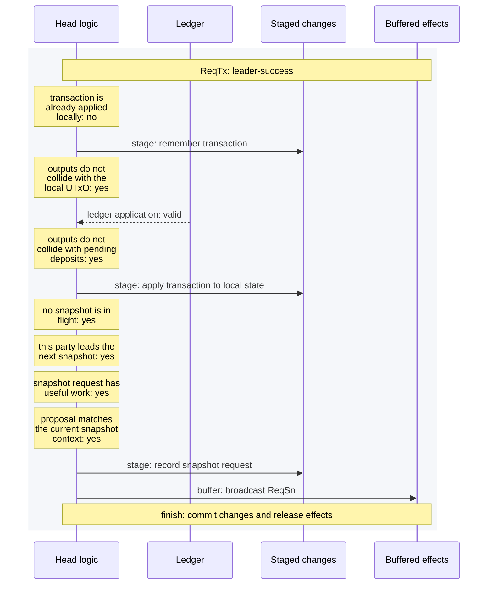

### ReqTx at a follower

The follower applies the transaction without requesting the next round.

[Mermaid source](head-logic/traces/follower.mmd)

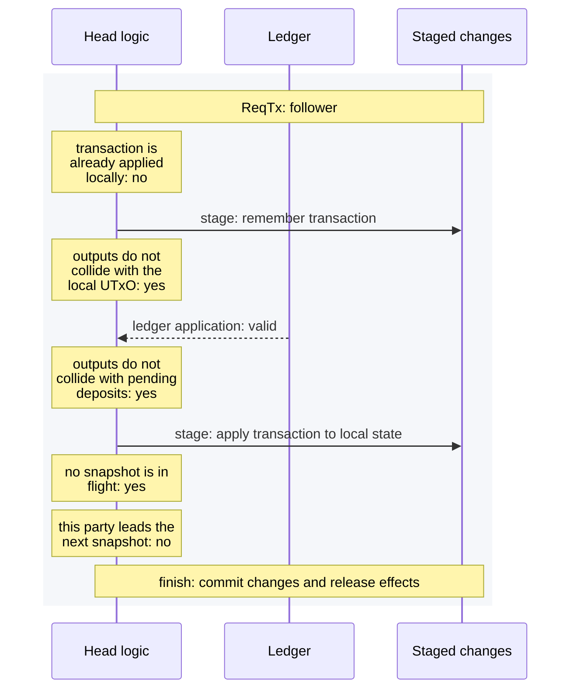

### ReqTx during a snapshot round

Local application succeeds while a snapshot is in flight.

[Mermaid source](head-logic/traces/snapshot-in-flight.mmd)

```mermaid
%%{init: {"sequence": {"wrap": true}}}%%
sequenceDiagram
  participant logic as Head logic
  participant ledger as Ledger
  participant changes as Staged changes
  rect rgb(245, 247, 250)
    Note over logic,changes: ReqTx: snapshot-in-flight
    Note over logic: transaction is already applied locally: no
    logic->>changes: stage: remember transaction
    Note over logic: outputs do not collide with the local UTxO: yes
    ledger-->>logic: ledger application: valid
    Note over logic: outputs do not collide with pending deposits: yes
    logic->>changes: stage: apply transaction to local state
    Note over logic: no snapshot is in flight: no
    Note over logic,changes: finish: commit changes and release effects
  end
```

### ReqTx output collision

The output-name guard fails before ledger application.

[Mermaid source](head-logic/traces/output-collision.mmd)

```mermaid
%%{init: {"sequence": {"wrap": true}}}%%
sequenceDiagram
  participant logic as Head logic
  participant changes as Staged changes
  rect rgb(245, 247, 250)
    Note over logic,changes: ReqTx: output-collision
    Note over logic: transaction is already applied locally: no
    logic->>changes: stage: remember transaction
    Note over logic: outputs do not collide with the local UTxO: no
    Note over logic: retry budget remains: yes
    Note over logic,changes: wait: commit changes and discard buffered effects
  end
```

### ReqTx retry expiry

An inapplicable transaction is invalidated when its retry budget is exhausted.

[Mermaid source](head-logic/traces/timeout.mmd)

```mermaid
%%{init: {"sequence": {"wrap": true}}}%%
sequenceDiagram
  participant logic as Head logic
  participant ledger as Ledger
  participant changes as Staged changes
  rect rgb(245, 247, 250)
    Note over logic,changes: ReqTx: timeout
    Note over logic: transaction is already applied locally: no
    logic->>changes: stage: remember transaction
    Note over logic: outputs do not collide with the local UTxO: yes
    ledger-->>logic: ledger application: invalid
    Note over logic: retry budget remains: no
    logic->>changes: stage: record invalid transaction
    Note over logic,changes: finish: commit changes and release effects
  end
```

### ReqTx dependency wait

Receipt is retained while the transaction waits for a dependency.

[Mermaid source](head-logic/traces/wait.mmd)

```mermaid
%%{init: {"sequence": {"wrap": true}}}%%
sequenceDiagram
  participant logic as Head logic
  participant ledger as Ledger
  participant changes as Staged changes
  rect rgb(245, 247, 250)
    Note over logic,changes: ReqTx: wait
    Note over logic: transaction is already applied locally: no
    logic->>changes: stage: remember transaction
    Note over logic: outputs do not collide with the local UTxO: yes
    ledger-->>logic: ledger application: invalid
    Note over logic: retry budget remains: yes
    Note over logic,changes: wait: commit changes and discard buffered effects
  end
```

## Complete input execution

### Close adopts an unconfirmed snapshot

The observed close carries valid signatures for the snapshot still collecting acknowledgements. Confirm it before recording HeadClosed.

[Mermaid source](head-logic/inputs/close-adopt.mmd)

```mermaid
%%{init: {"sequence": {"wrap": true}}}%%
sequenceDiagram
  participant logic as Head logic
  participant crypto as Cryptography
  participant changes as Staged changes
  rect rgb(245, 247, 250)
    Note over logic,changes: close-adopt
    Note over logic: input is admitted while at this sync status: yes
    Note over logic: chain observation matches the unconfirmed snapshot number: yes
    crypto-->>logic: primitive: verify multisignature
    Note over logic: observed snapshot signatures verify: yes
    logic->>changes: stage: confirm snapshot
    logic->>changes: stage: close head
    Note over logic: confirmed snapshot is newer than the on-chain snapshot: no
    Note over logic,changes: finish: commit changes and release effects
  end
```

### Client close

Post CloseTx using the confirmed snapshot and current version.

[Mermaid source](head-logic/inputs/close-request.mmd)

```mermaid
%%{init: {"sequence": {"wrap": true}}}%%
sequenceDiagram
  participant logic as Head logic
  participant effects as Buffered effects
  rect rgb(245, 247, 250)
    Note over logic,effects: close-request
    Note over logic: client input fits the accumulator: yes
    Note over logic: input is admitted while at this sync status: yes
    logic->>effects: buffer: post close
    Note over logic,effects: finish: commit changes and release effects
  end
```

### Connectivity input

Admit a connectivity event and record network status.

[Mermaid source](head-logic/inputs/connectivity.mmd)

```mermaid
%%{init: {"sequence": {"wrap": true}}}%%
sequenceDiagram
  participant logic as Head logic
  participant changes as Staged changes
  rect rgb(245, 247, 250)
    Note over logic,changes: connectivity
    Note over logic: input is admitted while at this sync status: yes
    logic->>changes: stage: record network connected
    Note over logic,changes: finish: commit changes and release effects
  end
```

### Contest adopts an unconfirmed snapshot

Adopt the matching signed snapshot and record the contest. Successful adoption does not post another contest.

[Mermaid source](head-logic/inputs/contest-adopt.mmd)

```mermaid
%%{init: {"sequence": {"wrap": true}}}%%
sequenceDiagram
  participant logic as Head logic
  participant crypto as Cryptography
  participant changes as Staged changes
  rect rgb(245, 247, 250)
    Note over logic,changes: contest-adopt
    Note over logic: input is admitted while at this sync status: yes
    Note over logic: chain observation matches the unconfirmed snapshot number: yes
    crypto-->>logic: primitive: verify multisignature
    Note over logic: observed snapshot signatures verify: yes
    logic->>changes: stage: confirm snapshot
    logic->>changes: stage: record contest
    Note over logic,changes: finish: commit changes and release effects
  end
```

### Invalid client decommit

A ledger failure records DecommitInvalid without broadcasting.

[Mermaid source](head-logic/inputs/decommit-invalid.mmd)

```mermaid
%%{init: {"sequence": {"wrap": true}}}%%
sequenceDiagram
  participant logic as Head logic
  participant ledger as Ledger
  participant changes as Staged changes
  rect rgb(245, 247, 250)
    Note over logic,changes: decommit-invalid
    Note over logic: client input fits the accumulator: yes
    Note over logic: input is admitted while at this sync status: yes
    Note over logic: no decommit is in flight: yes
    ledger-->>logic: ledger application: invalid
    logic->>changes: stage: record invalid decommit
    Note over logic,changes: finish: commit changes and release effects
  end
```

### Client decommit admission

Check pending work, ask the ledger, require outputs and local/confirmed capacity, then broadcast ReqDec. Reservation occurs on receipt of ReqDec.

[Mermaid source](head-logic/inputs/decommit-request.mmd)

```mermaid
%%{init: {"sequence": {"wrap": true}}}%%
sequenceDiagram
  participant logic as Head logic
  participant ledger as Ledger
  participant effects as Buffered effects
  rect rgb(245, 247, 250)
    Note over logic,effects: decommit-request
    Note over logic: client input fits the accumulator: yes
    Note over logic: input is admitted while at this sync status: yes
    Note over logic: no decommit is in flight: yes
    ledger-->>logic: ledger application: valid
    Note over logic: decommit produces outputs: yes
    Note over logic: decommit fits local and confirmed capacity: yes
    logic->>effects: buffer: broadcast ReqDec
    Note over logic,effects: finish: commit changes and release effects
  end
```

### Decrement adopts the seen snapshot

Finalize the decommit, verify the matching seen snapshot, and adopt it.

[Mermaid source](head-logic/inputs/decrement-adopt.mmd)

```mermaid
%%{init: {"sequence": {"wrap": true}}}%%
sequenceDiagram
  participant logic as Head logic
  participant crypto as Cryptography
  participant changes as Staged changes
  rect rgb(245, 247, 250)
    Note over logic,changes: decrement-adopt
    Note over logic: input is admitted while at this sync status: yes
    logic->>changes: stage: finalize decrement
    Note over logic: settlement matches the seen snapshot: yes
    crypto-->>logic: primitive: verify multisignature
    Note over logic: settlement signatures verify: yes
    logic->>changes: stage: confirm snapshot
    Note over logic,changes: finish: commit changes and release effects
  end
```

### Tick activates a deposit

The common tick prefix records time and deposit status before choosing head-specific work.

[Mermaid source](head-logic/inputs/deposit-activated.mmd)

```mermaid
%%{init: {"sequence": {"wrap": true}}}%%
sequenceDiagram
  participant logic as Head logic
  participant changes as Staged changes
  rect rgb(245, 247, 250)
    Note over logic,changes: deposit-activated
    Note over logic: input is admitted while at this sync status: yes
    logic->>changes: stage: advance chain time
    logic->>changes: stage: expire deposit
    Note over logic,changes: finish: commit changes and release effects
  end
```

### Observe deposit

Record a deposit for the active head.

[Mermaid source](head-logic/inputs/deposit-observed.mmd)

```mermaid
%%{init: {"sequence": {"wrap": true}}}%%
sequenceDiagram
  participant logic as Head logic
  participant changes as Staged changes
  rect rgb(245, 247, 250)
    Note over logic,changes: deposit-observed
    Note over logic: input is admitted while at this sync status: yes
    logic->>changes: stage: record deposit
    Note over logic,changes: finish: commit changes and release effects
  end
```

### Observe recovery

Consume a tracked deposit after its recovery is observed.

[Mermaid source](head-logic/inputs/deposit-recovered.mmd)

```mermaid
%%{init: {"sequence": {"wrap": true}}}%%
sequenceDiagram
  participant logic as Head logic
  participant changes as Staged changes
  rect rgb(245, 247, 250)
    Note over logic,changes: deposit-recovered
    Note over logic: input is admitted while at this sync status: yes
    logic->>changes: stage: consume recovered deposit
    Note over logic,changes: finish: commit changes and release effects
  end
```

### Continue driven fanout

Record the observed batch and post the next step. An empty remainder still needs the final token-burning step.

[Mermaid source](head-logic/inputs/fanout-driver-observation.mmd)

```mermaid
%%{init: {"sequence": {"wrap": true}}}%%
sequenceDiagram
  participant logic as Head logic
  participant changes as Staged changes
  participant effects as Buffered effects
  rect rgb(245, 247, 250)
    Note over logic,effects: fanout-driver-observation
    Note over logic: input is admitted while at this sync status: yes
    logic->>changes: stage: record distributed outputs
    logic->>effects: buffer: post final fanout
    Note over logic,effects: finish: commit changes and release effects
  end
```

### Reject an empty fanout selection

An empty selection produces CommandFailed without changing the driver state.

[Mermaid source](head-logic/inputs/fanout-empty-selection.mmd)

```mermaid
%%{init: {"sequence": {"wrap": true}}}%%
sequenceDiagram
  participant logic as Head logic
  participant effects as Buffered effects
  rect rgb(245, 247, 250)
    Note over logic,effects: fanout-empty-selection
    Note over logic: client input fits the accumulator: yes
    Note over logic: input is admitted while at this sync status: yes
    logic->>effects: buffer: client effect
    Note over logic,effects: finish: commit changes and release effects
  end
```

### Observe completed fanout

Record the final distributed set and return the head to Idle.

[Mermaid source](head-logic/inputs/fanout-finished.mmd)

```mermaid
%%{init: {"sequence": {"wrap": true}}}%%
sequenceDiagram
  participant logic as Head logic
  participant changes as Staged changes
  rect rgb(245, 247, 250)
    Note over logic,changes: fanout-finished
    Note over logic: input is admitted while at this sync status: yes
    logic->>changes: stage: finish fanout
    Note over logic,changes: finish: commit changes and release effects
  end
```

### Observe another party fanning out

Record distributed outputs and enter AwaitingSelection. A passive observer does not take over the driver role.

[Mermaid source](head-logic/inputs/fanout-passive-observer.mmd)

```mermaid
%%{init: {"sequence": {"wrap": true}}}%%
sequenceDiagram
  participant logic as Head logic
  participant changes as Staged changes
  rect rgb(245, 247, 250)
    Note over logic,changes: fanout-passive-observer
    Note over logic: input is admitted while at this sync status: yes
    logic->>changes: stage: record distributed outputs
    Note over logic,changes: finish: commit changes and release effects
  end
```

### Fanout initiation fails

A terminal failure of the current step before any outputs are distributed reverts optimistic fanout and reports the error.

[Mermaid source](head-logic/inputs/fanout-post-failure.mmd)

```mermaid
%%{init: {"sequence": {"wrap": true}}}%%
sequenceDiagram
  participant logic as Head logic
  participant changes as Staged changes
  participant effects as Buffered effects
  rect rgb(245, 247, 250)
    Note over logic,effects: fanout-post-failure
    Note over logic: input is admitted while at this sync status: yes
    logic->>changes: stage: revert failed fanout initiation
    logic->>effects: buffer: client effect
    Note over logic,effects: finish: commit changes and release effects
  end
```

### Fanout deadline passes

The tick prefix advances time before notifying readiness, once.

[Mermaid source](head-logic/inputs/fanout-ready.mmd)

```mermaid
%%{init: {"sequence": {"wrap": true}}}%%
sequenceDiagram
  participant logic as Head logic
  participant changes as Staged changes
  rect rgb(245, 247, 250)
    Note over logic,changes: fanout-ready
    Note over logic: input is admitted while at this sync status: yes
    logic->>changes: stage: advance chain time
    Note over logic: fanout deadline passed and notification is unsent: yes
    logic->>changes: stage: notify ready to fanout
    Note over logic,changes: finish: commit changes and release effects
  end
```

### Start automatic fanout

Record the driver role before posting full fanout.

[Mermaid source](head-logic/inputs/fanout-request.mmd)

```mermaid
%%{init: {"sequence": {"wrap": true}}}%%
sequenceDiagram
  participant logic as Head logic
  participant changes as Staged changes
  participant effects as Buffered effects
  rect rgb(245, 247, 250)
    Note over logic,effects: fanout-request
    Note over logic: client input fits the accumulator: yes
    Note over logic: input is admitted while at this sync status: yes
    logic->>changes: stage: start automatic fanout
    logic->>effects: buffer: post full fanout
    Note over logic,effects: finish: commit changes and release effects
  end
```

### Rollback during fanout

Record rollback and repost the currently driven step, without recording a new selection.

[Mermaid source](head-logic/inputs/fanout-rollback.mmd)

```mermaid
%%{init: {"sequence": {"wrap": true}}}%%
sequenceDiagram
  participant logic as Head logic
  participant changes as Staged changes
  participant effects as Buffered effects
  rect rgb(245, 247, 250)
    Note over logic,effects: fanout-rollback
    Note over logic: input is admitted while at this sync status: yes
    logic->>changes: stage: record chain rollback
    logic->>effects: buffer: post full fanout
    Note over logic,effects: finish: commit changes and release effects
  end
```

### Select the whole remaining fanout

A selection covering the complete closed head uses full fanout rather than an invalid final-partial transaction.

[Mermaid source](head-logic/inputs/fanout-selection.mmd)

```mermaid
%%{init: {"sequence": {"wrap": true}}}%%
sequenceDiagram
  participant logic as Head logic
  participant changes as Staged changes
  participant effects as Buffered effects
  rect rgb(245, 247, 250)
    Note over logic,effects: fanout-selection
    Note over logic: client input fits the accumulator: yes
    Note over logic: input is admitted while at this sync status: yes
    logic->>changes: stage: start automatic fanout
    logic->>effects: buffer: post full fanout
    Note over logic,effects: finish: commit changes and release effects
  end
```

### Fanout post is superseded

StalePartialFanoutTx is ignored because chain observation already advances the head.

[Mermaid source](head-logic/inputs/fanout-stale-post.mmd)

```mermaid
%%{init: {"sequence": {"wrap": true}}}%%
sequenceDiagram
  participant logic as Head logic
  rect rgb(245, 247, 250)
    Note over logic: fanout-stale-post
    Note over logic: input is admitted while at this sync status: yes
    Note over logic: finish: commit changes and release effects
  end
```

### Increment adopts the seen snapshot

Finalize the deposit, verify the matching seen snapshot, then adopt it before choosing subsequent work.

[Mermaid source](head-logic/inputs/increment-adopt.mmd)

```mermaid
%%{init: {"sequence": {"wrap": true}}}%%
sequenceDiagram
  participant logic as Head logic
  participant crypto as Cryptography
  participant changes as Staged changes
  rect rgb(245, 247, 250)
    Note over logic,changes: increment-adopt
    Note over logic: input is admitted while at this sync status: yes
    logic->>changes: stage: finalize increment
    Note over logic: settlement matches the seen snapshot: yes
    crypto-->>logic: primitive: verify multisignature
    Note over logic: settlement signatures verify: yes
    logic->>changes: stage: confirm snapshot
    Note over logic,changes: finish: commit changes and release effects
  end
```

### Increment with invalid adoption signatures

Finalization is still recorded. Failed verification prevents snapshot adoption without undoing the chain observation.

[Mermaid source](head-logic/inputs/increment-invalid-signatures.mmd)

```mermaid
%%{init: {"sequence": {"wrap": true}}}%%
sequenceDiagram
  participant logic as Head logic
  participant crypto as Cryptography
  participant changes as Staged changes
  rect rgb(245, 247, 250)
    Note over logic,changes: increment-invalid-signatures
    Note over logic: input is admitted while at this sync status: yes
    logic->>changes: stage: finalize increment
    Note over logic: settlement matches the seen snapshot: yes
    crypto-->>logic: primitive: verify multisignature
    Note over logic: settlement signatures verify: no
    Note over logic,changes: finish: commit changes and release effects
  end
```

### Observe init

Match the observed parties, participants and periods before opening the head.

[Mermaid source](head-logic/inputs/init-observed.mmd)

```mermaid
%%{init: {"sequence": {"wrap": true}}}%%
sequenceDiagram
  participant logic as Head logic
  participant changes as Staged changes
  rect rgb(245, 247, 250)
    Note over logic,changes: init-observed
    Note over logic: input is admitted while at this sync status: yes
    logic->>changes: stage: open head
    Note over logic,changes: finish: commit changes and release effects
  end
```

### Client init

Admit a client Init while Idle and buffer the configured on-chain init.

[Mermaid source](head-logic/inputs/init-request.mmd)

```mermaid
%%{init: {"sequence": {"wrap": true}}}%%
sequenceDiagram
  participant logic as Head logic
  participant effects as Buffered effects
  rect rgb(245, 247, 250)
    Note over logic,effects: init-request
    Note over logic: client input fits the accumulator: yes
    Note over logic: input is admitted while at this sync status: yes
    logic->>effects: buffer: post init
    Note over logic,effects: finish: commit changes and release effects
  end
```

### Rollback in an open head

Record rollback and evaluate retained settlement reposting without undoing L2 state.

[Mermaid source](head-logic/inputs/open-rollback.mmd)

```mermaid
%%{init: {"sequence": {"wrap": true}}}%%
sequenceDiagram
  participant logic as Head logic
  participant changes as Staged changes
  rect rgb(245, 247, 250)
    Note over logic,changes: open-rollback
    Note over logic: input is admitted while at this sync status: yes
    logic->>changes: stage: record chain rollback
    Note over logic,changes: finish: commit changes and release effects
  end
```

### Recover a previous head deposit

A recovery event consumes a previous head deposit while a different head is active. The event is exempt from the head-ID filter; the differential test checks the resulting registry.

[Mermaid source](head-logic/inputs/recover-previous-head.mmd)

```mermaid
%%{init: {"sequence": {"wrap": true}}}%%
sequenceDiagram
  participant logic as Head logic
  participant changes as Staged changes
  rect rgb(245, 247, 250)
    Note over logic,changes: recover-previous-head
    Note over logic: input is admitted while at this sync status: yes
    logic->>changes: stage: consume recovered deposit
    Note over logic,changes: finish: commit changes and release effects
  end
```

### Side-load the current snapshot

Check number and L1 fields, verify the multisignature, then confirm and clear optimistic local state.

[Mermaid source](head-logic/inputs/side-load-current.mmd)

```mermaid
%%{init: {"sequence": {"wrap": true}}}%%
sequenceDiagram
  participant logic as Head logic
  participant crypto as Cryptography
  participant changes as Staged changes
  rect rgb(245, 247, 250)
    Note over logic,changes: side-load-current
    Note over logic: client input fits the accumulator: yes
    Note over logic: input is admitted while at this sync status: yes
    Note over logic: side-loaded snapshot number does not go backwards: yes
    Note over logic: side-loaded version matches: yes
    Note over logic: side-loaded commit matches: yes
    Note over logic: side-loaded deposit matches: yes
    Note over logic: side-loaded decommit matches: yes
    crypto-->>logic: primitive: verify multisignature
    logic->>changes: stage: confirm snapshot
    logic->>changes: stage: clear optimistic local state
    Note over logic,changes: finish: commit changes and release effects
  end
```

### Side-load with invalid signatures

The field checks pass but verification fails. The existing client rejection is emitted; no state changes are staged.

[Mermaid source](head-logic/inputs/side-load-invalid-signatures.mmd)

```mermaid
%%{init: {"sequence": {"wrap": true}}}%%
sequenceDiagram
  participant logic as Head logic
  participant crypto as Cryptography
  participant effects as Buffered effects
  rect rgb(245, 247, 250)
    Note over logic,effects: side-load-invalid-signatures
    Note over logic: client input fits the accumulator: yes
    Note over logic: input is admitted while at this sync status: yes
    Note over logic: side-loaded snapshot number does not go backwards: yes
    Note over logic: side-loaded version matches: yes
    Note over logic: side-loaded commit matches: yes
    Note over logic: side-loaded deposit matches: yes
    Note over logic: side-loaded decommit matches: yes
    crypto-->>logic: primitive: verify multisignature
    logic->>effects: buffer: client effect
    Note over logic,effects: finish: commit changes and release effects
  end
```

### Chain input while catching up

Chain observations pass the synchronisation gate and update the head.

[Mermaid source](head-logic/inputs/unsynced-chain.mmd)

```mermaid
%%{init: {"sequence": {"wrap": true}}}%%
sequenceDiagram
  participant logic as Head logic
  participant changes as Staged changes
  rect rgb(245, 247, 250)
    Note over logic,changes: unsynced-chain
    Note over logic: input is admitted while at this sync status: yes
    Note over logic: chain observation matches the unconfirmed snapshot number: no
    logic->>changes: stage: close head
    Note over logic: confirmed snapshot is newer than the on-chain snapshot: no
    Note over logic,changes: finish: commit changes and release effects
  end
```

### Client input while catching up

After the size check, synchronisation rejects the client input with the existing drift report.

[Mermaid source](head-logic/inputs/unsynced-client.mmd)

```mermaid
%%{init: {"sequence": {"wrap": true}}}%%
sequenceDiagram
  participant logic as Head logic
  participant effects as Buffered effects
  rect rgb(245, 247, 250)
    Note over logic,effects: unsynced-client
    Note over logic: client input fits the accumulator: yes
    Note over logic: node is in sync: no
    logic->>effects: buffer: client effect
    Note over logic,effects: finish: commit changes and release effects
  end
```

### Network input while catching up

Connectivity events follow the same existing wait policy as other network inputs.

[Mermaid source](head-logic/inputs/unsynced-connectivity.mmd)

```mermaid
%%{init: {"sequence": {"wrap": true}}}%%
sequenceDiagram
  participant logic as Head logic
  rect rgb(245, 247, 250)
    Note over logic: unsynced-connectivity
    Note over logic: node is in sync: no
    Note over logic: wait: commit changes and discard buffered effects
  end
```

## Review findings

### Conflicting transaction leaves a decommit reservation

All three parties confirm the ordinary transaction after 24 deliveries, but party 1 retains a decommit of its already-consumed input and refuses a valid replacement. The normal interpreter and frozen implementation agree. See the [review](head-logic/adversarial-review.md#correctness-a-remaining-decommit-bug) and [reproduction source](head-logic/review-examples.hs) for final-state assertions and side-load recovery.

[Mermaid source](head-logic/traces/conflicting-decommit.mmd)

```mermaid
%%{init: {"sequence": {"wrap": true}}}%%
sequenceDiagram
  participant logic as Head logic
  participant ledger as Ledger
  participant crypto as Cryptography
  participant changes as Staged changes
  participant effects as Buffered effects
  rect rgb(245, 247, 250)
    Note over logic,effects: deliver ReqTx 1 from party 0 to 0 (TTL 2)
    Note over logic: input is admitted while at this sync status: yes
    Note over logic: transaction is already applied locally: no
    logic->>changes: stage: remember transaction
    Note over logic: outputs do not collide with the local UTxO: yes
    ledger-->>logic: ledger application: valid
    Note over logic: outputs do not collide with pending deposits: yes
    logic->>changes: stage: apply transaction to local state
    Note over logic: no snapshot is in flight: yes
    Note over logic: this party leads the next snapshot: yes
    Note over logic: snapshot request has useful work: yes
    Note over logic: proposal matches the current snapshot context: yes
    logic->>changes: stage: record snapshot request
    logic->>effects: buffer: broadcast ReqSn
    Note over logic,effects: finish: commit changes and release effects
  end
  rect rgb(245, 247, 250)
    Note over logic,effects: ReqDec 10 to party 1 (TTL 2)
    Note over logic: input is admitted while at this sync status: yes
    Note over logic: next snapshot carries a deposit: no
    Note over logic: no decommit is in flight: yes
    ledger-->>logic: ledger application: valid
    Note over logic: decommit produces outputs: yes
    Note over logic: decommit fits local and confirmed capacity: yes
    logic->>changes: stage: reserve decommit
    Note over logic: no snapshot is in flight: yes
    Note over logic: this party leads the next snapshot: no
    Note over logic,effects: finish: commit changes and release effects
  end
  rect rgb(245, 247, 250)
    Note over logic,effects: deliver ReqTx 1 from party 0 to 1 (TTL 2)
    Note over logic: input is admitted while at this sync status: yes
    Note over logic: transaction is already applied locally: no
    logic->>changes: stage: remember transaction
    Note over logic: outputs do not collide with the local UTxO: yes
    ledger-->>logic: ledger application: invalid
    Note over logic: retry budget remains: yes
    Note over logic,effects: wait: commit changes and discard buffered effects
  end
  rect rgb(245, 247, 250)
    Note over logic,effects: deliver ReqTx 1 from party 0 to 2 (TTL 2)
    Note over logic: input is admitted while at this sync status: yes
    Note over logic: transaction is already applied locally: no
    logic->>changes: stage: remember transaction
    Note over logic: outputs do not collide with the local UTxO: yes
    ledger-->>logic: ledger application: valid
    Note over logic: outputs do not collide with pending deposits: yes
    logic->>changes: stage: apply transaction to local state
    Note over logic: no snapshot is in flight: yes
    Note over logic: this party leads the next snapshot: no
    Note over logic,effects: finish: commit changes and release effects
  end
  rect rgb(245, 247, 250)
    Note over logic,effects: ReqDec 10 to party 0 (TTL 2)
    Note over logic: input is admitted while at this sync status: yes
    Note over logic: next snapshot carries a deposit: no
    Note over logic: no decommit is in flight: yes
    ledger-->>logic: ledger application: invalid
    Note over logic: retry budget remains: yes
    Note over logic,effects: wait: commit changes and discard buffered effects
  end
  rect rgb(245, 247, 250)
    Note over logic,effects: ReqDec 10 to party 2 (TTL 2)
    Note over logic: input is admitted while at this sync status: yes
    Note over logic: next snapshot carries a deposit: no
    Note over logic: no decommit is in flight: yes
    ledger-->>logic: ledger application: invalid
    Note over logic: retry budget remains: yes
    Note over logic,effects: wait: commit changes and discard buffered effects
  end
  rect rgb(245, 247, 250)
    Note over logic,effects: deliver ReqSn 0/1 txs [1] from party 0 to 0 (TTL 2)
    Note over logic: input is admitted while at this sync status: yes
    Note over logic: request is the next snapshot: yes
    Note over logic: sender leads this snapshot: yes
    Note over logic: previous snapshot is confirmed: yes
    Note over logic: snapshot version matches: yes
    Note over logic: snapshot transaction outputs are fresh: yes
    ledger-->>logic: ledger application: valid
    Note over logic: unsettled fanout fits accumulator capacity: yes
    Note over logic: settled fanout fits accumulator capacity: yes
    crypto-->>logic: primitive: sign snapshot
    logic->>effects: buffer: broadcast AckSn
    Note over logic: snapshot transaction outputs are fresh: no
    logic->>changes: stage: record requested snapshot and prune local transactions
    Note over logic,effects: finish: commit changes and release effects
  end
  rect rgb(245, 247, 250)
    Note over logic,effects: deliver ReqSn 0/1 txs [1] from party 0 to 1 (TTL 2)
    Note over logic: input is admitted while at this sync status: yes
    Note over logic: request is the next snapshot: yes
    Note over logic: sender leads this snapshot: yes
    Note over logic: previous snapshot is confirmed: yes
    Note over logic: snapshot version matches: yes
    Note over logic: snapshot transaction outputs are fresh: yes
    ledger-->>logic: ledger application: valid
    Note over logic: unsettled fanout fits accumulator capacity: yes
    Note over logic: settled fanout fits accumulator capacity: yes
    crypto-->>logic: primitive: sign snapshot
    logic->>effects: buffer: broadcast AckSn
    logic->>changes: stage: record requested snapshot and prune local transactions
    Note over logic,effects: finish: commit changes and release effects
  end
  rect rgb(245, 247, 250)
    Note over logic,effects: deliver ReqSn 0/1 txs [1] from party 0 to 2 (TTL 2)
    Note over logic: input is admitted while at this sync status: yes
    Note over logic: request is the next snapshot: yes
    Note over logic: sender leads this snapshot: yes
    Note over logic: previous snapshot is confirmed: yes
    Note over logic: snapshot version matches: yes
    Note over logic: snapshot transaction outputs are fresh: yes
    ledger-->>logic: ledger application: valid
    Note over logic: unsettled fanout fits accumulator capacity: yes
    Note over logic: settled fanout fits accumulator capacity: yes
    crypto-->>logic: primitive: sign snapshot
    logic->>effects: buffer: broadcast AckSn
    Note over logic: snapshot transaction outputs are fresh: no
    logic->>changes: stage: record requested snapshot and prune local transactions
    Note over logic,effects: finish: commit changes and release effects
  end
  rect rgb(245, 247, 250)
    Note over logic,effects: deliver AckSn 1 from party 0 to 0 (TTL 2)
    Note over logic: input is admitted while at this sync status: yes
    Note over logic: acknowledgement number is admissible: yes
    Note over logic: party has not signed this snapshot: yes
    logic->>changes: stage: record snapshot signature
    Note over logic: all parties have signed: no
    logic->>changes: stage: record snapshot signature
    Note over logic,effects: finish: commit changes and release effects
  end
  rect rgb(245, 247, 250)
    Note over logic,effects: deliver AckSn 1 from party 0 to 1 (TTL 2)
    Note over logic: input is admitted while at this sync status: yes
    Note over logic: acknowledgement number is admissible: yes
    Note over logic: party has not signed this snapshot: yes
    logic->>changes: stage: record snapshot signature
    Note over logic: all parties have signed: no
    logic->>changes: stage: record snapshot signature
    Note over logic,effects: finish: commit changes and release effects
  end
  rect rgb(245, 247, 250)
    Note over logic,effects: deliver AckSn 1 from party 0 to 2 (TTL 2)
    Note over logic: input is admitted while at this sync status: yes
    Note over logic: acknowledgement number is admissible: yes
    Note over logic: party has not signed this snapshot: yes
    logic->>changes: stage: record snapshot signature
    Note over logic: all parties have signed: no
    logic->>changes: stage: record snapshot signature
    Note over logic,effects: finish: commit changes and release effects
  end
  rect rgb(245, 247, 250)
    Note over logic,effects: deliver AckSn 1 from party 1 to 0 (TTL 2)
    Note over logic: input is admitted while at this sync status: yes
    Note over logic: acknowledgement number is admissible: yes
    Note over logic: party has not signed this snapshot: yes
    logic->>changes: stage: record snapshot signature
    Note over logic: all parties have signed: no
    logic->>changes: stage: record snapshot signature
    Note over logic,effects: finish: commit changes and release effects
  end
  rect rgb(245, 247, 250)
    Note over logic,effects: deliver AckSn 1 from party 1 to 1 (TTL 2)
    Note over logic: input is admitted while at this sync status: yes
    Note over logic: acknowledgement number is admissible: yes
    Note over logic: party has not signed this snapshot: yes
    logic->>changes: stage: record snapshot signature
    Note over logic: all parties have signed: no
    logic->>changes: stage: record snapshot signature
    Note over logic,effects: finish: commit changes and release effects
  end
  rect rgb(245, 247, 250)
    Note over logic,effects: deliver AckSn 1 from party 1 to 2 (TTL 2)
    Note over logic: input is admitted while at this sync status: yes
    Note over logic: acknowledgement number is admissible: yes
    Note over logic: party has not signed this snapshot: yes
    logic->>changes: stage: record snapshot signature
    Note over logic: all parties have signed: no
    logic->>changes: stage: record snapshot signature
    Note over logic,effects: finish: commit changes and release effects
  end
  rect rgb(245, 247, 250)
    Note over logic,effects: deliver AckSn 1 from party 2 to 0 (TTL 2)
    Note over logic: input is admitted while at this sync status: yes
    Note over logic: acknowledgement number is admissible: yes
    Note over logic: party has not signed this snapshot: yes
    logic->>changes: stage: record snapshot signature
    Note over logic: all parties have signed: yes
    crypto-->>logic: primitive: verify multisignature
    logic->>changes: stage: confirm snapshot
    Note over logic,effects: finish: commit changes and release effects
  end
  rect rgb(245, 247, 250)
    Note over logic,effects: deliver AckSn 1 from party 2 to 1 (TTL 2)
    Note over logic: input is admitted while at this sync status: yes
    Note over logic: acknowledgement number is admissible: yes
    Note over logic: party has not signed this snapshot: yes
    logic->>changes: stage: record snapshot signature
    Note over logic: all parties have signed: yes
    crypto-->>logic: primitive: verify multisignature
    logic->>changes: stage: confirm snapshot
    Note over logic,effects: finish: commit changes and release effects
  end
  rect rgb(245, 247, 250)
    Note over logic,effects: deliver AckSn 1 from party 2 to 2 (TTL 2)
    Note over logic: input is admitted while at this sync status: yes
    Note over logic: acknowledgement number is admissible: yes
    Note over logic: party has not signed this snapshot: yes
    logic->>changes: stage: record snapshot signature
    Note over logic: all parties have signed: yes
    crypto-->>logic: primitive: verify multisignature
    logic->>changes: stage: confirm snapshot
    Note over logic,effects: finish: commit changes and release effects
  end
  rect rgb(245, 247, 250)
    Note over logic,effects: retry ReqTx 1 from party 0 to 1 (TTL 1)
    Note over logic: input is admitted while at this sync status: yes
    Note over logic: transaction is already applied locally: no
    logic->>changes: stage: remember transaction
    Note over logic: outputs do not collide with the local UTxO: no
    Note over logic: retry budget remains: yes
    Note over logic,effects: wait: commit changes and discard buffered effects
  end
  rect rgb(245, 247, 250)
    Note over logic,effects: ReqDec 10 to party 0 (TTL 1)
    Note over logic: input is admitted while at this sync status: yes
    Note over logic: next snapshot carries a deposit: no
    Note over logic: no decommit is in flight: yes
    ledger-->>logic: ledger application: invalid
    Note over logic: retry budget remains: yes
    Note over logic,effects: wait: commit changes and discard buffered effects
  end
  rect rgb(245, 247, 250)
    Note over logic,effects: ReqDec 10 to party 2 (TTL 1)
    Note over logic: input is admitted while at this sync status: yes
    Note over logic: next snapshot carries a deposit: no
    Note over logic: no decommit is in flight: yes
    ledger-->>logic: ledger application: invalid
    Note over logic: retry budget remains: yes
    Note over logic,effects: wait: commit changes and discard buffered effects
  end
  rect rgb(245, 247, 250)
    Note over logic,effects: retry ReqTx 1 from party 0 to 1 (TTL 0)
    Note over logic: input is admitted while at this sync status: yes
    Note over logic: transaction is already applied locally: no
    logic->>changes: stage: remember transaction
    Note over logic: outputs do not collide with the local UTxO: no
    Note over logic: retry budget remains: no
    logic->>changes: stage: record invalid transaction
    Note over logic,effects: finish: commit changes and release effects
  end
  rect rgb(245, 247, 250)
    Note over logic,effects: ReqDec 10 to party 0 (TTL 0)
    Note over logic: input is admitted while at this sync status: yes
    Note over logic: next snapshot carries a deposit: no
    Note over logic: no decommit is in flight: yes
    ledger-->>logic: ledger application: invalid
    Note over logic: retry budget remains: no
    logic->>changes: stage: record invalid decommit
    Note over logic,effects: finish: commit changes and release effects
  end
  rect rgb(245, 247, 250)
    Note over logic,effects: ReqDec 10 to party 2 (TTL 0)
    Note over logic: input is admitted while at this sync status: yes
    Note over logic: next snapshot carries a deposit: no
    Note over logic: no decommit is in flight: yes
    ledger-->>logic: ledger application: invalid
    Note over logic: retry budget remains: no
    logic->>changes: stage: record invalid decommit
    Note over logic,effects: finish: commit changes and release effects
  end
```

## Archived diagrams

<details>
<summary>Prior-spike index (31 diagrams)</summary>

These records are rendered in [prior-spike/diagrams.md](prior-spike/diagrams.md).
They include superseded behavior, deliberate mutations, and migration comparisons.

| Diagram | What it records | Source |
| --- | --- | --- |
| [Leader accepts a transaction](prior-spike/diagrams.md#leader-accepts-a-transaction) | Ledger application succeeds; the leader records local application and requests a snapshot. | [Mermaid](prior-spike/workflows/req-tx-leader.mmd) |
| [Follower accepts a transaction](prior-spike/diagrams.md#follower-accepts-a-transaction) | The follower applies the transaction without requesting the next round. | [Mermaid](prior-spike/workflows/req-tx-follower.mmd) |
| [Transaction waits for a dependency](prior-spike/diagrams.md#transaction-waits-for-a-dependency) | Receipt survives the wait; buffered effects do not. A retry runs a fresh program against current state. | [Mermaid](prior-spike/workflows/req-tx-wait.mmd) |
| [Transaction retry expires](prior-spike/diagrams.md#transaction-retry-expires) | An inapplicable transaction with no retry budget is invalidated. | [Mermaid](prior-spike/workflows/req-tx-timeout.mmd) |
| [Locally applied duplicate](prior-spike/diagrams.md#locally-applied-duplicate) | The known transaction ID is ignored before receipt or ledger application. | [Mermaid](prior-spike/workflows/req-tx-duplicate.mmd) |
| [Transaction output collision](prior-spike/diagrams.md#transaction-output-collision) | The rule rejects conflicting output names; the interpreter does not own this policy. | [Mermaid](prior-spike/workflows/req-tx-output-collision.mmd) |
| [Transaction during a snapshot round](prior-spike/diagrams.md#transaction-during-a-snapshot-round) | Local application succeeds while snapshot request selection waits for the current round. | [Mermaid](prior-spike/workflows/req-tx-in-flight.mmd) |
| [Snapshot request succeeds](prior-spike/diagrams.md#snapshot-request-succeeds) | The rule resolves transactions, constructs and signs the snapshot, buffers AckSn, then prunes local transactions. | [Mermaid](prior-spike/workflows/req-sn-sign.mmd) |
| [Snapshot version mismatch](prior-spike/diagrams.md#snapshot-version-mismatch) | A future or otherwise different local version waits at the version guard. | [Mermaid](prior-spike/workflows/req-sn-version-wait.mmd) |
| [Snapshot transaction is missing](prior-spike/diagrams.md#snapshot-transaction-is-missing) | The request waits until the local registry contains the requested transaction. | [Mermaid](prior-spike/workflows/req-sn-missing-transaction.mmd) |
| [Snapshot carries a decommit](prior-spike/diagrams.md#snapshot-carries-a-decommit) | The decommit is applied before ordinary transactions; this order matters in the dependency bug. | [Mermaid](prior-spike/workflows/req-sn-decommit.mmd) |
| [Network decommit is recorded](prior-spike/diagrams.md#network-decommit-is-recorded) | The network rule reserves the decommit and can broadcast ReqSn; it does not stage SnapshotRequestDecided. | [Mermaid](prior-spike/workflows/req-dec-record.mmd) |
| [Network decommit waits](prior-spike/diagrams.md#network-decommit-waits) | An inapplicable decommit waits while retry budget remains. | [Mermaid](prior-spike/workflows/req-dec-wait.mmd) |
| [Network decommit expires](prior-spike/diagrams.md#network-decommit-expires) | Without retry budget, the same failure records DecommitInvalid. | [Mermaid](prior-spike/workflows/req-dec-timeout.mmd) |
| [Recover a registered deposit](prior-spike/diagrams.md#recover-a-registered-deposit) | Registration and retained-finalization checks pass, then the rule posts recovery. | [Mermaid](prior-spike/workflows/recover-post.mmd) |
| [Recover an unknown deposit](prior-spike/diagrams.md#recover-an-unknown-deposit) | The missing-deposit guard rejects before any post. | [Mermaid](prior-spike/workflows/recover-missing.mmd) |
| [Recover a finalized deposit](prior-spike/diagrams.md#recover-a-finalized-deposit) | A retained finalized increment blocks recovery of its resurfaced deposit. | [Mermaid](prior-spike/workflows/recover-blocked.mmd) |
| [Acknowledgement arrives early](prior-spike/diagrams.md#acknowledgement-arrives-early) | The acknowledgement waits for the snapshot it signs. | [Mermaid](prior-spike/workflows/ack-early.mmd) |
| [Partial acknowledgement](prior-spike/diagrams.md#partial-acknowledgement) | The partial path records the signature twice. The migration preserves this observable event order. | [Mermaid](prior-spike/workflows/ack-partial.mmd) |
| [Duplicate acknowledgement](prior-spike/diagrams.md#duplicate-acknowledgement) | An already recorded signer is rejected according to the existing acknowledgement policy. | [Mermaid](prior-spike/workflows/ack-duplicate.mmd) |
| [Final acknowledgement confirms](prior-spike/diagrams.md#final-acknowledgement-confirms) | A complete valid multisignature confirms the round and selects subsequent work. | [Mermaid](prior-spike/workflows/ack-confirm.mmd) |
| [Invalid final acknowledgement](prior-spike/diagrams.md#invalid-final-acknowledgement) | The signature is staged before aggregate verification. Verification fails, so rejection discards that staged signature and every buffered effect. | [Mermaid](prior-spike/workflows/ack-invalid.mmd) |
| [Historical invalid confirmation (v1)](prior-spike/diagrams.md#historical-invalid-confirmation-v1) | Historical fault-injected verification witness. The primitive tape format is superseded; use the v2 counterexample to replay. | [Mermaid](prior-spike/traces/counterexample-v1.json.mmd) |
| [Decommit dependency failure](prior-spike/diagrams.md#decommit-dependency-failure) | Historical v1 trace of the decommit stall: snapshot 1 pruning restores the reserved input; snapshot 2 applies the decommit before tx2 and all parties reject. Use the v2 historical and corrected commands for current reproduction. | [Mermaid](prior-spike/traces/decommit-dependency-v1.json.mmd) |
| [Cardano witness replacement](prior-spike/diagrams.md#cardano-witness-replacement) | A transaction with stripped witnesses shares a valid transaction body and ID. The frozen rule corrupts the registry; the duplicate guard preserves the validated payload. | [Mermaid](prior-spike/traces/registry-demo-v1.json.mmd) |
| [Historical snapshot round (v1)](prior-spike/diagrams.md#historical-snapshot-round-v1) | The original three-party round artifact. Its v1 primitive tape is historical; use v2 for replay. | [Mermaid](prior-spike/traces/snapshot-round-v1.json.mmd) |
| [Maintenance exercise](prior-spike/diagrams.md#maintenance-exercise) | A deliberately changed rule guard alters execution and the generated trace without changing the interpreter. | [Mermaid](prior-spike/traces/maintenance-rejected.mmd) |
| [Decommit failure at the owner boundary](prior-spike/diagrams.md#decommit-failure-at-the-owner-boundary) | Historical explanation of reservation loss and a premature decommit request, grouped by rules, state owners, and independent checks. | [Mermaid](prior-spike/machines/decommit-ownership.mmd) |
| [Historical decommit dependency failure](prior-spike/diagrams.md#historical-decommit-dependency-failure) | The frozen implementation loses the reservation and rejects snapshot 2 after 24 deliveries. This v2 report checks complete outcomes and serialized state at every prefix. | [Mermaid](prior-spike/traces/decommit-dependency-historical-v2.json.mmd) |
| [Oversized snapshot request before rebase](prior-spike/diagrams.md#oversized-snapshot-request-before-rebase) | Historical production trace at 386e95947: the split records a request, ReqSn rejects for capacity, and the later merge cannot request another round. The rejection cannot undo the preceding completed input. The capacity lab now reproduces the defect with frozen programs. | [Mermaid](prior-spike/traces/capacity-before-rebase.mmd) |
| [Historical capacity stall](prior-spike/diagrams.md#historical-capacity-stall) | Frozen programs accept the split and independent merge locally, but the oversized snapshot 4 request is rejected everywhere. Nine FIFO deliveries leave snapshot 3 confirmed and the leader stuck. | [Mermaid](prior-spike/traces/capacity-historical-v1.json.mmd) |

</details>
