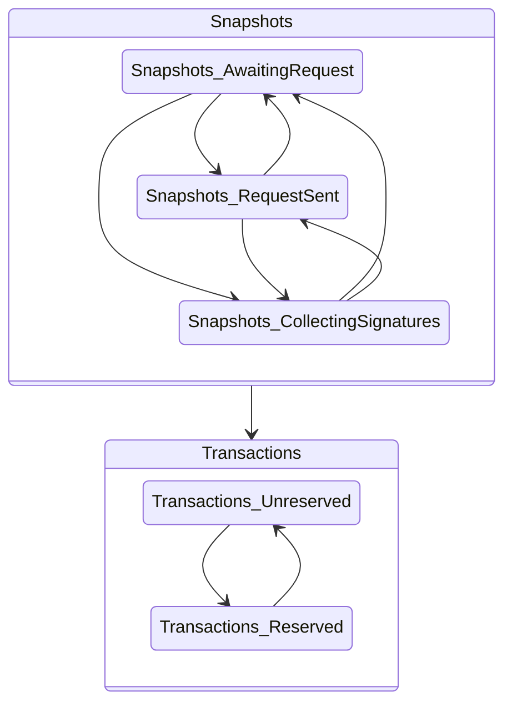
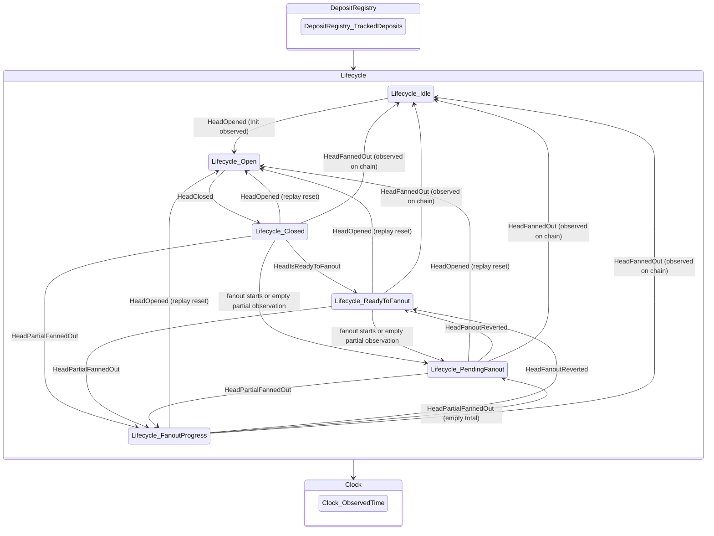
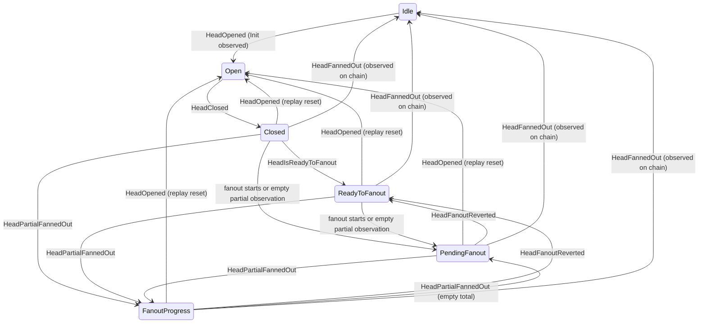
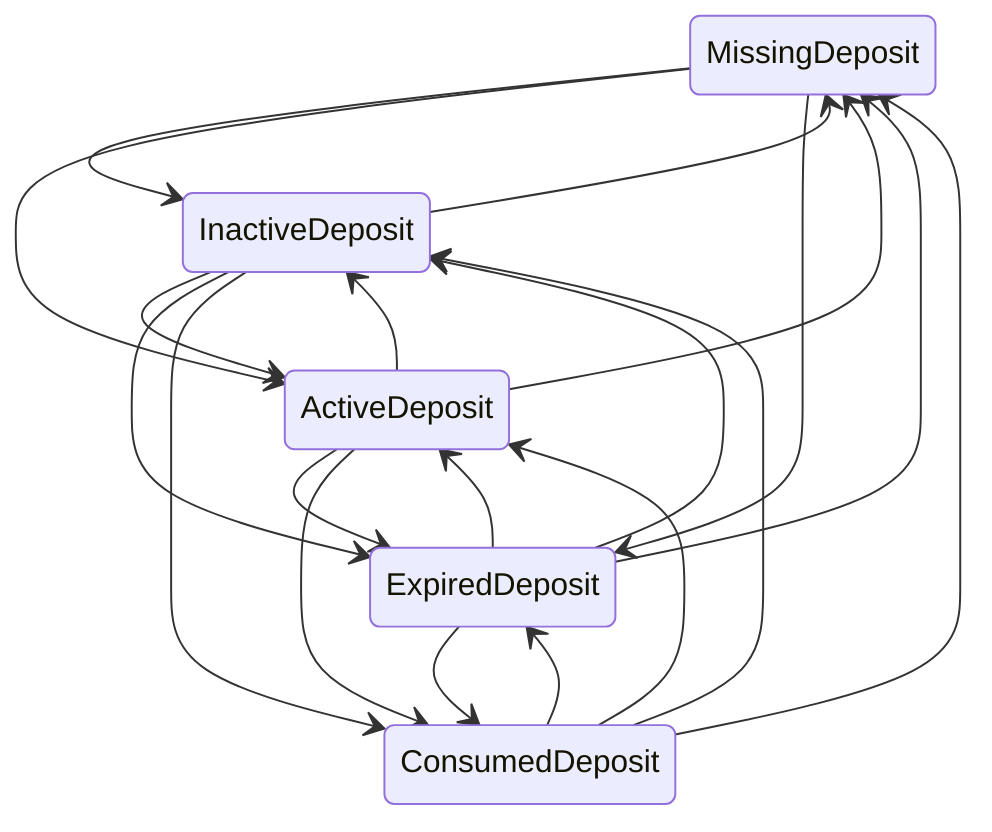

# Head state machines

Generated from crem's executable definitions with:

```sh
cabal run hydra-node:head-logic-lab -- machines docs/head-logic-machines
```

Coordinated contains the snapshot and transaction owners used by live staging and replay. Its Reserved phase records a pending decommit; it does not prove that rebuilding preserved the reservation. Composition shows DepositRegistry → Lifecycle → Clock. The open lifecycle state holds the Coordinated continuation; its nested composition is shown separately. These are allowed replay transitions, including resets and events outside their usual phase. Edges to Idle mean observed completion (HeadFannedOut), including at parties that did not initiate fanout. Identity transitions are implicit. They do not show admission guards or prove that every edge is reachable from network input. See [the implementation guide](../head-logic-crem.md) for event meanings and limitations.

## coordinated



## composition



## lifecycle



## deposits


