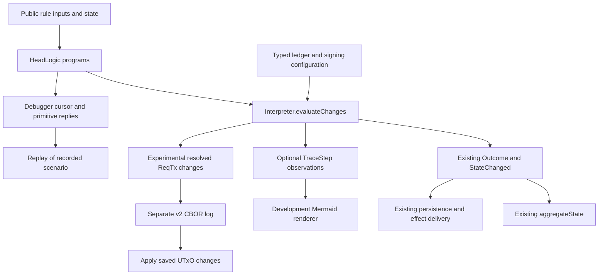

# Head logic spike

This spike moves the `ReqTx`, `ReqSn` and `AckSn` handlers into programs that
describe their ledger queries, state changes and effects. `hydra-node` runs them
through a shared interpreter. The same programs drive the explorer and debugger.

Network messages and persisted `StateChanged` encodings are unchanged. One rule
changes: `ReqTx` ignores a transaction ID already applied locally. This prevents
a duplicate from replacing or deleting the valid transaction in `allTxs`.

## Documentation

| Document | Purpose |
| --- | --- |
| This guide | Implementation and code references |
| [Lab guide](./docs/dev/architecture/head-logic-lab.md) | Reproducible commands, scenarios, debugging and maintenance exercise |
| [Peer demonstration](./head-logic-demonstration.md) | Real Cardano failure and fix, focused expiry search, settlement/rollback sequences |
| [Bug investigation](./head-logic-bug-audit.md) | Registry fixes, transaction expiry and acknowledgement recovery |
| [Measurements](./docs/dev/architecture/head-logic-benchmark.md) | Timing, allocations, encoded size and remaining uncertainty |
| [Design sketch](./docs/dev/architecture/head-logic-refactor.md) | Broader proposal; distinguishes implemented work from future extensions |
| [Agda orientation](./docs/dev/agda.md) | Specification and independent reference extraction |
| [Generating head logic from Agda](./head-logic-agda-generated.md) | Proposal for generated rules and their proofs; documentation only |

## Code to read

Start with `onOpenNetworkReqTxProgram` for a complete rule, then read `Instruction`
and `evaluateChanges` together. `RegistryDemo` shows that rule's effect on a real
Cardano transaction. The table below covers the remaining entry points.

| Module | Responsibility and entry points |
| --- | --- |
| [Program.hs](../hydra-node/src/Hydra/HeadLogic/Program.hs) | `Instruction`, `Program`, smart constructors and `foldProgram`. No evaluator, keys or rendering. |
| [Interpreter.hs](../hydra-node/src/Hydra/HeadLogic/Interpreter.hs) | `InterpreterConfig`, `evaluateChanges`, `compatibleChange`, `runProgramWith`. Runs primitives and commits or discards buffered events/effects. |
| [Trace.hs](../hydra-node/src/Hydra/HeadLogic/Trace.hs) | `TraceStep`, `traceLabel`, `changeLabel`, `effectLabel`. Trace events and labels. |
| [HeadLogic.hs](../hydra-node/src/Hydra/HeadLogic.hs) | `RuleEnvironment`, `onOpenNetworkReqTxProgram`, `onOpenNetworkReqSnProgram`, `onOpenNetworkAckSnProgram`, `applyTransactionsProgram`. Actual protocol decisions. |
| [Retry.hs](../hydra-node/src/Hydra/HeadLogic/Retry.hs) | `retryDecision`, shared by the node queue and development scheduler. |
| [Scenario.hs](../hydra-node/testlib/Test/Hydra/HeadLogic/Scenario.hs) | Test heads and transactions, message queues, scenario selection and JSON. |
| [Explorer.hs](../hydra-node/testlib/Test/Hydra/HeadLogic/Explorer.hs) | `programFor`, `advance`, `safetyFailure`, `progressFailure`, `explore`, `exploreRetryWindows`, `minimize`. |
| [Replay.hs](../hydra-node/testlib/Test/Hydra/HeadLogic/Replay.hs) | `recordScenario`, `replayScenario`: scheduled inputs and recorded primitive replies. |
| [RegistryDemo.hs](../hydra-node/testlib/Test/Hydra/HeadLogic/RegistryDemo.hs) | Checked Cardano witness-replacement demonstration; full outcomes and states. |
| [Settlement.hs](../hydra-node/testlib/Test/Hydra/HeadLogic/Settlement.hs) | Three-party deposit/spend/rollback sequences through `update`, with serialized replay checks. |
| [Debugger.hs](../hydra-node/testlib/Test/Hydra/HeadLogic/Debugger.hs) | `prepare`, live `Cursor`, prepared trace inspection, controlled primitive replies and test-only verification bypass. |
| [Mermaid.hs](../hydra-node/testlib/Test/Hydra/HeadLogic/Mermaid.hs) | `renderSteps`, `renderTraces`, `renderTimeline`: component lanes and handler sections, or party lanes for settlement. Rendering stays outside the rules and debugger. |
| [Resolved.hs](../hydra-node/testlib/Test/Hydra/HeadLogic/Resolved.hs) | UTxO differences, experimental CBOR log, replay and diagnostic events. |
| [head-logic-lab/Main.hs](../hydra-node/exe/head-logic-lab/Main.hs) | Development CLI, options and resolved benchmarks. |
| [HeadLogicProgram.hs](../hydra-node/bench/HeadLogicProgram.hs) | ReqTx and complete-round benchmarks; confirmation/equality prerequisites run outside timing. |

The `Program` type records whether a rule can apply transactions or sign snapshots.
The aliases
`TransactionProgram`, `SnapshotProgram` and `AcknowledgementProgram` name the
three supported combinations. A transaction configuration cannot interpret a
signing instruction: the type checker rejects that pairing. `RuleEnvironment`
contains only party identity and deposit period. The full environment, including
the signing key, is confined to wrapper/interpreter configuration.

`Program` uses a Church encoding to avoid allocating an instruction tree during
normal execution. `foldProgram` and `Cursor` expose instructions for other uses.
Rules use the smart constructors in `Program.hs`; they do not need to handle the
rank-2 representation directly. See the benchmark report for the measured cost.

## Execution and inspection

| Terminal result | Committed changes | Released effects |
| --- | --- | --- |
| Completion | All staged changes in order | All buffered effects in order |
| Wait | Staged prefix in order | None |
| Rejection | None | None |

These rules live once in `evaluateChanges`. Debugger preparation supplies
primitive answers and preserves remaining operations for this evaluator.
The resolved-replay experiment translates only committed changes and returns an
error for unsupported events. `ReqTx` supplies the before/after UTxO in
`RecordAppliedTransaction` after successful ledger validation. The instruction
type does not itself prove that validation took place. These endpoints are lazy:
compatibility interpretation discards them; resolved interpretation evaluates
them to construct the delta.

## Snapshot round

Read `onOpenNetworkReqSnProgram` from outer guards inward: number and leader,
predecessor confirmation, version, deposit/decommit consistency, transaction
lookup/application, accumulator bounds, pruning, recording and signing.
`applyTransactionsProgram` keeps output-collision policy in the rule and asks
for individual ledger applications. No opaque instruction decides whether a
snapshot is acceptable.

Then read `onOpenNetworkAckSnProgram`: stage a signature, test completeness,
verify the aggregate, confirm, approve incremental actions and select the next
request. Migration preserves two observable details: partial acknowledgements
record the signature twice, and the number guard precedes the redundant-ack
shortcut. The test **“rejecting the last invalid signature discards its staged
change”** demonstrates rejection semantics: a trace sees the tentative record,
but the outcome commits no changes.

[LegacyReqTx.hs](../hydra-node/testlib/Test/Hydra/HeadLogic/LegacyReqTx.hs) and
[LegacySnapshot.hs](../hydra-node/testlib/Test/Hydra/HeadLogic/LegacySnapshot.hs)
keep copies of the previous handlers. Tests compare their events, effects, errors
and resulting states with the new handlers. Shared helpers limit the independence
of this comparison. The duplicate-ID regression tests check the deliberate change
in behavior and still reproduce the old failure through `LegacyReqTx`.

## Explorer and debugger

`Scenario.initialFor` selects dependent transactions, duplicate traffic or delayed
dependencies. `Explorer.programFor` pairs each actual rule with its typed
configuration. `installOutcome` aggregates production events, broadcasts effects
and applies production retry eligibility. Scheduling is deterministic, with
selectable delivery-first DFS, retry-first DFS and BFS. These use the same enabled
actions and bounds: **24 deliveries and 100,000 visited states** by default.
The focused `retry-windows` search varies per-party retry windows before draining
traffic. It finds the known expiry failure within those bounds, but covers only
that restricted schedule family and excludes optional disturbances.

Deduplication includes delivery depth, complete node state, pending/retry/delayed
queues, disturbance budgets and confirmation history; diagnostic traces are
excluded. Reports retain bounds, counts and truncation. A stopped or truncated
search is not exhaustive. Minimization removes single actions to a fixed point,
requiring enabled actions and the same failure; it is not globally minimal.

`safetyFailure` independently checks real confirmed signatures, agreement,
dependency order, exact registry payload equality and local UTxO reconciliation.
`progressFailure` checks stranded local work after an honest scenario's queues
drain. This is a fixed-slot Simple-ledger model without chain transitions,
settlement or wall-clock retry timing. It proves no general liveness property.
A separate settlement driver checks 24 deposit/spend/rollback schedules using
trusted chain observations, real signatures and serialized state/event replay.
It does not widen the general explorer's domain or the Agda proof coverage.

Scenario v2 stores the starting node states and message queues, as well as the
execution mode and allowed disturbances. The v1 reader uses the original fixture.
A rule change can invalidate recorded replies or disable scheduled retries; replay
reports these mismatches. `Replay` validates enabled actions; `Debugger`
validates primitive identity and public arguments before decoding each reply.

CLI stepping and breakpoints inspect a **prepared trace**: replies have already
been consumed. A live `Cursor` retains the typed continuation for callers that
want to supply replies while suspended. Full payloads remain inspectable, while
diagrams use concise labels. Only `testlib` can transform verification into the
named bypass decision. The independent invariant still invokes the real verifier;
normal execution rejects the same corrupted acknowledgement sequence.

## Resolved transaction replay

The compatibility interpreter emits the original applied-transaction event.
Production aggregation reconstructs its UTxO change using `applyTxTo`; production
replay already skips ledger validation. `Resolved.resolve` instead computes
removed/added UTxOs from the before/after values returned by ledger application.

The experimental `hydra-reqtx-resolved-v2` log includes the Head ID and the
diagnostics from `TxInvalid`. `replay` requires an open matching head, checks delta
consistency, and updates the UTxO, transaction registry, sequence and request
marker. It calls no ledger, `applyTxTo`, signing or protocol program.
`compatibilityEvents` recovers the original ReqTx diagnostic events.

This experiment is not production persistence. Whole-state delta construction
remains expensive, and measurements do not establish a recovery speedup. The
[measurement report](./docs/dev/architecture/head-logic-benchmark.md) keeps
historical v1 results separate from the stricter v2 contract.

## Performance

The [measurement report](./docs/dev/architecture/head-logic-benchmark.md#what-does-this-cost-in-tps)
compares separate node binaries in a three-party cluster, with real Cardano
transactions, API transport and asynchronous persistence. Each client waits for
confirmation, so these runs measure three outstanding transactions rather than
maximum saturated capacity. The report records paired throughput and latency,
allocation and GC, alongside the earlier in-process measurements.

The one-CPU small-Head control measured 0.03–2.56% lower TPS; the large-Head
comparison ranged from 1.09% lower to 3.07% higher. Small-Head timings on eight
CPUs were too variable to resolve a 5% effect. These runs do not establish a
general performance bound.

The investigation found and removed unnecessary evaluation of the resolved-change
UTxO endpoints in compatibility interpretation. The experimental delta cost
remains separate: production emits the existing events and constructs no delta.

## Tests and remaining work

[ProgramSpec.hs](../hydra-node/test/Hydra/HeadLogic/ProgramSpec.hs) covers terminal
semantics, primitive arguments, reification, tracing and fresh-ID ReqTx migration.
[SnapshotProgramSpec.hs](../hydra-node/test/Hydra/HeadLogic/SnapshotProgramSpec.hs)
covers snapshot migration, independent Agda comparison, scheduled-prefix safety,
fair-delivery confirmation, replay/version boundaries and resolved state equality.
[HeadLogicSpec.hs](../hydra-node/test/Hydra/HeadLogicSpec.hs) contains the real
Cardano witness-stripped duplicate regression.

The independent [Agda reference](../spec/src/Hydra/Protocol/OffChainReference.agda)
uses named snapshot phases, changes, effects and terminal outcomes. The
[literate specification](../spec/src/Hydra/Protocol/OffChain.lagda.typ) states
operational semantics and the bounded duplicate-ID lemma. Extraction is generated,
not manually edited. Payload validation, pruning contents, incremental actions,
output collisions, accumulator overflow and scheduling remain outside the bounded
snapshot outcome projection. Existing incremental-action guard comparisons and
Haskell invariants cover different questions.

The [bug investigation](./head-logic-bug-audit.md) records the two registry fixes
and remaining recovery policies. Finite dependency expiry requires re-submission;
an invalid early acknowledgement cannot be replaced through the current protocol.
Neither limitation is disguised as a general progress guarantee.

The lab has commands for traces, replay and the maintenance exercise, followed
by the test results. Before extending the design, measure capacity with bounded pipelining and
decide whether to remove duplicate acknowledgement events. Changes
to persistence, the remaining handlers, settlement backends and Agda-generated
production code need separate work.
