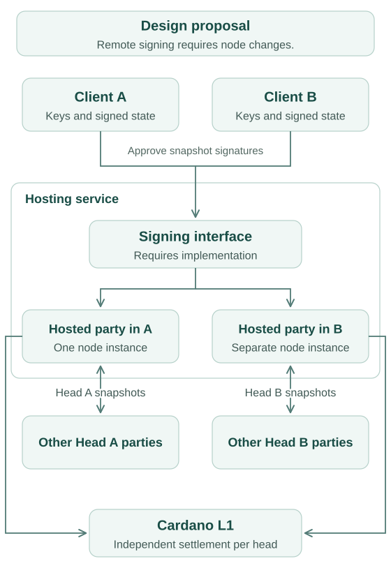

# Managed Hydra head

:::note

This is a design proposal. The current `hydra-node` signs snapshots locally
and manages one active head per process. A service with client-held Hydra
keys requires additional signing infrastructure; it is not an existing remote
signing mode of the node.

:::

This document outlines the _managed Hydra head_ topology, which could also be described as _Hydra as a service_.

The [basic Hydra head setup](/topologies/basic) requires each participant to host an instance of a `hydra-node`, similar to how `cardano-node`s operate on the Cardano network. In contrast, 'light node' setups allow users to access the blockchain through a hosted API, with light wallets being a common example.

In this topology, clients do not need to run their own `hydra-node`s but instead access a `hydra-node` provided by a _service provider_. Client applications, such as light wallets, do not need to be aware of individual `hydra-node` instances. Instead, logical _Hydra heads_ are accessible via an API.

The illustration shows one hosted party in each of two independent heads.
Each hosted instance has peers belonging to its own head. In this proposal,
clients retain their Hydra keys and approve snapshot signatures through an
additional signing interface. Implementing that interface requires changes
to the current node; hosting existing nodes alone does not provide it.

As a result, the client must be online for any progress to occur within a Hydra head. This requirement can be cumbersome in multi-party Hydra heads, as they may stall if a lightweight mobile client is offline for a period. However, this setup aligns well with _two-party Hydra heads_, where a transaction is only completed if both parties are online to send, receive, and acknowledge it.

An example use case for two-party Hydra heads includes payment channels between two [machines](/use-cases/payments/pay-per-use-api) or [individuals](/use-cases/payments/inter-wallet-payments), especially if such multiple channels are logically interconnected, similar to the Lightning Network.

A complete implementation must let clients retain the signed state and keys
needed to close and contest independently, submit L1 transactions, and recover
service availability. Hosting alone does not establish these guarantees. See
[delegated heads](/topologies/delegated-head) for a different model in which
operators hold the Hydra snapshot keys and users hold their spending keys.
