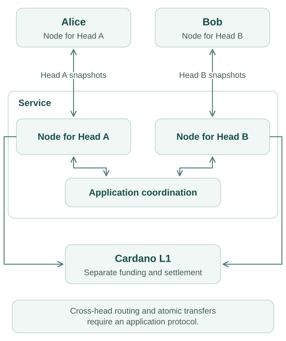
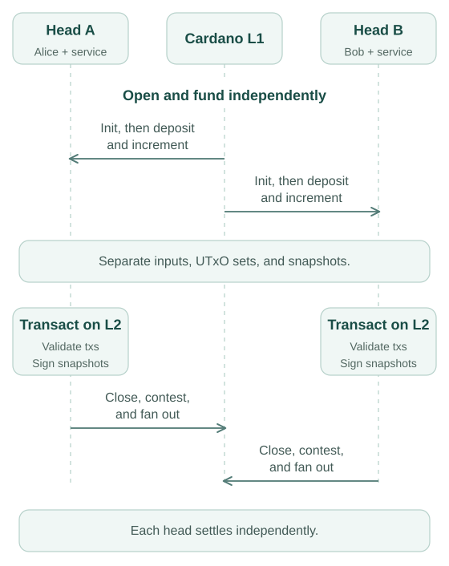
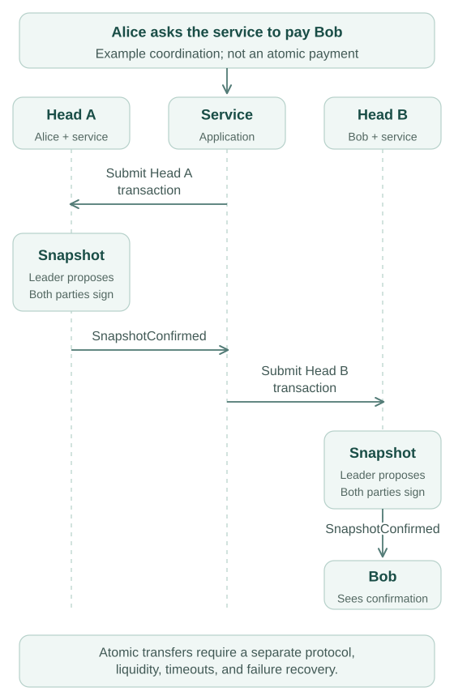

# Star-shaped head network

:::note Design proposal

This topology describes an application built from independent heads. Hydra
provides the individual heads; it does not provide routing or atomic payments
between them.

:::

A service can participate in a separate two-party head with each client. It
runs a `hydra-node` process for each head. Clients and the service must remain
available to sign snapshots in their respective heads.

## Funding and settlement

Each head opens empty and receives its own deposits. The same L1 input cannot
fund two heads: each deposit spends distinct inputs. Heads maintain separate
UTxO sets, snapshot signatures, and settlement transactions.

A service needs liquidity in both heads and an application protocol to move
economic value between them. An atomic transfer mechanism, its timeouts, and
failure recovery must be designed separately. Copying a transaction or snapshot
from one head to another does not provide these guarantees.

## Off-chain coordination

Each head uses its own snapshot leader rotation and requires signatures from
all its parties. The service is not permanently the leader.

The illustrated sequence is not an atomic payment protocol. A complete design
must explain what happens if either head stops progressing, closes, or loses
its required liquidity between the two confirmations. Each head can close
and settle independently; any coupling must be enforced by the application.
