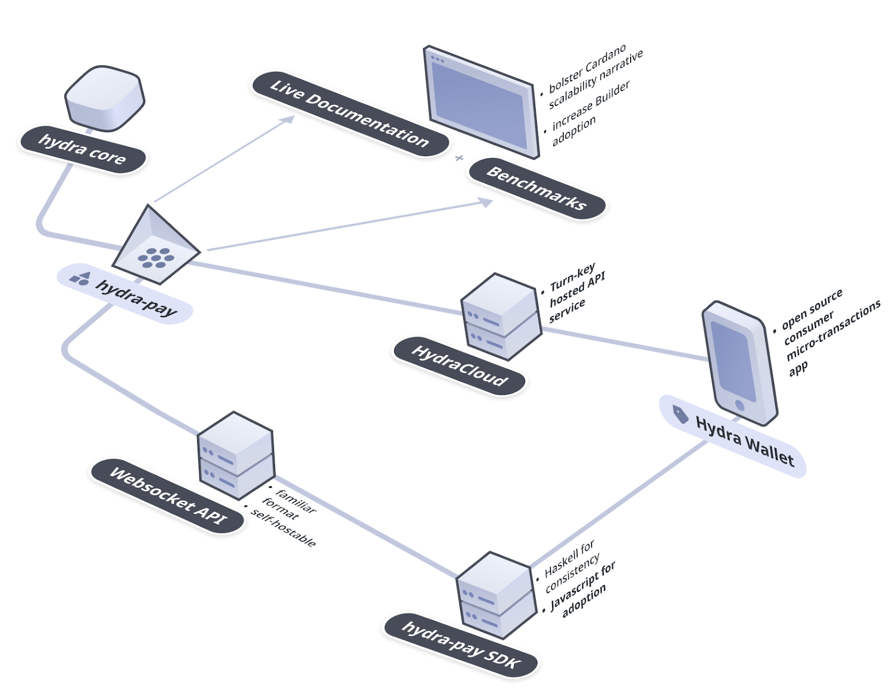

# Hydra for payments

Hydra heads can support repeated payments between a fixed set of operators.
Users can deposit funds while a head is open, transact on L2, and return funds
to L1 through decommits or final settlement.

The articles in this section describe application designs and earlier
integration work. They are not compatibility guarantees for a particular
Hydra release. Before adopting an external SDK, check its supported node
version, deposit lifecycle, API events, and recovery behavior.

## Earlier tooling

The [Hydra for payments project](https://github.com/obsidiansystems/hydra-pay)
explored payment-channel APIs and wallet integration. Its
[2022 introduction](https://iohk.io/en/blog/posts/2022/11/10/hydra-for-payments-introducing-developer-tooling-to-unlock-micropayments-on-cardano/)
provides historical context; consult the project's current repository for
maintenance and compatibility information.

For an example maintained in this repository, see the
[delegated demo](https://github.com/cardano-scaling/hydra/tree/master/delegated-demo).
